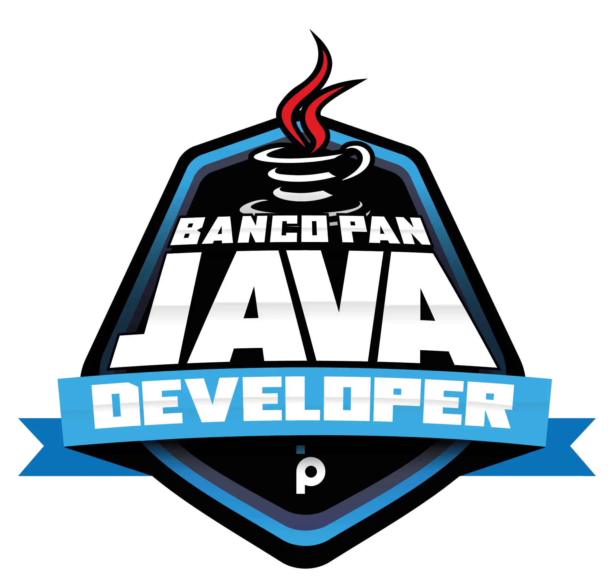

<div align="center">



# Banco Pan · Java Developer

**Resumo completo do bootcamp da DIO (114 horas), reescrito para quem está começando do zero.**


**[🌐 Ler no site](https://joshpcbrrj.github.io/Dio-Banco_Pan-Java_developer/) · [📝 Fazer o simulado](https://joshpcbrrj.github.io/Dio-Banco_Pan-Java_developer/simulado/) · [📖 Baixar o EPUB](https://joshpcbrrj.github.io/Dio-Banco_Pan-Java_developer/downloads/java-developer-banco-pan.epub)**

[📜 Certificado](./docs/certificado/certificado.pdf) ·
[⚡ Guia rápido e glossário](./docs/guia-rapido.md) ·
[🧪 Projetos do curso](#-projetos-do-curso)

</div>

---

## 👋 Sobre este repositório

Este repositório reúne as minhas anotações do bootcamp **Banco Pan · Java Developer**, da **DIO (Digital Innovation One)**. A ideia é que ele sirva como um **material de estudo e consulta** para qualquer pessoa que esteja aprendendo Java para o back-end.

As explicações foram escritas em **linguagem simples**, com analogias, diagramas, código comentado, **exercícios com respostas** e alertas sobre os erros mais comuns. O conteúdo foi **atualizado** para as versões atuais das ferramentas: Java 21/25, Spring Boot 3+, Spring Security 6+ (`SecurityFilterChain`), springdoc-openapi no lugar do Springfox, `jakarta.*` no lugar de `javax.*` e o `mongosh` no lugar do antigo shell do MongoDB. O módulo de **bancos de dados** foi ampliado para ensinar do zero (modelagem, normalização, SQL completo com JOINs e transações, e JDBC), e foram acrescentadas aulas sobre `String`, classes abstratas, `static` e `enum`. No fim, um módulo extra traz assuntos que vão além do curso: Java moderno, `Optional`, Docker, testes no Spring Boot, boas práticas de API (DTOs, paginação, Flyway e logs) e um guia de erros comuns. Os exemplos de código e de SQL foram executados para conferir os resultados mostrados.

## 🧭 Como usar este material

- **Quer a melhor experiência de leitura?** Use o **[site](https://joshpcbrrj.github.io/Dio-Banco_Pan-Java_developer/)**, com busca, menu e modo escuro, ou baixe o **[EPUB](https://joshpcbrrj.github.io/Dio-Banco_Pan-Java_developer/downloads/java-developer-banco-pan.epub)** para ler offline.
- **Começando do zero?** Siga as aulas **na ordem**. Cada aula tem links de "Anterior" e "Próximo" no final.
- **Quer testar o que aprendeu?** Faça o **[📝 simulado](https://joshpcbrrj.github.io/Dio-Banco_Pan-Java_developer/simulado/)**: perguntas de múltipla escolha com nota automática, explicação de cada resposta e link para revisar a aula. Dá para fazer o completo ou só de um módulo.
- **Já sabe o básico?** Use o índice abaixo para ir direto ao assunto.
- **Precisa só lembrar um comando ou um termo?** Vá para o **[⚡ Guia rápido e glossário](./docs/guia-rapido.md)**.

Todas as aulas seguem o mesmo formato:

| Seção | O que tem |
| --- | --- |
| **Em uma frase** | O resumo da ideia principal, logo no começo |
| **Explicação** | O conceito com analogias, diagramas e tabelas |
| **Código** | Exemplos completos e comentados, que compilam e rodam |
| **Alertas** | 💡 Dicas, ⚠️ cuidados e ❗ pontos importantes |
| **📌 Resumindo** | Uma revisão rápida da aula |
| **🏋️ Mão na massa** | Exercícios para praticar, com a resposta escondida (clique para ver) |

## 🛠️ O que você precisa instalar

| Ferramenta | Para quê | Aula |
| --- | --- | --- |
| [JDK 21 ou 25](https://adoptium.net/) (Temurin) | Compilar e rodar Java | [2.1](./docs/02-java/01-historia-e-plataforma.md) |
| [IntelliJ IDEA](https://www.jetbrains.com/idea/) (ou VS Code / Eclipse) | Escrever o código | [2.2](./docs/02-java/02-ides.md) |
| [Git](https://git-scm.com/) | Versionar os projetos | [1.3](./docs/01-principios/03-primeiro-commit.md) |
| [Maven](https://maven.apache.org/) (ou o `mvnw` dos projetos) | Dependências e build | [4.15](./docs/04-poo/15-maven.md) |
| [PostgreSQL](https://www.postgresql.org/download/) + [DBeaver](https://dbeaver.io/) (ou o [DB Fiddle](https://www.db-fiddle.com/), no navegador) | Praticar SQL | [5.1](./docs/05-banco-de-dados/01-o-que-e-banco-de-dados.md) |
| [Docker](https://www.docker.com/products/docker-desktop/) (opcional) | Subir bancos de dados sem instalar nada | [8.3](./docs/08-extras/03-docker-para-java.md) |

## ☕ Java em 30 segundos

```java
public class OlaMundo {
    public static void main(String[] args) {
        System.out.println("Olá, mundo!");
    }
}
```

```text
 OlaMundo.java ──javac──▶ OlaMundo.class (bytecode) ──java──▶ JVM roda em Windows, Linux ou macOS
```

---

## 📚 Índice do conteúdo

### 1️⃣ Princípios de desenvolvimento de software

Git e GitHub do zero, métodos ágeis (XP, Scrum, Kanban) e OKRs.

| Aula | Assunto |
| --- | --- |
| 1.1 | [Git e GitHub](./docs/01-principios/01-git-e-github.md) |
| 1.2 | [Como o Git funciona por dentro](./docs/01-principios/02-como-o-git-funciona.md) |
| 1.3 | [Configurando o Git e fazendo o primeiro commit](./docs/01-principios/03-primeiro-commit.md) |
| 1.4 | [Ciclo de vida dos arquivos, desfazendo mudanças e conflitos](./docs/01-principios/04-ciclo-de-vida-e-conflitos.md) |
| 1.5 | [O Manifesto Ágil](./docs/01-principios/05-manifesto-agil.md) |
| 1.6 | [Gestão tradicional × gestão ágil](./docs/01-principios/06-tradicional-vs-agil.md) |
| 1.7 | [XP (Extreme Programming)](./docs/01-principios/07-xp.md) |
| 1.8 | [Scrum](./docs/01-principios/08-scrum.md) |
| 1.9 | [Kanban](./docs/01-principios/09-kanban.md) |
| 1.10 | [OKR (Objetivos e Resultados-Chave)](./docs/01-principios/10-okr.md) |
| 1.11 | [Ferramentas para times ágeis](./docs/01-principios/11-ferramentas-ageis.md) |

### 2️⃣ Conhecendo a linguagem Java

JDK, IDEs, sintaxe, Strings, controle de fluxo, arrays, estruturas de dados, Collections e métodos.

| Aula | Assunto |
| --- | --- |
| 2.1 | [História do Java, JVM, JRE e JDK](./docs/02-java/01-historia-e-plataforma.md) |
| 2.2 | [IDEs: IntelliJ, Eclipse e VS Code](./docs/02-java/02-ides.md) |
| 2.3 | [Anatomia de uma classe e convenções de nomes](./docs/02-java/03-anatomia-das-classes.md) |
| 2.4 | [Tipos de dados, variáveis e constantes](./docs/02-java/04-tipos-e-variaveis.md) |
| 2.5 | [Operadores](./docs/02-java/05-operadores.md) |
| 2.6 | [Métodos: primeiros passos](./docs/02-java/06-metodos-introducao.md) |
| 2.7 | [Escopo de variáveis](./docs/02-java/07-escopo.md) |
| 2.8 | [Palavras reservadas](./docs/02-java/08-palavras-reservadas.md) |
| 2.9 | [Comentários, Javadoc e a documentação oficial](./docs/02-java/09-javadoc.md) |
| 2.10 | [Compilando e executando pelo terminal](./docs/02-java/10-terminal.md) |
| 2.11 | [Strings e entrada de dados com `Scanner`](./docs/02-java/11-strings-e-entrada.md) |
| 2.12 | [Operadores relacionais e lógicos a fundo](./docs/02-java/12-operadores-relacionais-e-logicos.md) |
| 2.13 | [Controle de fluxo: `if`, `else` e `switch`](./docs/02-java/13-controle-de-fluxo.md) |
| 2.14 | [Blocos de código](./docs/02-java/14-blocos-de-codigo.md) |
| 2.15 | [Estruturas de repetição e arrays](./docs/02-java/15-repeticao-e-arrays.md) |
| 2.16 | [Exercícios de estruturas de repetição](./docs/02-java/16-exercicios-repeticao.md) |
| 2.17 | [Exercícios de arrays](./docs/02-java/17-exercicios-arrays.md) |
| 2.18 | [Estruturas de dados: referências, nós e generics](./docs/02-java/18-estruturas-de-dados.md) |
| 2.19 | [Pilhas (LIFO)](./docs/02-java/19-pilhas.md) |
| 2.20 | [Filas (FIFO)](./docs/02-java/20-filas.md) |
| 2.21 | [Listas encadeadas](./docs/02-java/21-listas-encadeadas.md) |
| 2.22 | [Listas duplamente encadeadas](./docs/02-java/22-listas-duplamente-encadeadas.md) |
| 2.23 | [Listas circulares](./docs/02-java/23-listas-circulares.md) |
| 2.24 | [Árvores e árvores binárias de busca](./docs/02-java/24-arvores-binarias.md) |
| 2.25 | [`equals()` e `hashCode()`](./docs/02-java/25-equals-e-hashcode.md) |
| 2.26 | [Pilhas prontas do Java: `Stack` e `Deque`](./docs/02-java/26-stack-e-deque.md) |
| 2.27 | [Filas prontas do Java: `Queue`, `ArrayDeque`, `LinkedList` e `PriorityQueue`](./docs/02-java/27-queue.md) |
| 2.28 | [Listas prontas: a interface `List`](./docs/02-java/28-list.md) |
| 2.29 | [Conjuntos: a interface `Set`](./docs/02-java/29-set.md) |
| 2.30 | [Mapas: a interface `Map`](./docs/02-java/30-map.md) |
| 2.31 | [Métodos: assinatura, construtores e passagem de parâmetros](./docs/02-java/31-metodos-conceitos.md) |
| 2.32 | [Sobrecarga × sobrescrita](./docs/02-java/32-sobrecarga-e-sobrescrita.md) |
| 2.33 | [Retorno de métodos](./docs/02-java/33-retorno-de-metodos.md) |
| 2.34 | [Exercícios de métodos](./docs/02-java/34-exercicios-metodos.md) |

### 3️⃣ Desafios de código: algoritmos básicos

Cinco desafios resolvidos e explicados passo a passo.

| Aula | Assunto |
| --- | --- |
| 3.1 | [Desafio: Fábrica de carros](./docs/03-desafios-basicos/01-fabrica-de-carros.md) |
| 3.2 | [Desafio: Positivos e média](./docs/03-desafios-basicos/02-positivos-e-media.md) |
| 3.3 | [Desafio: Soma de H com N termos](./docs/03-desafios-basicos/03-soma-de-h.md) |
| 3.4 | [Desafio: Dragão (Mais de 8000!)](./docs/03-desafios-basicos/04-dragao.md) |
| 3.5 | [Desafio: Fibonacci](./docs/03-desafios-basicos/05-fibonacci.md) |

### 4️⃣ Programação orientada a objetos

Classes, herança, interfaces, classes abstratas, `static`, `enum`, Collections, Stream API, exceções, Maven e testes com JUnit.

| Aula | Assunto |
| --- | --- |
| 4.1 | [Classes, objetos, atributos, métodos e encapsulamento](./docs/04-poo/01-classes-e-objetos.md) |
| 4.2 | [Herança, upcast/downcast e polimorfismo](./docs/04-poo/02-heranca-e-polimorfismo.md) |
| 4.3 | [Associação: dependência, agregação e composição](./docs/04-poo/03-associacao.md) |
| 4.4 | [Interfaces](./docs/04-poo/04-interfaces.md) |
| 4.5 | [Classes abstratas, membros `static` e `enum`](./docs/04-poo/05-abstratas-static-enum.md) |
| 4.6 | [Pacotes](./docs/04-poo/06-pacotes.md) |
| 4.7 | [Modificadores de acesso](./docs/04-poo/07-modificadores-de-acesso.md) |
| 4.8 | [O framework Collections](./docs/04-poo/08-collections.md) |
| 4.9 | [List: ordenação, `Comparable` e `Comparator`](./docs/04-poo/09-list.md) |
| 4.10 | [Set: conjuntos sem repetição](./docs/04-poo/10-set.md) |
| 4.11 | [Map: dicionários chave → valor](./docs/04-poo/11-map.md) |
| 4.12 | [Lambdas, referências de método e Stream API](./docs/04-poo/12-stream-api.md) |
| 4.13 | [Debugging: encontrando erros no código](./docs/04-poo/13-debugging.md) |
| 4.14 | [Tratamento de exceções](./docs/04-poo/14-excecoes.md) |
| 4.15 | [O que é o Apache Maven](./docs/04-poo/15-maven.md) |
| 4.16 | [Criando projetos e comandos do Maven](./docs/04-poo/16-maven-comandos.md) |
| 4.17 | [Gerenciamento de dependências: transitividade, escopos e exclusões](./docs/04-poo/17-maven-dependencias.md) |
| 4.18 | [Ciclo de vida do build (*build lifecycle*)](./docs/04-poo/18-maven-ciclo-de-vida.md) |
| 4.19 | [Projetos multimódulos](./docs/04-poo/19-maven-multi-modulos.md) |
| 4.20 | [Plugins do Maven](./docs/04-poo/20-maven-plugins.md) |
| 4.21 | [Testes unitários e JUnit](./docs/04-poo/21-testes-unitarios.md) |
| 4.22 | [JUnit a fundo: assertions, assumptions e ciclo de vida](./docs/04-poo/22-junit-recursos.md) |
| 4.23 | [Boas práticas de testes e TDD](./docs/04-poo/23-testes-boas-praticas.md) |
| 4.24 | [Desafio POO: o domínio de um bootcamp](./docs/04-poo/24-desafio-poo.md) |

### 5️⃣ Bancos de dados SQL e NoSQL

Do zero: o que é um banco, modelagem, normalização, SQL completo (com JOINs, transações e índices), JDBC, MongoDB e Amazon DynamoDB.

| Aula | Assunto |
| --- | --- |
| 5.1 | [O que é um banco de dados (e como preparar o ambiente)](./docs/05-banco-de-dados/01-o-que-e-banco-de-dados.md) |
| 5.2 | [Modelagem relacional: tabelas, chaves e relacionamentos](./docs/05-banco-de-dados/02-modelagem-relacional.md) |
| 5.3 | [Normalização: organizando as tabelas sem repetição](./docs/05-banco-de-dados/03-normalizacao.md) |
| 5.4 | [SQL: criando tabelas, tipos e restrições (DDL)](./docs/05-banco-de-dados/04-sql-criando-tabelas.md) |
| 5.5 | [SQL: inserindo, alterando e apagando dados (DML)](./docs/05-banco-de-dados/05-sql-inserindo-e-alterando.md) |
| 5.6 | [SQL: consultando dados com `SELECT`](./docs/05-banco-de-dados/06-sql-consultas.md) |
| 5.7 | [SQL: juntando tabelas com `JOIN` e subconsultas](./docs/05-banco-de-dados/07-sql-joins-e-subconsultas.md) |
| 5.8 | [Transações, índices, views e permissões](./docs/05-banco-de-dados/08-transacoes-indices-e-views.md) |
| 5.9 | [Java + banco de dados: JDBC](./docs/05-banco-de-dados/09-jdbc.md) |
| 5.10 | [NoSQL: o que é e quando usar](./docs/05-banco-de-dados/10-nosql.md) |
| 5.11 | [MongoDB: conceitos e instalação](./docs/05-banco-de-dados/11-mongodb.md) |
| 5.12 | [MongoDB: comandos essenciais (CRUD)](./docs/05-banco-de-dados/12-mongodb-comandos.md) |
| 5.13 | [MongoDB: modelagem (*embedding* × referência) e boas práticas](./docs/05-banco-de-dados/13-mongodb-modelagem.md) |
| 5.14 | [MongoDB: índices, desempenho e agregações](./docs/05-banco-de-dados/14-mongodb-indices-e-agregacoes.md) |
| 5.15 | [Amazon DynamoDB](./docs/05-banco-de-dados/15-dynamodb.md) |
| 5.16 | [Prática: DynamoDB pela AWS CLI](./docs/05-banco-de-dados/16-dynamodb-pratica.md) |

### 6️⃣ Produtividade com Spring Framework

Protocolos da web, Spring Boot, APIs REST, Swagger, Spring Security, JWT, JPA e padrões de projeto.

| Aula | Assunto |
| --- | --- |
| 6.1 | [Como funciona o protocolo HTTP](./docs/06-spring/01-http.md) |
| 6.2 | [Mensagens HTTP: request, response e códigos de status](./docs/06-spring/02-mensagens-http.md) |
| 6.3 | [Cookies, cache e proxy](./docs/06-spring/03-cookies-cache-proxy.md) |
| 6.4 | [HTTP/2 e HTTP/3](./docs/06-spring/04-http2-e-http3.md) |
| 6.5 | [Servidores web e de aplicação](./docs/06-spring/05-servidores-web.md) |
| 6.6 | [Criptografia e certificados digitais](./docs/06-spring/06-criptografia-e-certificados.md) |
| 6.7 | [SSL e TLS: o "S" do HTTPS](./docs/06-spring/07-tls.md) |
| 6.8 | [WebSocket](./docs/06-spring/08-websocket.md) |
| 6.9 | [Conceitos de rede: DNS, proxy reverso, balanceador, camadas OSI e TCP/IP](./docs/06-spring/09-conceitos-de-rede.md) |
| 6.10 | [Spring Framework: visão geral](./docs/06-spring/10-spring-framework.md) |
| 6.11 | [IoC, injeção de dependências, beans e escopos](./docs/06-spring/11-ioc-di-e-beans.md) |
| 6.12 | [Spring Boot](./docs/06-spring/12-spring-boot.md) |
| 6.13 | [Projeto prático: primeiros passos, beans, escopos, propriedades e JPA](./docs/06-spring/13-projeto-spring-boot.md) |
| 6.14 | [REST e APIs RESTful](./docs/06-spring/14-rest.md) |
| 6.15 | [`@RestController`: criando os endpoints](./docs/06-spring/15-rest-controller.md) |
| 6.16 | [Documentando a API com OpenAPI e Swagger](./docs/06-spring/16-openapi-swagger.md) |
| 6.17 | [Tratamento de erros na API: `@RestControllerAdvice`](./docs/06-spring/17-tratamento-de-erros.md) |
| 6.18 | [Projeto: minha primeira API REST documentada](./docs/06-spring/18-projeto-rest-api.md) |
| 6.19 | [Introdução ao Spring Security](./docs/06-spring/19-spring-security.md) |
| 6.20 | [Autenticação simples, usuários em memória e configuração de segurança](./docs/06-spring/20-autenticacao.md) |
| 6.21 | [Autenticação com banco de dados](./docs/06-spring/21-autenticacao-com-banco.md) |
| 6.22 | [JWT: autenticação com tokens](./docs/06-spring/22-jwt.md) |
| 6.23 | [Projetos: APIs com Spring Security e JWT](./docs/06-spring/23-projetos-seguranca.md) |
| 6.24 | [API REST conectada ao Amazon RDS](./docs/06-spring/24-amazon-rds.md) |
| 6.25 | [Projeto: Spring Data JPA na prática (Academia Digital)](./docs/06-spring/25-spring-data-jpa.md) |
| 6.26 | [Padrões de projeto: Singleton, Strategy e Facade](./docs/06-spring/26-padroes-de-projeto.md) |
| 6.27 | [Projeto: padrões de projeto com Spring (ViaCEP + Feign)](./docs/06-spring/27-padroes-com-spring.md) |

### 7️⃣ Desafios de código: algoritmos intermediários

Mais cinco desafios, com soluções comentadas e variações.

| Aula | Assunto |
| --- | --- |
| 7.1 | [Desafio: Animal](./docs/07-desafios-intermediarios/01-animal.md) |
| 7.2 | [Desafio: Quitanda do Seu Zé](./docs/07-desafios-intermediarios/02-quitanda.md) |
| 7.3 | [Desafio: Triângulo](./docs/07-desafios-intermediarios/03-triangulo.md) |
| 7.4 | [Desafio: Contar espaços e vogais](./docs/07-desafios-intermediarios/04-espacos-e-vogais.md) |
| 7.5 | [Desafio: Taxa de Imposto de Renda](./docs/07-desafios-intermediarios/05-imposto-de-renda.md) |

### 8️⃣ Extras (além do curso)

Java moderno, `Optional`, Docker, testes no Spring Boot, boas práticas de API e um guia de erros comuns.

| Aula | Assunto |
| --- | --- |
| 8.1 | [Java moderno: o que mudou do Java 8 ao 25](./docs/08-extras/01-java-moderno.md) |
| 8.2 | [Lidando com `null`: `NullPointerException` e `Optional`](./docs/08-extras/02-optional-e-null.md) |
| 8.3 | [Docker para quem programa em Java](./docs/08-extras/03-docker-para-java.md) |
| 8.4 | [Testando uma API Spring Boot](./docs/08-extras/04-testes-spring-boot.md) |
| 8.5 | [Boas práticas em APIs: DTOs, paginação, migrações e logs](./docs/08-extras/05-boas-praticas-api.md) |
| 8.6 | [Erros comuns em Java e Spring e como resolver](./docs/08-extras/06-erros-comuns.md) |

---

## 🧪 Projetos do curso

O código dos projetos feitos durante o bootcamp está na pasta [`projetos/`](./projetos/). Eles foram mantidos **como foram entregues** (alguns usam Spring Boot 2 e Springfox, que hoje estão desatualizados); as aulas correspondentes explicam o que mudou e como fazer o mesmo nas versões atuais.

| Projeto | Assunto | Aula |
| --- | --- | --- |
| [02-loops-e-arrays](./projetos/02-loops-e-arrays/) | Exercícios de laços e arrays | [2.16](./docs/02-java/16-exercicios-repeticao.md) |
| [04-testes-junit](./projetos/04-testes-junit/) | Testes unitários com JUnit 5 | [4.21](./docs/04-poo/21-testes-unitarios.md) |
| [05-desafio-dynamodb](./projetos/05-desafio-dynamodb/) | Tabela, índices e consultas no DynamoDB | [5.16](./docs/05-banco-de-dados/16-dynamodb-pratica.md) |
| [06-spring-boot-dio](./projetos/06-spring-boot-dio/) | Primeiros passos, beans, escopos, propriedades, JPA e segurança | [6.13](./docs/06-spring/13-projeto-spring-boot.md) |
| [06-api-com-swagger](./projetos/06-api-com-swagger/) | API REST documentada com Swagger | [6.18](./docs/06-spring/18-projeto-rest-api.md) |
| [06-api-spring-security](./projetos/06-api-spring-security/) | API com Spring Security e banco de dados | [6.23](./docs/06-spring/23-projetos-seguranca.md) |
| [06-api-spring-security-jwt](./projetos/06-api-spring-security-jwt/) | API com autenticação por JWT | [6.23](./docs/06-spring/23-projetos-seguranca.md) |
| [06-api-amazon-rds](./projetos/06-api-amazon-rds/) | API REST conectada ao Amazon RDS | [6.24](./docs/06-spring/24-amazon-rds.md) |
| [06-academia-digital](./projetos/06-academia-digital/) | Spring Data JPA na prática | [6.25](./docs/06-spring/25-spring-data-jpa.md) |
| [06-padroes-de-projeto](./projetos/06-padroes-de-projeto/) | Singleton, Strategy e Facade, em Java puro e com Spring | [6.27](./docs/06-spring/27-padroes-com-spring.md) |

Os slides em PDF usados em algumas aulas do módulo 6 estão em [`docs/06-spring/slides/`](./docs/06-spring/slides/).

## 🤝 Encontrou um erro ou quer sugerir uma melhoria?

Fique à vontade para contribuir! É uma ótima forma de praticar o Git e o GitHub da [aula 1.1](./docs/01-principios/01-git-e-github.md):

- abra uma **[issue](https://github.com/Joshpcbrrj/Dio-Banco_Pan-Java_developer/issues)** descrevendo o problema ou a sugestão; ou
- faça um **fork**, corrija e envie um **pull request**.

## 🙏 Créditos

- Bootcamp: **Banco Pan · Java Developer**, da **[DIO](https://www.dio.me/)**, e seus instrutores.
- Anotações e resumo: **[Josué B. Almeida](https://github.com/Joshpcbrrj)**.

## 📄 Licença

Os textos, exercícios e diagramas escritos neste repositório estão sob a licença **[Creative Commons Atribuição 4.0 Internacional (CC BY 4.0)](./LICENSE)**: você pode copiar, adaptar e compartilhar, inclusive para fins comerciais, desde que dê o crédito ao autor.

> [!NOTE]
> Os **slides em PDF**, o **banner** e o código-base dos projetos fornecidos pelo bootcamp pertencem à **DIO** e aos seus instrutores e **não** estão cobertos por esta licença. Os logos de produtos (Java, Spring, MongoDB, AWS etc.) pertencem aos seus respectivos donos.

<div align="center">

Se este material te ajudou, deixe uma ⭐ no repositório!

</div>
