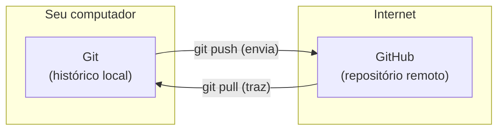

# 1.1 · Git e GitHub

> **Em uma frase:** o **Git** é a ferramenta que guarda o histórico de tudo o que muda no seu código; o **GitHub** é um site que hospeda esse histórico na internet para você compartilhar e trabalhar em equipe.

## 🤔 Por que controlar versões?

Imagine escrever um programa e ir salvando cópias assim:

```text
calculadora.java
calculadora_final.java
calculadora_final_agora_vai.java
calculadora_final_v2_DEFINITIVO.java
```

Funciona até o dia em que você não lembra o que mudou entre uma cópia e outra, ou duas pessoas editam o mesmo arquivo ao mesmo tempo. Um **sistema de controle de versão** resolve isso: ele funciona como uma **máquina do tempo** do projeto, registrando **quem** mudou, **quando** mudou, **o que** mudou e **por quê**.

## 📖 Um pouco de história

O Git foi criado em **2005 por Linus Torvalds**, o criador do Linux. A ferramenta que a equipe do Linux usava deixou de ser gratuita, e Linus decidiu criar a sua própria, com três objetivos:

- ser **muito rápida**, mesmo em projetos gigantes;
- ser **distribuída**: cada pessoa tem uma cópia completa do projeto e do histórico;
- lidar bem com **milhares de pessoas** trabalhando em paralelo.

Hoje o Git é o padrão do mercado: praticamente toda empresa de software usa.

## 🧰 Vantagens do Git

| Vantagem | O que significa na prática |
| --- | --- |
| **Velocidade** | Quase tudo acontece no seu computador, sem esperar um servidor. |
| **Distribuído** | Você trabalha offline e, se o servidor sumir, qualquer cópia restaura o projeto. |
| **Branches leves** | Criar uma "linha paralela" para testar uma ideia é instantâneo. |
| **Histórico completo** | Dá para saber quem alterou cada linha, quando e em qual commit. |

## 🌐 E o GitHub?

O **GitHub** (lançado em 2008 e comprado pela Microsoft em 2018) é uma **plataforma online** que hospeda repositórios Git. Além de guardar o código, ele oferece:

- **pull requests** para revisar código antes de juntá-lo ao projeto;
- **issues** para registrar bugs e tarefas;
- **GitHub Actions** para automatizar testes e publicações;
- uma vitrine pública que funciona como **portfólio** de quem programa.

### Git × GitHub

> **Analogia:** o Git está para o GitHub assim como a **foto** está para o **Instagram**. Você tira e organiza fotos sem o Instagram; o Instagram é só um lugar para guardar, mostrar e interagir com elas.

| | Git | GitHub |
| --- | --- | --- |
| O que é | Programa (ferramenta) | Site (plataforma) |
| Onde roda | No seu computador | Na internet |
| Precisa de internet? | Não | Sim |
| Alternativas | Mercurial, SVN | GitLab, Bitbucket |



> [!TIP]
> Este material tem um resumo bem mais completo de Git e GitHub em outro repositório do autor: **[Git e GitHub Essencial](https://github.com/Joshpcbrrj/Udemy-Geek_university-Git_GitHub-Essencial_para_o_Desenvolvedor)**. Aqui ficamos no essencial para quem vai programar em Java.

## 📌 Resumindo

- Controle de versão guarda o histórico do projeto e permite voltar no tempo e trabalhar em equipe.
- **Git** é o sistema de controle de versão distribuído criado por Linus Torvalds em 2005.
- **GitHub** é uma plataforma online que hospeda repositórios Git e adiciona colaboração (PRs, issues, Actions).
- Você pode usar Git sem GitHub, mas não faz sentido usar GitHub sem Git.

## 🏋️ Mão na massa

> Tente responder antes de abrir a resposta.

**1.** Explique, com suas palavras, a diferença entre Git e GitHub.

<details>
<summary>Ver resposta</summary>

O Git é um **programa** instalado no computador que registra o histórico de versões do projeto, e funciona sem internet. O GitHub é um **site** que hospeda repositórios Git na nuvem e acrescenta recursos de colaboração, como pull requests e issues.

</details>

**2.** Por que dizemos que o Git é **distribuído**? Cite uma vantagem disso.

<details>
<summary>Ver resposta</summary>

Porque cada pessoa tem no próprio computador uma **cópia completa** do repositório, com todo o histórico. Vantagens: dá para trabalhar offline, as operações são rápidas e qualquer cópia pode restaurar o projeto se o servidor falhar.

</details>

**3.** Crie uma conta no GitHub (se ainda não tiver) e instale o Git. Confira a instalação no terminal.

<details>
<summary>Ver resposta</summary>

Baixe o Git em [git-scm.com/downloads](https://git-scm.com/downloads) e crie a conta em [github.com](https://github.com). Depois rode:

```bash
git --version
# Exemplo de saída: git version 2.51.0
```

Se aparecer a versão, está tudo certo.

</details>

---

<div align="center">

[🏠 Índice](../../README.md) &nbsp;|&nbsp; [1.2 Como o Git funciona por dentro ➡️](./02-como-o-git-funciona.md)

</div>
