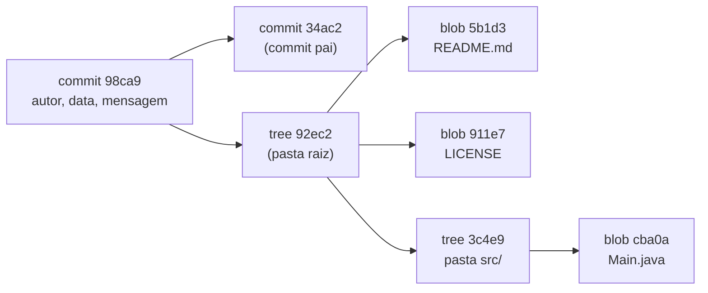

# 1.2 · Como o Git funciona por dentro

> **Em uma frase:** o Git guarda o projeto como uma coleção de **objetos** (blobs, trees e commits), e cada objeto é identificado por um **hash**: uma "impressão digital" calculada a partir do próprio conteúdo.

## 🔑 Hash: a impressão digital do conteúdo

Um **hash** é um número gerado a partir de um conteúdo qualquer. Ele tem três propriedades importantes:

1. **O mesmo conteúdo sempre gera o mesmo hash.**
2. **Qualquer mudança mínima** (uma vírgula!) gera um hash completamente diferente.
3. **Não dá para voltar** do hash para o conteúdo original.

O Git usa o algoritmo **SHA-1**, que gera um código de **40 caracteres hexadecimais**, como `a94a8fe5ccb19ba61c4c0873d391e987982fbbd3`. Na prática, você costuma ver só os 7 primeiros (`a94a8fe`).

> [!NOTE]
> SHA-1 é uma **função de hash**, não uma criptografia: ele não "esconde" nada, só gera uma identificação. Como hoje já se sabe forjar colisões de SHA-1 (desde 2017), o Git passou a proteger-se contra esse ataque e ganhou suporte a repositórios com **SHA-256**. Para o dia a dia, nada muda.

### Experimente

Você pode calcular o hash de um texto com o próprio Git:

```bash
echo "Olá mundo" | git hash-object --stdin
# a cada vez que rodar, o resultado é o mesmo

echo "Olá mundo!" | git hash-object --stdin
# basta um "!" a mais e o hash muda totalmente
```

## 🧱 Os três objetos principais

| Objeto | O que guarda | Analogia |
| --- | --- | --- |
| **Blob** | O **conteúdo** de um arquivo (sem nome, sem data). | O texto de uma página. |
| **Tree** | Uma **pasta**: lista de nomes de arquivos/subpastas e o hash de cada um. | O índice de um capítulo. |
| **Commit** | Uma **foto do projeto**: aponta para a tree principal, para o commit anterior (pai), autor, data e mensagem. | Uma página do diário do projeto. |



Repare em algo esperto: se um arquivo **não mudou** entre dois commits, o novo commit simplesmente aponta para o **mesmo blob** que já existia. Por isso o Git ocupa pouco espaço mesmo com milhares de versões.

## 🔗 Por que isso garante a integridade?

O hash de um commit é calculado a partir de tudo o que ele contém, **inclusive o hash do commit anterior**. Então, se alguém alterasse um arquivo antigo, o hash daquele blob mudaria, o da tree mudaria, o do commit mudaria... e todos os commits seguintes também. Qualquer adulteração fica evidente.

> [!TIP]
> Quer espiar os objetos de verdade? Em qualquer repositório, rode `git cat-file -p HEAD` para ver o último commit e `git cat-file -p <hash>` para abrir qualquer objeto.

## 📌 Resumindo

- O Git identifica tudo por **hashes SHA-1** de 40 caracteres, calculados a partir do conteúdo.
- **Blob** = conteúdo de um arquivo; **tree** = pasta; **commit** = foto do projeto + metadados + ponteiro para o commit pai.
- Arquivos iguais reaproveitam o mesmo blob, por isso o Git é leve.
- Como cada commit depende do anterior, o histórico é à prova de adulteração.

## 🏋️ Mão na massa

**1.** Rode `echo "teste" | git hash-object --stdin` duas vezes. Os resultados são iguais? E se trocar para `"Teste"`?

<details>
<summary>Ver resposta</summary>

As duas execuções com `"teste"` geram **exatamente o mesmo hash**, porque o conteúdo é o mesmo. Com `"Teste"` (T maiúsculo), o hash muda completamente: qualquer diferença no conteúdo gera outro hash.

</details>

**2.** Qual objeto do Git guarda o **nome** de um arquivo: o blob ou a tree?

<details>
<summary>Ver resposta</summary>

A **tree**. O blob guarda apenas o conteúdo; o nome do arquivo (e a permissão) ficam registrados na tree que representa a pasta onde ele está.

</details>

**3.** Você fez 10 commits e o arquivo `LICENSE` nunca mudou. Quantos blobs desse arquivo o Git guardou?

<details>
<summary>Ver resposta</summary>

**Um só.** Como o conteúdo é sempre igual, o hash é sempre o mesmo, e todas as trees apontam para esse único blob.

</details>

---

<div align="center">

[⬅️ 1.1 Git e GitHub](./01-git-e-github.md) &nbsp;|&nbsp; [🏠 Índice](../../README.md) &nbsp;|&nbsp; [1.3 Configurando o Git e fazendo o primeiro commit ➡️](./03-primeiro-commit.md)

</div>
