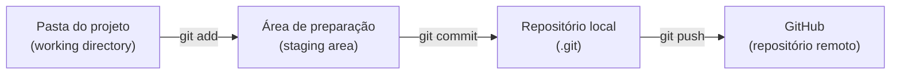

# 1.3 · Configurando o Git e fazendo o primeiro commit

> **Em uma frase:** depois de instalar o Git, você diz a ele quem você é, transforma uma pasta em repositório com `git init`, salva versões com `git add` + `git commit` e envia tudo para o GitHub com `git push`.

## 🔗 Links úteis

- [Download do Git](https://git-scm.com/downloads) · [Documentação oficial em português](https://git-scm.com/docs/git/pt_BR)
- [GitHub Desktop](https://desktop.github.com/) (interface gráfica, opcional)
- [Guia de Markdown](https://www.markdownguide.org/) e [lista de emojis para Markdown](https://gist.github.com/rxaviers/7360908)

## 1️⃣ Configuração inicial (uma vez por computador)

Todo commit leva uma "assinatura" com seu nome e e-mail. Configure antes do primeiro commit:

```bash
git config --global user.name "Seu Nome"
git config --global user.email "seuemail@exemplo.com"   # o mesmo da conta do GitHub

# Faz os repositórios novos começarem com a branch "main"
git config --global init.defaultBranch main

# Conferir tudo o que está configurado
git config --list

# Apagar uma configuração (ex.: para refazer)
git config --global --unset user.email
```

> [!IMPORTANT]
> Use o **mesmo e-mail da sua conta do GitHub**. É assim que o GitHub liga seus commits ao seu perfil.

### Precisa de ajuda no terminal?

```bash
git help            # resumo dos comandos mais usados
git help commit     # manual completo de um comando
```

## 2️⃣ Criando o repositório

Abra o terminal **dentro da pasta do projeto** e rode:

```bash
git init        # transforma a pasta em repositório (cria a pasta oculta .git)
ls -a           # mostra arquivos ocultos: a pasta .git deve aparecer
git status      # mostra a situação dos arquivos
```

> [!WARNING]
> Nunca apague nem edite a pasta `.git` manualmente: é lá que fica todo o histórico.

> [!NOTE]
> Em versões antigas do Git, a branch inicial se chamava `master`. Se o seu Git não tiver a configuração `init.defaultBranch`, renomeie com `git branch -M main`. Note que a branch só passa a "existir" de verdade depois do **primeiro commit**.

## 3️⃣ Primeiro arquivo e primeiro commit

Vamos criar um arquivo `receita.md` (Markdown é um jeito simples de formatar texto; a extensão é `.md`):

```markdown
# Strogonoff de frango 🐔

## Ingredientes

- 1 kg de peito de frango em cubos
- 1 caldo de galinha
- 2 caixinhas de creme de leite
- 2 colheres de molho de tomate, ketchup e mostarda
- Champignon a gosto

## Modo de preparo

1. Doure o frango no óleo com o caldo de galinha.
2. Acrescente molho de tomate, ketchup, mostarda e champignon.
3. Abaixe o fogo, misture o creme de leite e sirva com arroz e batata palha.

> Receita testada e aprovada!
```

Agora registre essa versão:

```bash
# Prepara o arquivo (coloca na "staging area")
git add receita.md        # ou "git add ." para tudo o que mudou

# Salva a versão no histórico, com uma mensagem
git commit -m "Adiciona receita de strogonoff"
```



## 4️⃣ Enviando para o GitHub

1. No GitHub, clique em **+ → New repository**, dê um nome e crie o repositório **vazio** (sem README).
2. Conecte o repositório local ao remoto e envie:

```bash
# "origin" é o apelido padrão do repositório remoto
git remote add origin https://github.com/seu-usuario/seu-repositorio.git
git remote -v                 # confere a conexão

# Envia a branch main e liga a local à remota (-u)
git push -u origin main
```

Nas próximas vezes, basta `git push`.

> [!IMPORTANT]
> O GitHub **não aceita a senha da conta** no terminal. Na primeira vez, o Git Credential Manager (que vem com o Git no Windows e no macOS) abre o navegador para você fazer login. Outra opção é usar uma chave SSH.

## 📌 Resumindo

| Comando | Para que serve |
| --- | --- |
| `git config --global user.name/user.email` | Define quem assina os commits |
| `git init` | Transforma a pasta em repositório |
| `git status` | Mostra a situação dos arquivos |
| `git add <arquivo>` / `git add .` | Prepara alterações para o commit |
| `git commit -m "msg"` | Salva uma versão no histórico |
| `git remote add origin <url>` | Conecta ao repositório no GitHub |
| `git push -u origin main` | Envia os commits (primeira vez) |

## 🏋️ Mão na massa

> Os exercícios práticos deste módulo usam uma pasta chamada `treino-git`.

**1.** Crie a pasta `treino-git`, transforme-a em repositório e faça um commit com um arquivo `README.md` contendo seu nome.

<details>
<summary>Ver resposta</summary>

```bash
mkdir treino-git
cd treino-git
git init
echo "# Treino de Git - Seu Nome" > README.md
git add README.md
git commit -m "Cria README do projeto de treino"
git log --oneline     # o commit deve aparecer
```

</details>

**2.** Qual é a diferença entre `git add` e `git commit`?

<details>
<summary>Ver resposta</summary>

O `git add` **escolhe** o que vai entrar no próximo commit (coloca na staging area). O `git commit` **grava** de fato essa versão no histórico, com autor, data e mensagem.

</details>

**3.** Envie o `treino-git` para um repositório novo no GitHub.

<details>
<summary>Ver resposta</summary>

Crie o repositório vazio no GitHub e rode:

```bash
git remote add origin https://github.com/seu-usuario/treino-git.git
git push -u origin main
```

Atualize a página do repositório: o `README.md` deve aparecer.

</details>

---

<div align="center">

[⬅️ 1.2 Como o Git funciona por dentro](./02-como-o-git-funciona.md) &nbsp;|&nbsp; [🏠 Índice](../../README.md) &nbsp;|&nbsp; [1.4 Ciclo de vida dos arquivos, desfazendo mudanças e conflitos ➡️](./04-ciclo-de-vida-e-conflitos.md)

</div>
