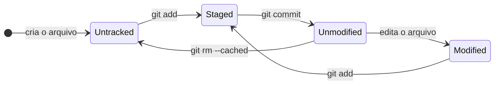
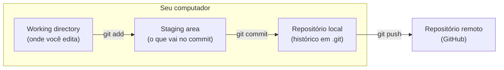

# 1.4 · Ciclo de vida dos arquivos, desfazendo mudanças e conflitos

> **Em uma frase:** todo arquivo passa por estados (novo, modificado, preparado, salvo); o `git status` mostra em qual estado cada um está, o `git restore` e o `git reset` desfazem mudanças, e um **conflito** é quando o Git precisa que você decida qual versão fica.

## 🔄 Os estados de um arquivo

| Estado | O que significa |
| --- | --- |
| 🔴 **Untracked** (não rastreado) | Arquivo novo: o Git sabe que ele existe, mas não guarda o histórico dele. |
| ⚪ **Unmodified** (sem alteração) | Igual à versão do último commit. |
| 🟡 **Modified** (modificado) | Você alterou depois do último commit, mas ainda não preparou. |
| 🟢 **Staged** (preparado) | Marcado com `git add` para entrar no próximo commit. |



E as **três áreas** por onde as alterações passam:



> [!TIP]
> **`git status` é o comando mais importante do dia a dia.** Ele mostra o estado de cada arquivo e ainda sugere o próximo passo.

## ♻️ Desfazendo alterações em arquivos: `git restore`

```bash
# Descarta as alterações de um arquivo (volta ao último commit)
git restore Main.java

# Tira um arquivo do staging, mas mantém as alterações nele
git restore --staged Main.java

# Restaura um arquivo como ele estava em um commit específico
git restore --source=a1b2c3d Main.java
```

> [!WARNING]
> `git restore <arquivo>` (sem `--staged`) **apaga** as alterações não commitadas. Elas não vão para a lixeira.

## ⏪ Desfazendo commits: `git reset`

O `reset` faz a branch "voltar" para um commit anterior. O que acontece com as alterações dos commits desfeitos depende da opção:

| Opção | Commits | Alterações vão para... | Risco |
| --- | --- | --- | --- |
| `--soft` | Desfeitos | **Staging area** (prontas para commitar de novo) | 🟢 Baixo |
| `--mixed` (padrão) | Desfeitos | **Arquivos**, fora do staging | 🟢 Baixo |
| `--hard` | Desfeitos | **Lugar nenhum: são apagadas** | 🔴 Alto |

```bash
git reset --soft HEAD~1    # desfaz o último commit, mantendo tudo preparado
git reset HEAD~1           # desfaz o último commit, mantendo as alterações nos arquivos
git reset --hard HEAD~1    # desfaz o último commit e APAGA as alterações
```

`HEAD~1` significa "um commit antes do atual".

> [!CAUTION]
> Nunca use `reset` em commits que **já foram enviados** para o GitHub e que outras pessoas possam ter baixado. Para desfazer algo já compartilhado, use `git revert <hash>`, que cria um **novo commit** desfazendo o anterior sem reescrever o histórico.

## ⚔️ Conflitos

Um **conflito** acontece quando duas versões alteram **a mesma linha** do mesmo arquivo (por exemplo, você e um colega, ou duas branches) e o Git não sabe qual manter. Ele para e marca o trecho:

```text
<<<<<<< HEAD
System.out.println("Bem-vindo!");
=======
System.out.println("Olá, seja bem-vindo!");
>>>>>>> feature-saudacao
```

| Marcador | Significado |
| --- | --- |
| `<<<<<<< HEAD` | Início da **sua** versão |
| `=======` | Divisória |
| `>>>>>>> feature-saudacao` | Fim da versão que está **chegando** |

### Como resolver

1. Rode `git status`: os arquivos em conflito aparecem como *both modified*.
2. Abra cada arquivo, escolha o que deve ficar (uma versão, a outra ou uma mistura) e **apague os marcadores**.
3. Marque como resolvido com `git add <arquivo>`.
4. Finalize com `git commit`.

> [!TIP]
> O IntelliJ e o VS Code mostram botões como **Accept Current**, **Accept Incoming** e **Accept Both**, que facilitam muito. Desistiu no meio? `git merge --abort` volta tudo como estava.

## 📌 Resumindo

- Estados: **untracked → staged → unmodified → modified → staged...**
- `git restore` desfaz alterações em arquivos; `git restore --staged` tira do staging.
- `git reset` desfaz commits locais (`--soft`, `--mixed`, `--hard`); `git revert` desfaz commits já compartilhados.
- Conflito: edite o trecho, apague os marcadores, `git add` e `git commit`.

## 🏋️ Mão na massa

**1.** No `treino-git`, edite o `README.md` e depois descarte a alteração sem commitar.

<details>
<summary>Ver resposta</summary>

```bash
echo "linha que vou descartar" >> README.md
git status              # README.md aparece como modified
git restore README.md
git status              # working tree clean
```

</details>

**2.** Você fez um commit com a mensagem errada e ainda não deu push. Como desfazê-lo mantendo as alterações para commitar de novo?

<details>
<summary>Ver resposta</summary>

```bash
git reset --soft HEAD~1
git commit -m "Mensagem correta"
```

(Outra opção para só corrigir a mensagem é `git commit --amend -m "Mensagem correta"`.)

</details>

**3.** Provoque um conflito de propósito no `treino-git` e resolva-o.

<details>
<summary>Ver resposta</summary>

```bash
git switch -c outra
echo "versão da branch outra" > conflito.txt
git add . && git commit -m "Versão da branch outra"
git switch main
echo "versão da main" > conflito.txt
git add . && git commit -m "Versão da main"
git merge outra            # CONFLICT em conflito.txt
# edite conflito.txt, deixe o texto final e apague os marcadores
git add conflito.txt
git commit
```

</details>

---

<div align="center">

[⬅️ 1.3 Configurando o Git e fazendo o primeiro commit](./03-primeiro-commit.md) &nbsp;|&nbsp; [🏠 Índice](../../README.md) &nbsp;|&nbsp; [1.5 O Manifesto Ágil ➡️](./05-manifesto-agil.md)

</div>
