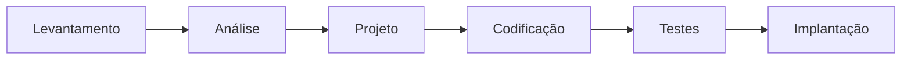
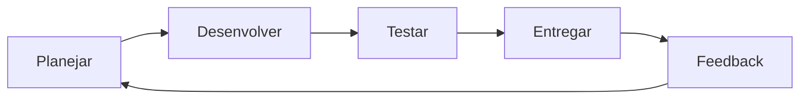

# 1.6 · Gestão tradicional × gestão ágil

> **Em uma frase:** no modelo **tradicional (cascata)** você planeja tudo no início e entrega no fim; no modelo **ágil** você entrega em ciclos curtos (sprints), recebendo feedback e ajustando o plano a cada volta.

## 🧩 Projeto × processo

| | Projeto | Processo |
| --- | --- | --- |
| Duração | **Temporário**: tem início e fim definidos | **Contínuo**: se repete regularmente |
| Resultado | **Único** (ex.: lançar um app) | **Replicável** (ex.: fechar a folha de pagamento) |
| Exemplo em TI | Criar um sistema de agendamento | Fazer o deploy semanal do sistema |

## 🌊 Modelo tradicional (cascata / *waterfall*)

As etapas acontecem em sequência, e cada uma só começa quando a anterior termina:

- O planejamento é feito no início, fixando **escopo → custo → prazo**.
- O cliente só vê valor **no final**, na implantação.
- Mudanças no meio do caminho são caras, porque obrigam a refazer etapas.

> [!NOTE]
> O cascata não é "errado": funciona bem quando os requisitos são estáveis e bem conhecidos (por exemplo, obras ou sistemas regulados). O problema é que, em software, os requisitos quase sempre mudam.

## 🔁 Modelo ágil

O trabalho é dividido em **ciclos curtos** (no Scrum, chamados de *sprints*, de 1 a 4 semanas). Cada ciclo passa por planejamento, desenvolvimento, testes e entrega de um pedaço **funcionando** do produto.

- O valor é entregue **de forma iterativa e incremental**: o produto cresce a cada ciclo.
- Ao fim de cada ciclo há **feedback** do cliente, e o plano é ajustado.
- No ágil, normalmente **prazo e custo** ficam fixos, e o **escopo** se adapta.

## ⚖️ Comparando

| | Tradicional (cascata) | Ágil |
| --- | --- | --- |
| Planejamento | Todo no início | Contínuo, a cada ciclo |
| Entrega de valor | No fim do projeto | A cada ciclo |
| Mudanças | Caras e evitadas | Esperadas e bem-vindas |
| Contato com o cliente | Início e fim | Constante |
| Risco de "entregar a coisa errada" | Alto | Baixo |

## 📌 Resumindo

- Projeto é temporário e único; processo é contínuo e repetível.
- Cascata: etapas em sequência, valor só no final.
- Ágil: ciclos curtos, entregas frequentes, feedback e adaptação.
- Vantagens do ágil: flexibilidade, transparência, aprendizado e entrega contínua de valor.

## 🏋️ Mão na massa

**1.** Classifique como projeto ou processo: (a) migrar o banco de dados para a nuvem; (b) responder chamados de suporte todos os dias.

Ver resposta

(a) **Projeto**: é temporário e tem um resultado único. (b) **Processo**: é contínuo e se repete.

**2.** Em qual modelo o cliente vê o software funcionando mais cedo? Por quê?

Ver resposta

No **ágil**, porque cada ciclo entrega um incremento funcionando. No cascata, o cliente só vê o sistema na etapa de implantação.

**3.** Cite um cenário em que o modelo cascata ainda faz sentido.

Ver resposta

Quando os requisitos são muito estáveis e bem definidos desde o início e mudanças são raras ou proibidas, como em projetos com regulamentação rígida ou contratos de escopo fechado.

---

[⬅️ 1.5 O Manifesto Ágil](./05-manifesto-agil.md) &nbsp;|&nbsp; [🏠 Índice](../../README.md) &nbsp;|&nbsp; [1.7 XP (Extreme Programming) ➡️](./07-xp.md)

