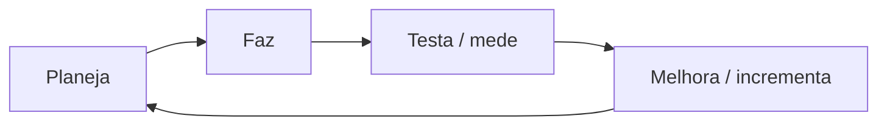

# 1.7 · XP (Extreme Programming)

> **Em uma frase:** o XP é uma metodologia ágil focada em **práticas de engenharia**, como testes automatizados, programação em par e integração contínua, para entregar software de qualidade em ciclos curtos.

## 📖 Origem

O XP foi criado por **Kent Beck** no fim dos anos 1990. A ideia do nome é levar ao "extremo" as boas práticas: se revisar código é bom, revise o tempo todo (programação em par); se testar é bom, teste o tempo todo (testes automatizados antes do código).

## 💎 Valores

**Comunicação**, **simplicidade**, **feedback**, **coragem** e **respeito**.

## 🔁 Ciclo do XP

## 🛠️ Principais práticas

| Prática | O que é |
| --- | --- |
| **Programação em par** | Duas pessoas no mesmo código: uma digita, a outra revisa e pensa adiante. Trocam de papel com frequência. |
| **TDD** (Desenvolvimento Guiado por Testes) | Escrever o teste **antes** do código (você verá isso na aula de [testes](../04-poo/22-testes-boas-praticas.md)). |
| **Integração contínua** | Juntar o código de todos várias vezes ao dia, com testes automáticos rodando a cada mudança. |
| **Design simples** | Fazer a solução mais simples que resolve o problema de hoje. |
| **Refatoração** | Melhorar o código constantemente sem mudar o que ele faz. |
| **Entregas pequenas** | Liberar versões com frequência. |
| **Cliente presente** | Alguém do negócio disponível para tirar dúvidas o tempo todo. |
| **Ritmo sustentável** | Nada de horas extras como rotina. |

## 📌 Resumindo

- XP = metodologia ágil criada por Kent Beck, focada em qualidade técnica.
- Ciclos curtos de planejar → fazer → testar → melhorar.
- Práticas marcantes: programação em par, TDD, integração contínua, refatoração e design simples.

## 🏋️ Mão na massa

**1.** Qual a vantagem da programação em par, se "duas pessoas fazem o trabalho de uma"?

Ver resposta

O código é revisado no momento em que é escrito, o que reduz bugs, espalha conhecimento pela equipe e melhora o design. O custo extra costuma ser compensado pelo retrabalho evitado.

**2.** O que significa TDD?

Ver resposta

*Test-Driven Development*, desenvolvimento guiado por testes: primeiro você escreve um teste que falha, depois o código mínimo para ele passar, e por fim refatora.

**3.** Cite três valores do XP.

Ver resposta

Quaisquer três entre: comunicação, simplicidade, feedback, coragem e respeito.

---

[⬅️ 1.6 Gestão tradicional × gestão ágil](./06-tradicional-vs-agil.md) &nbsp;|&nbsp; [🏠 Índice](../../README.md) &nbsp;|&nbsp; [1.8 Scrum ➡️](./08-scrum.md)

