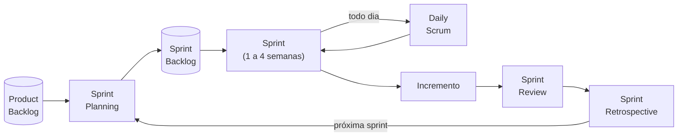

# 1.8 · Scrum

> **Em uma frase:** o Scrum é um *framework* ágil que organiza o trabalho em ciclos curtos chamados **sprints**, com papéis, eventos e artefatos bem definidos para planejar, entregar e melhorar continuamente.

📘 Referência oficial: **[Guia do Scrum](https://scrumguides.org/)** (disponível em português).

## 📖 Origem

O Scrum foi formalizado por **Ken Schwaber e Jeff Sutherland** em **1995**. O nome veio de um artigo de 1986 de Hirotaka Takeuchi e Ikujiro Nonaka, que comparava equipes de alta performance a um *scrum* do rúgbi: o time inteiro avançando junto.

## 🏛️ Os pilares: transparência, inspeção e adaptação

O Scrum se apoia no **empirismo** (decidir com base no que se observa, e não em suposições) e no **lean thinking** (reduzir desperdício e focar no essencial):

| Pilar | Na prática |
| --- | --- |
| **Transparência** | Todo mundo enxerga o trabalho e o progresso (quadro, backlog, metas). |
| **Inspeção** | O time verifica com frequência o que foi feito e o progresso rumo à meta. |
| **Adaptação** | Se algo não vai bem, o time ajusta o plano ou o processo o quanto antes. |

## 👥 Papéis (responsabilidades)

| Papel | Responsabilidade |
| --- | --- |
| **Product Owner (PO)** | Decide **o que** construir e em que ordem; cuida do Product Backlog e do valor do produto. |
| **Scrum Master** | Ajuda o time a aplicar o Scrum, remove impedimentos e facilita os eventos. |
| **Desenvolvedores** | Constroem o incremento; decidem **como** fazer o trabalho. |

## 📅 Eventos

| Evento | Quando | Para quê |
| --- | --- | --- |
| **Sprint** | Ciclo de até 1 mês (geralmente 2 semanas) | "Contêiner" de todos os outros eventos |
| **Sprint Planning** | Início da sprint | Definir a meta e o que será feito |
| **Daily Scrum** | Todo dia, 15 minutos | Alinhar o progresso rumo à meta |
| **Sprint Review** | Fim da sprint | Mostrar o incremento e coletar feedback |
| **Sprint Retrospective** | Depois da review | Melhorar o jeito de trabalhar |

## 📦 Artefatos

| Artefato | O que é | Compromisso |
| --- | --- | --- |
| **Product Backlog** | Lista ordenada de tudo o que pode entrar no produto | Meta do Produto |
| **Sprint Backlog** | O que foi escolhido para a sprint + o plano | Meta da Sprint |
| **Incremento** | O produto funcionando ao fim da sprint | Definição de Pronto |

## 🔁 O fluxo de uma sprint

## 🧭 Framework × metodologia

- **Framework** (como o Scrum): diz **por que** e **o que** fazer, mas deixa o **como** em aberto. Você pode combinar com outras práticas (por exemplo, as do XP).
- **Metodologia**: diz o porquê, o quê e **como** fazer, passo a passo, como uma receita de bolo.

## 📌 Resumindo

- Scrum = framework ágil de Schwaber e Sutherland, baseado em **empirismo** e **lean**.
- Pilares: **transparência, inspeção e adaptação**.
- Papéis: PO, Scrum Master e Desenvolvedores.
- Eventos: Sprint, Planning, Daily, Review e Retrospective.
- Artefatos: Product Backlog, Sprint Backlog e Incremento.

## 🏋️ Mão na massa

**1.** Quem decide **o que** entra no produto e **quem** decide **como** fazer?

Ver resposta

O **Product Owner** decide o que construir e a prioridade. Os **Desenvolvedores** decidem como fazer o trabalho.

**2.** Qual a diferença entre a Sprint Review e a Sprint Retrospective?

Ver resposta

A **Review** olha para o **produto**: mostra o incremento e coleta feedback. A **Retrospective** olha para o **time e o processo**: como trabalhar melhor na próxima sprint.

**3.** A Daily Scrum é uma reunião para o time prestar contas ao chefe?

Ver resposta

**Não.** É um encontro curto **dos desenvolvedores**, para inspecionar o progresso rumo à meta da sprint e ajustar o plano do dia.

---

[⬅️ 1.7 XP (Extreme Programming)](./07-xp.md) &nbsp;|&nbsp; [🏠 Índice](../../README.md) &nbsp;|&nbsp; [1.9 Kanban ➡️](./09-kanban.md)

