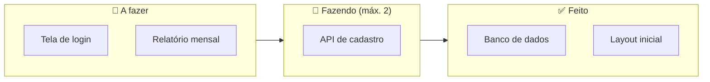

# 1.9 · Kanban

> **Em uma frase:** o Kanban é um método **visual** de gestão do trabalho: as tarefas viram cartões que andam por colunas (A fazer → Fazendo → Feito), e limitar o que está "em andamento" faz o fluxo andar mais rápido.

## 📖 Origem

*Kanban* significa "cartão" ou "sinal" em japonês. O método nasceu na **Toyota**, entre o fim dos anos 1940 e os anos 1950, para produzir só o necessário e evitar estoque parado. Em 2007, David J. Anderson adaptou a ideia para o trabalho de conhecimento, e hoje ele é muito usado em equipes de software, sozinho ou junto com o Scrum.

## 🗂️ O quadro Kanban

## 🧭 Princípios práticos

| Prática | O que significa |
| --- | --- |
| **Visualizar o trabalho** | Tudo o que está sendo feito aparece no quadro. |
| **Limitar o WIP** (*work in progress*) | Cada coluna tem um limite de cartões. Termine antes de começar algo novo. |
| **Gerenciar o fluxo** | Observar onde os cartões "empacam" e resolver o gargalo. |
| **Políticas explícitas** | Regras claras, como "o que significa um cartão estar *Feito*". |
| **Melhoria contínua** | Medir (por exemplo, quanto tempo um cartão leva para atravessar o quadro) e ajustar. |

> [!TIP]
> Limitar o WIP parece contraintuitivo, mas faz o trabalho fluir: com menos coisas paradas pela metade, cada tarefa termina mais cedo.

## ⚖️ Kanban × Scrum

| | Kanban | Scrum |
| --- | --- | --- |
| Ritmo | Fluxo contínuo | Sprints de tamanho fixo |
| Papéis | Não exige papéis novos | PO, Scrum Master e Desenvolvedores |
| Mudanças | Podem entrar a qualquer momento | Normalmente esperam a próxima sprint |
| Métrica comum | Tempo de ciclo (*lead time*) | Meta da sprint / velocidade |

## 📌 Resumindo

- Kanban é um método visual nascido na Toyota.
- Cartões andam por colunas; o limite de WIP evita trabalho acumulado.
- Pode ser usado sozinho ou combinado com Scrum ("Scrumban").

## 🏋️ Mão na massa

**1.** Monte um quadro Kanban para seus estudos de Java usando o [Trello](https://trello.com), o [GitHub Projects](https://github.com/features/issues) ou papel e post-its.

Ver resposta

Crie colunas **A estudar**, **Estudando** (limite de 2 cartões) e **Concluído**, e um cartão por aula deste material. Mova os cartões conforme avança.

**2.** O que é WIP e por que limitá-lo?

Ver resposta

*Work in progress*, o trabalho em andamento. Limitar evita começar muitas coisas e não terminar nenhuma, reduz trocas de contexto e faz cada tarefa ser concluída mais rápido.

**3.** A coluna "Testando" do seu quadro está sempre lotada. O que isso indica?

Ver resposta

Um **gargalo**: o trabalho chega aos testes mais rápido do que eles são feitos. A equipe pode ajudar nos testes, automatizá-los ou reduzir a entrada de novas tarefas até o fluxo se normalizar.

---

[⬅️ 1.8 Scrum](./08-scrum.md) &nbsp;|&nbsp; [🏠 Índice](../../README.md) &nbsp;|&nbsp; [1.10 OKR (Objetivos e Resultados-Chave) ➡️](./10-okr.md)

