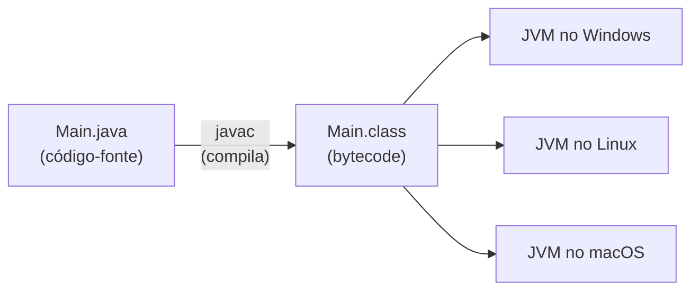
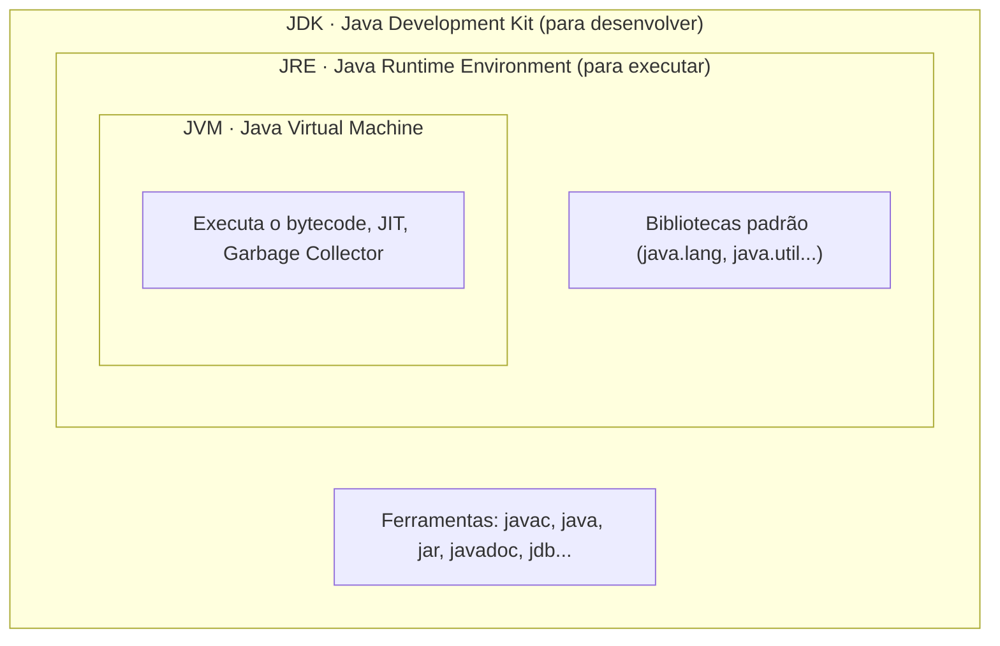

# 2.1 · História do Java, JVM, JRE e JDK

> **Em uma frase:** o Java compila seu código para **bytecode**, que roda em qualquer computador que tenha uma **JVM**; para **rodar** programas basta o JRE, e para **criar** programas você precisa do **JDK**.

## 📖 Um pouco de história

- **1991:** na Sun Microsystems, a equipe de **James Gosling** (com Mike Sheridan e Patrick Naughton) inicia o *Green Project*, para criar uma linguagem que rodasse em vários aparelhos eletrônicos.
- A linguagem se chamava **Oak** (carvalho, a árvore em frente ao escritório), mas o nome já era registrado e virou **Java** (gíria americana para café ☕).
- **1995:** lançamento oficial do Java.
- **2010:** a **Oracle** compra a Sun e passa a cuidar do Java.
- **Hoje:** uma versão nova sai **a cada 6 meses** (março e setembro), e a cada 2 anos uma delas é **LTS** (*Long-Term Support*, com suporte estendido).

| Versões LTS | Destaque |
| --- | --- |
| Java 8 (2014) | Lambdas e Stream API |
| Java 11 (2018) | `var` em lambdas, novo cliente HTTP |
| Java 17 (2021) | `record`, `sealed`, *pattern matching* com `instanceof` |
| Java 21 (2023) | *Virtual threads*, *pattern matching* no `switch` |
| Java 25 (2025) | LTS mais recente |

> [!TIP]
> Para estudar e para projetos novos, use uma versão **LTS recente** (21 ou 25). Muitas empresas ainda usam o Java 8, 11 ou 17, então vale saber que elas existem.

Java está em todo lugar: sistemas de bancos (como o do próprio Banco Pan), o **Android**, o **Minecraft**, ferramentas como **IntelliJ** e **Eclipse**, e servidores como o **Tomcat**.

## ⚙️ Como um programa Java roda

Em linguagens como C, o compilador gera código de máquina específico para **um** sistema operacional. No Java, o compilador gera **bytecode**, um código intermediário que a **JVM** (Máquina Virtual Java) de cada sistema sabe executar.



Esse é o famoso lema **"Write once, run anywhere"**: escreva uma vez, rode em qualquer lugar.

> [!NOTE]
> A JVM não apenas "interpreta" o bytecode: ela usa um compilador **JIT** (*Just-In-Time*) que transforma os trechos mais usados em código de máquina enquanto o programa roda. Por isso o Java é rápido.

### C × Java

| | C / C++ | Java |
| --- | --- | --- |
| Compila para | Código de máquina de um sistema | Bytecode (independente de sistema) |
| Roda em | Só no sistema para o qual foi compilado | Qualquer sistema com JVM |
| Memória | Você aloca e libera manualmente | O **Garbage Collector** libera sozinho |
| Paradigma | C é procedural | Orientado a objetos |

## 📦 JVM, JRE e JDK



| Sigla | Para quem | O que contém |
| --- | --- | --- |
| **JVM** | — | A máquina virtual que executa o bytecode |
| **JRE** | Quem só quer **rodar** programas | JVM + bibliotecas padrão |
| **JDK** | Quem vai **programar** | JRE + compilador (`javac`) e outras ferramentas |

> [!IMPORTANT]
> Como você vai programar, instale sempre o **JDK**. Há várias distribuições gratuitas do OpenJDK: [Eclipse Temurin (Adoptium)](https://adoptium.net/), [Azul Zulu](https://www.azul.com/downloads/), [Amazon Corretto](https://aws.amazon.com/corretto/) e a da [Oracle](https://www.oracle.com/java/technologies/downloads/). Qualquer uma serve.

## 🗂️ As plataformas Java

| Plataforma | Uso |
| --- | --- |
| **Java SE** (*Standard Edition*) | A base da linguagem: o que você vai aprender aqui. |
| **Jakarta EE** (antigo Java EE) | Especificações para aplicações corporativas e web. Desde 2017 é mantida pela Eclipse Foundation. |
| **Java ME** (*Micro Edition*) | Dispositivos com poucos recursos (praticamente em desuso). |
| **JavaFX** | Interfaces gráficas para desktop. |
| **Java Card** | Cartões inteligentes, como chips de cartão de banco. |

> [!NOTE]
> No mercado, o desenvolvimento web/back-end em Java hoje é feito majoritariamente com **Spring Boot** (assunto do [Módulo 6](../06-spring/10-spring-framework.md)), que usa várias especificações do Jakarta EE por baixo.

## 📌 Resumindo

- Java foi criado por James Gosling na Sun (1995) e hoje é da Oracle; há versões LTS a cada 2 anos.
- O `javac` compila `.java` em bytecode `.class`, que roda em qualquer **JVM**.
- **JVM** executa; **JRE** = JVM + bibliotecas; **JDK** = JRE + ferramentas de desenvolvimento.
- Para programar, instale um **JDK** LTS recente.

## 🏋️ Mão na massa

**1.** Instale um JDK LTS (21 ou 25) e confira no terminal.

<details>
<summary>Ver resposta</summary>

Depois de instalar (por exemplo, o Temurin em [adoptium.net](https://adoptium.net/)), rode:

```bash
java -version
javac -version
```

Os dois devem mostrar a mesma versão. Se o `javac` não for encontrado, você instalou só um JRE ou o `PATH` não foi configurado.

</details>

**2.** O que é bytecode e por que ele torna o Java portável?

<details>
<summary>Ver resposta</summary>

É o código intermediário gerado pelo `javac` (arquivos `.class`). Ele não depende do sistema operacional: cada sistema tem sua própria JVM capaz de executá-lo. Por isso o mesmo `.class` roda no Windows, no Linux e no macOS.

</details>

**3.** Um colega só quer **executar** um programa `.jar` que você criou. Ele precisa do JDK?

<details>
<summary>Ver resposta</summary>

Não necessariamente: um **JRE** (ou o próprio JDK, que o inclui) basta para executar. O JDK só é obrigatório para **compilar** código.

</details>

---

<div align="center">

[⬅️ 1.11 Ferramentas para times ágeis](../01-principios/11-ferramentas-ageis.md) &nbsp;|&nbsp; [🏠 Índice](../../README.md) &nbsp;|&nbsp; [2.2 IDEs ➡️](./02-ides.md)

</div>
