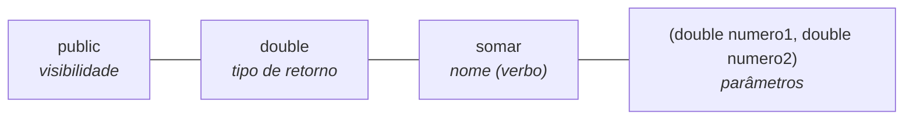

# 2.6 · Métodos: primeiros passos

> **Em uma frase:** um método é um bloco de código com nome que executa **uma tarefa**: ele pode receber dados (parâmetros), pode devolver um resultado (retorno) e sempre mora dentro de uma classe.

Uma classe é formada por **atributos** (o que ela *tem*, como `nome` e `saldo`) e **métodos** (o que ela *faz*, como `depositar()` e `sacar()`).

> [!NOTE]
> Em Java **não existem funções soltas**: todo método é declarado dentro de uma classe.

## 🧩 A estrutura de um método

```java
public double somar(double numero1, double numero2) {
    return numero1 + numero2;
}
```



## ❓ Cinco perguntas para desenhar um método

1. **Qual é a finalidade?** Um método, uma responsabilidade.
2. **Retorna algo?** Se não retornar nada, o tipo é `void`.
3. **Precisa de quais dados?** Esses são os parâmetros.
4. **Pode dar erro?** Pode ser preciso tratar ou declarar uma exceção (`throws`), assunto da aula [4.14](../04-poo/14-excecoes.md).
5. **Quem pode usar?** Visibilidade: `public`, `private`, `protected` ou nenhuma (padrão).

```java
public class Calculadora {

    public double somar(int num1, int num2) {        // retorna um valor
        return num1 + num2;
    }

    public void imprimir(String texto) {             // não retorna nada
        System.out.println(texto);
    }

    public double dividir(int dividendo, int divisor) {
        if (divisor == 0) {
            throw new IllegalArgumentException("Divisor não pode ser zero");
        }
        return (double) dividendo / divisor;
    }

    private void metodoInterno() { }                 // só a própria classe enxerga
}
```

## 🚩 Erros comuns de desenho

```java
public void validar() { }
// ❌ "validar" deveria responder algo: melhor retornar boolean

public void calcularEEnviar() { }
// ❌ duas responsabilidades: separe em calcular() e enviar()

public void gravarCliente(String nome, String cpf, String telefone, String email, String endereco) { }
// ❌ parâmetros demais: agrupe em um objeto
public void gravar(Cliente cliente) { }
// ✅
```

## 🏷️ Nomes de métodos

- Verbos no infinitivo, em `camelCase`: `somar()`, `abrirConexao()`, `concluirProcessamento()`.
- Em projetos em inglês, você verá muito `findById()`, `save()`, `getName()`.

> [!TIP]
> Este é só o primeiro contato. Assinatura, parâmetros, construtores, sobrecarga e retornos são aprofundados nas aulas [2.31 a 2.33](./31-metodos-conceitos.md).

## 📌 Resumindo

- Método = bloco nomeado que executa uma tarefa, sempre dentro de uma classe.
- Estrutura: visibilidade + tipo de retorno + nome + parâmetros.
- `void` quando não retorna nada; `return` para devolver um valor.
- Um método, uma responsabilidade; poucos parâmetros.

## 🏋️ Mão na massa

**1.** Escreva um método `ehMaiorDeIdade` que recebe uma idade e diz se a pessoa é maior de idade.

<details>
<summary>Ver resposta</summary>

```java
public static boolean ehMaiorDeIdade(int idade) {
    return idade >= 18;
}
```

Como o método só responde "sim ou não", o retorno é `boolean`.

</details>

**2.** O que há de errado com `public void calcularMediaEImprimirBoletim()`?

<details>
<summary>Ver resposta</summary>

Ele tem **duas responsabilidades** (calcular e imprimir). O ideal é um método `calcularMedia()` que retorna a média e outro `imprimirBoletim()` que usa esse valor.

</details>

**3.** No `treino-java`, crie uma classe `Conversor` com um método que converte graus Celsius em Fahrenheit (`F = C × 9/5 + 32`) e teste no `main`.

<details>
<summary>Ver resposta</summary>

```java
public class Conversor {
    public static double celsiusParaFahrenheit(double celsius) {
        return celsius * 9 / 5 + 32;
    }

    public static void main(String[] args) {
        System.out.println(celsiusParaFahrenheit(25));   // 77.0
    }
}
```

</details>

---

<div align="center">

[⬅️ 2.5 Operadores](./05-operadores.md) &nbsp;|&nbsp; [🏠 Índice](../../README.md) &nbsp;|&nbsp; [2.7 Escopo de variáveis ➡️](./07-escopo.md)

</div>
