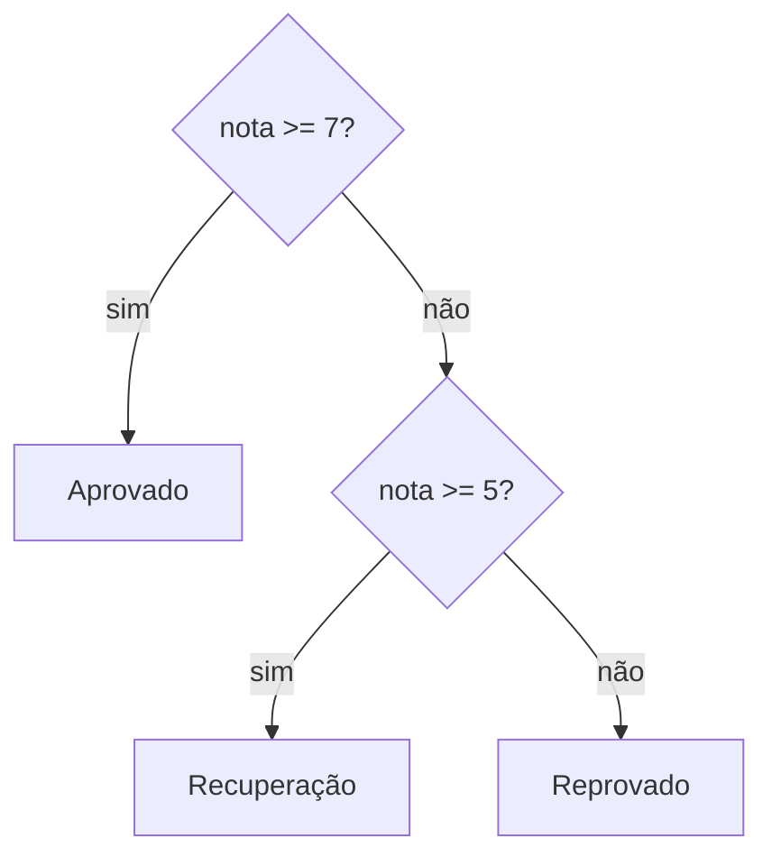

# 2.12 · Controle de fluxo: `if`, `else` e `switch`

> **Em uma frase:** estruturas de controle de fluxo decidem **qual caminho** o programa segue (`if`, `else`, `switch`), **quantas vezes** algo se repete (`for`, `while`) e **quando parar** (`break`, `continue`, `return`).

| Tipo | Estruturas |
| --- | --- |
| **Decisão** | `if`, `if-else`, `if-else-if`, `switch`, operador ternário |
| **Repetição** | `for`, `while`, `do-while` (aula [2.14](./14-repeticao-e-arrays.md)) |
| **Interrupção** | `break`, `continue`, `return` |

## 🔀 `if`, `else if` e `else`



```java
double nota = 6.0;

if (nota >= 7) {
    System.out.println("Aprovado");
} else if (nota >= 5) {
    System.out.println("Recuperação");
} else {
    System.out.println("Reprovado");
}
```

> [!TIP]
> Mesmo quando o bloco tem uma linha só, **use as chaves**. Evita bugs quando alguém acrescenta uma segunda linha depois.

### Exemplo: mês atual e férias

```java
import java.util.Scanner;

public class Ferias {
    public static void main(String[] args) {
        Scanner entrada = new Scanner(System.in);
        System.out.print("Digite o número do mês atual: ");
        int mes = entrada.nextInt();

        if (mes < 1 || mes > 12) {
            System.out.println("Mês inválido! Escolha de 1 a 12.");
        } else if (mes == 1 || mes == 7 || mes == 12) {
            System.out.println("Período de férias disponível.");
        } else {
            System.out.println("Férias só em janeiro, julho ou dezembro.");
        }
    }
}
```

> [!NOTE]
> O `Scanner` lê dados digitados no terminal: `nextInt()` lê um inteiro, `nextDouble()` um decimal, `next()` uma palavra e `nextLine()` uma linha inteira.

## 🎛️ `switch`

Ideal quando você compara **uma mesma variável** com vários valores fixos.

### Forma moderna (Java 14+): com setas

```java
int diaDaSemana = 3;

switch (diaDaSemana) {
    case 1 -> System.out.println("Domingo");
    case 2 -> System.out.println("Segunda-feira");
    case 3 -> System.out.println("Terça-feira");
    case 4 -> System.out.println("Quarta-feira");
    case 5 -> System.out.println("Quinta-feira");
    case 6 -> System.out.println("Sexta-feira");
    case 7 -> System.out.println("Sábado");
    default -> System.out.println("Dia inválido");
}
```

Ele também pode **devolver um valor** (*switch expression*) e agrupar casos com vírgula:

```java
int numero = 2;
String resposta = switch (numero) {
    case 1, 2, 3 -> "certo";
    case 4 -> "errado";
    case 5 -> "talvez";
    default -> "valor não definido";
};
```

### Forma tradicional: com `break`

```java
switch (numero) {
    case 1:
    case 2:
    case 3:
        System.out.println("certo");
        break;            // sem o break, ele "cai" no próximo case!
    case 4:
        System.out.println("errado");
        break;
    default:
        System.out.println("valor não definido");
}
```

> [!WARNING]
> Na forma tradicional, esquecer o `break` faz o código continuar executando os `case` seguintes (*fall-through*). A forma com setas `->` não tem esse problema: prefira-a.

O `switch` funciona com `int`, `char`, `String`, `enum` e, nas versões recentes, até com tipos de objetos (*pattern matching*).

## ⏹️ Interrupção

| Comando | O que faz |
| --- | --- |
| `break` | Sai do laço ou do `switch` atual. |
| `continue` | Pula o resto da volta atual do laço e vai para a próxima. |
| `return` | Sai do método (devolvendo um valor, se houver). |

## 📌 Resumindo

- `if / else if / else` escolhe caminhos com base em condições.
- `switch` compara uma variável com valores fixos; prefira a forma com `->`.
- Na forma antiga do `switch`, cada `case` precisa de `break`.
- `break`, `continue` e `return` interrompem o fluxo.

## 🏋️ Mão na massa

**1.** Peça a idade e informe: "criança" (até 12), "adolescente" (13 a 17), "adulto" (18 a 59) ou "idoso" (60+).

<details>
<summary>Ver resposta</summary>

```java
import java.util.Scanner;

public class FaixaEtaria {
    public static void main(String[] args) {
        Scanner entrada = new Scanner(System.in);
        System.out.print("Idade: ");
        int idade = entrada.nextInt();

        if (idade <= 12) {
            System.out.println("criança");
        } else if (idade <= 17) {
            System.out.println("adolescente");
        } else if (idade <= 59) {
            System.out.println("adulto");
        } else {
            System.out.println("idoso");
        }
    }
}
```

</details>

**2.** Usando `switch` com setas, transforme a sigla de um estado (`"RJ"`, `"SP"`, `"MG"`) no nome completo.

<details>
<summary>Ver resposta</summary>

```java
String sigla = "RJ";
String estado = switch (sigla) {
    case "RJ" -> "Rio de Janeiro";
    case "SP" -> "São Paulo";
    case "MG" -> "Minas Gerais";
    default -> "Estado não cadastrado";
};
System.out.println(estado);
```

</details>

**3.** O que este código imprime quando `opcao` vale 1?

```java
switch (opcao) {
    case 1: System.out.println("Um");
    case 2: System.out.println("Dois");
        break;
    case 3: System.out.println("Três");
}
```

<details>
<summary>Ver resposta</summary>

Imprime `Um` e `Dois`. Como não há `break` no `case 1`, a execução "cai" no `case 2` até encontrar o `break`.

</details>

---

<div align="center">

[⬅️ 2.11 Operadores relacionais e lógicos a fundo](./11-operadores-relacionais-e-logicos.md) &nbsp;|&nbsp; [🏠 Índice](../../README.md) &nbsp;|&nbsp; [2.13 Blocos de código ➡️](./13-blocos-de-codigo.md)

</div>
