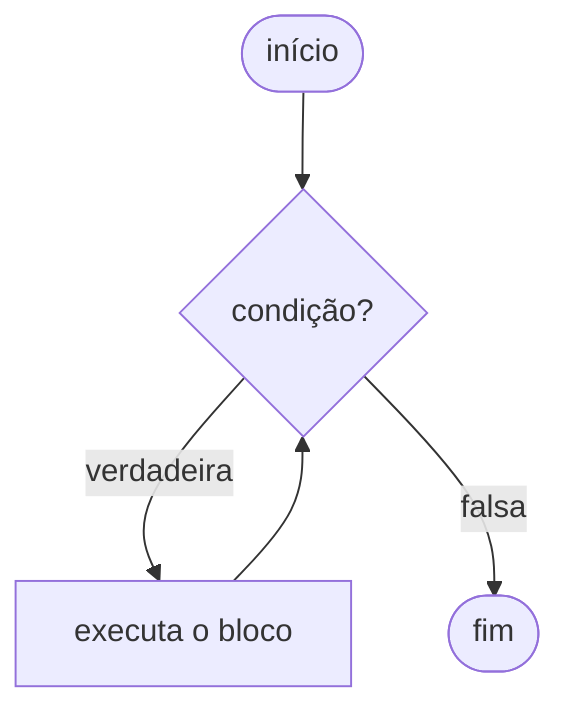
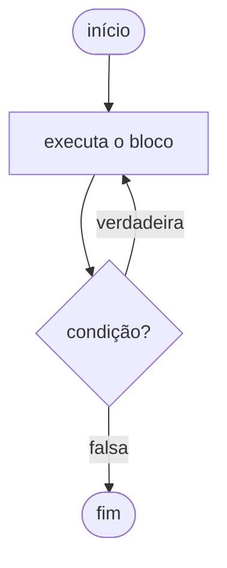
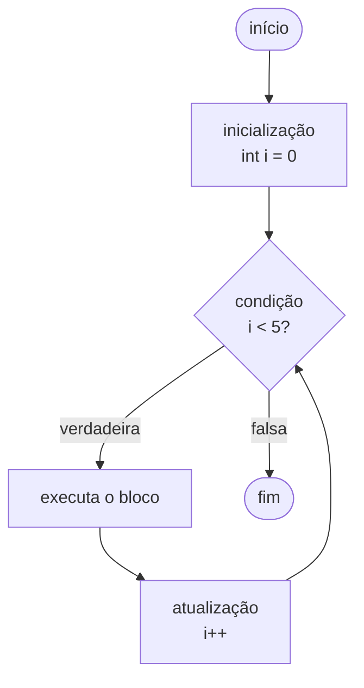
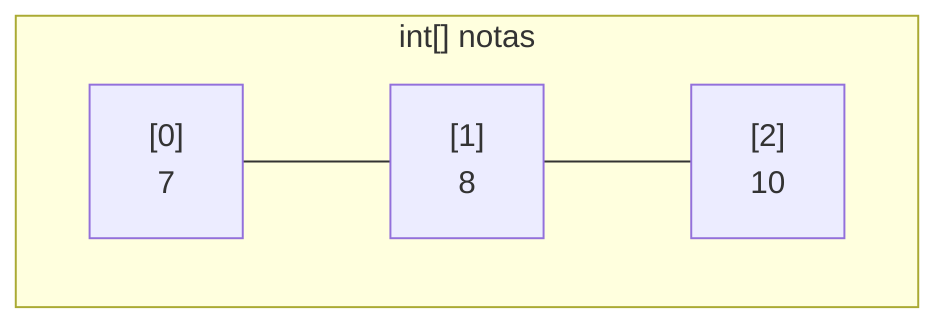

# 2.15 · Estruturas de repetição e arrays

> **Em uma frase:** laços (`while`, `do-while`, `for`, `for-each`) repetem um bloco de código enquanto uma condição for verdadeira, e **arrays** guardam vários valores do mesmo tipo em posições numeradas a partir de **zero**.

## 🔁 Os laços

### `while`: testa **antes**

Pode executar **zero** vezes, se a condição já começar falsa.



```java
int contador = 1;
while (contador <= 5) {
    System.out.println("Volta " + contador);
    contador++;
}
```

### `do-while`: testa **depois**

Executa **pelo menos uma vez**. Ótimo para menus e validação de entrada.



```java
int nota;
do {
    System.out.print("Digite uma nota de 0 a 10: ");
    nota = entrada.nextInt();
} while (nota < 0 || nota > 10);
```

### `for`: repetição **contada**

Junta numa linha a **inicialização**, a **condição** e a **atualização**.



```java
for (int i = 0; i < 5; i++) {
    System.out.println("i = " + i);   // 0, 1, 2, 3, 4
}
```

### `for-each`: percorre **todos os elementos**

```java
String[] frutas = {"maçã", "banana", "uva"};
for (String fruta : frutas) {
    System.out.println(fruta);
}
```

> [!TIP]
> Use `for` quando precisar do **índice**; `for-each` quando só quiser **cada elemento**; `while` quando não souber quantas voltas serão; `do-while` quando precisar executar ao menos uma vez.

### `break` e `continue`

```java
for (int i = 1; i <= 10; i++) {
    if (i == 3) continue;   // pula o 3
    if (i == 6) break;      // para no 6
    System.out.println(i);  // 1, 2, 4, 5
}
```

> [!WARNING]
> Cuidado com o **laço infinito**: se a condição nunca ficar falsa (por exemplo, esquecer o `contador++` no `while`), o programa nunca termina.

## 🗃️ Arrays

Um array guarda **vários valores do mesmo tipo** em uma única variável, com **tamanho fixo**. Cada posição tem um **índice** que começa em **0** e vai até `tamanho - 1`.

```java
double[] c = new double[12];   // 12 posições, todas valendo 0.0
c[0] = -45;
c[1] = 6;
c[11] = 78;

int[] notas = {7, 8, 10};      // criando já com valores
System.out.println(notas.length);   // 3
System.out.println(notas[0]);       // 7
```



> [!CAUTION]
> Acessar um índice que não existe (como `notas[3]` num array de tamanho 3) lança `ArrayIndexOutOfBoundsException`. O último índice é sempre `length - 1`.

### Arrays multidimensionais (matrizes)

Um array de arrays: o primeiro índice é a **linha**, o segundo a **coluna**.

```java
int[][] matriz = new int[3][4];   // 3 linhas × 4 colunas
matriz[0][2] = 5;                 // linha 0, coluna 2

for (int linha = 0; linha < matriz.length; linha++) {
    for (int coluna = 0; coluna < matriz[linha].length; coluna++) {
        System.out.print(matriz[linha][coluna] + " ");
    }
    System.out.println();
}
```

| | Coluna 0 | Coluna 1 | Coluna 2 | Coluna 3 |
| --- | --- | --- | --- | --- |
| **Linha 0** | `[0][0]` | `[0][1]` | `[0][2]` | `[0][3]` |
| **Linha 1** | `[1][0]` | `[1][1]` | `[1][2]` | `[1][3]` |
| **Linha 2** | `[2][0]` | `[2][1]` | `[2][2]` | `[2][3]` |

### Utilitários da classe `Arrays`

```java
import java.util.Arrays;

int[] numeros = {5, 2, 9, 1};
Arrays.sort(numeros);                          // ordena: [1, 2, 5, 9]
System.out.println(Arrays.toString(numeros));  // imprime bonitinho
System.out.println(Arrays.deepToString(matriz)); // para matrizes
```

> [!NOTE]
> Arrays têm tamanho fixo. Quando precisar de uma lista que cresce e diminui, use as **coleções**, como `ArrayList` (aula [2.28](./28-list.md)).

## 📌 Resumindo

- `while` testa antes; `do-while` testa depois (roda ao menos uma vez); `for` é contado; `for-each` percorre todos os elementos.
- `break` sai do laço; `continue` pula para a próxima volta.
- Arrays: tamanho fixo, mesmo tipo, índices de `0` a `length - 1`.
- `Arrays.toString()`, `Arrays.sort()` e `Arrays.deepToString()` ajudam muito.

## 🏋️ Mão na massa

> Os exercícios completos com resolução estão nas próximas duas aulas. Aqui vão alguns rápidos.

**1.** Imprima os números pares de 0 a 20 usando `for`.

<details>
<summary>Ver resposta</summary>

```java
for (int i = 0; i <= 20; i += 2) {
    System.out.println(i);
}
```

</details>

**2.** Crie um array com 5 temperaturas e calcule a média usando `for-each`.

<details>
<summary>Ver resposta</summary>

```java
double[] temperaturas = {28.5, 31.0, 25.4, 29.9, 30.2};
double soma = 0;
for (double t : temperaturas) {
    soma += t;
}
System.out.println("Média: " + soma / temperaturas.length);
```

</details>

**3.** Quantas vezes o bloco executa em `while (x < 0)` se `x` começar valendo 5? E em `do { } while (x < 0)`?

<details>
<summary>Ver resposta</summary>

No `while`, **zero** vezes (a condição já começa falsa). No `do-while`, **uma** vez (o teste só acontece depois da primeira execução).

</details>

---

<div align="center">

[⬅️ 2.14 Blocos de código](./14-blocos-de-codigo.md) &nbsp;|&nbsp; [🏠 Índice](../../README.md) &nbsp;|&nbsp; [2.16 Exercícios de estruturas de repetição ➡️](./16-exercicios-repeticao.md)

</div>
