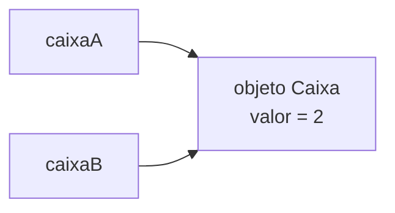
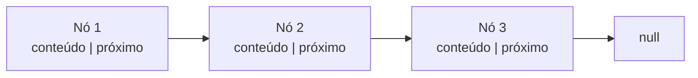

# 2.18 · Estruturas de dados: referências, nós e generics

> **Em uma frase:** estruturas como pilhas, filas e listas encadeadas são feitas de **nós**: objetos que guardam um valor e uma **referência** para o próximo nó; com **generics** (`<T>`), a mesma estrutura funciona para qualquer tipo.

## 🧠 Valor × referência

No Java, **toda atribuição copia o conteúdo da variável**. A diferença está no que a variável guarda:

- Um **primitivo** guarda o próprio valor → a cópia é independente.
- Um **objeto** é acessado por uma **referência** (o "endereço" dele na memória) → a cópia aponta para o **mesmo** objeto.

```java
int a = 1;
int b = a;      // b recebe uma cópia do valor 1
a = 2;
System.out.println(b);   // 1: b não mudou

Caixa caixaA = new Caixa(1);
Caixa caixaB = caixaA;   // caixaB recebe uma cópia da REFERÊNCIA
caixaA.setValor(2);
System.out.println(caixaB.getValor());   // 2: os dois apontam para o mesmo objeto
```



> [!TIP]
> **Analogia:** a referência é como o **endereço de uma casa** anotado num papel. Copiar o papel não constrói outra casa: os dois papéis levam à mesma casa.

## 🔗 Nós e encadeamento

Um **nó** é um objeto com duas partes: o **conteúdo** e a **referência para o próximo nó**. Ligando vários nós, formamos uma corrente. O último aponta para `null`, que marca o fim.



```java
public class No {
    private String conteudo;
    private No proximo;          // referência para o próximo nó

    public No(String conteudo) {
        this.conteudo = conteudo;
    }

    public String getConteudo() { return conteudo; }
    public No getProximo() { return proximo; }
    public void setProximo(No proximo) { this.proximo = proximo; }

    @Override
    public String toString() {
        return "No{" + conteudo + "}";
    }
}
```

```java
No no1 = new No("primeiro");
No no2 = new No("segundo");
No no3 = new No("terceiro");
no1.setProximo(no2);
no2.setProximo(no3);

System.out.println(no1);                                // No{primeiro}
System.out.println(no1.getProximo());                   // No{segundo}
System.out.println(no1.getProximo().getProximo());      // No{terceiro}
System.out.println(no3.getProximo());                   // null
```

## 🧬 Generics: uma estrutura para qualquer tipo

O nó acima só guarda `String`. Para não reescrever a classe para cada tipo, usamos **generics**: um **parâmetro de tipo** entre `< >`, que só é definido na hora de usar.

```java
public class No<T> {
    private T conteudo;
    private No<T> proximo;

    public No(T conteudo) { this.conteudo = conteudo; }

    public T getConteudo() { return conteudo; }
    public No<T> getProximo() { return proximo; }
    public void setProximo(No<T> proximo) { this.proximo = proximo; }

    @Override
    public String toString() { return "No{" + conteudo + "}"; }
}
```

```java
No<String> noTexto = new No<>("olá");
No<Integer> noNumero = new No<>(42);
// noTexto.setProximo(noNumero);   ❌ erro de compilação: tipos diferentes
```

Vantagens: o compilador **verifica os tipos** (nada de erro só na hora de rodar) e você não precisa fazer *casting*.

> [!NOTE]
> O `<>` vazio do lado direito (`new No<>(...)`) é o **operador diamante**: o compilador deduz o tipo pelo lado esquerdo.

### Convenção de nomes

| Letra | Significa |
| --- | --- |
| `T` | *Type* (tipo genérico) |
| `E` | *Element* (elemento de coleção) |
| `K` / `V` | *Key* / *Value* (chave e valor de um mapa) |
| `N` | *Number* |

### Wildcards (`?`)

Usados quando um método aceita "algum tipo" genérico:

| Forma | Significa | Exemplo |
| --- | --- | --- |
| `<?>` | qualquer tipo | `void imprimir(List<?> lista)` |
| `<? extends Tipo>` | `Tipo` ou qualquer **subclasse** (bom para **ler**) | `double somar(List<? extends Number> numeros)` |
| `<? super Tipo>` | `Tipo` ou qualquer **superclasse** (bom para **escrever**) | `void preencher(List<? super Integer> destino)` |

## 📌 Resumindo

- Primitivos são copiados por valor; objetos são acessados por referência (a cópia aponta para o mesmo objeto).
- Um **nó** guarda um conteúdo e a referência para o próximo; o último aponta para `null`.
- **Generics** (`<T>`) tornam a estrutura reutilizável e segura em tempo de compilação.

## 🏋️ Mão na massa

**1.** O que este código imprime?

```java
int[] a = {1, 2, 3};
int[] b = a;
b[0] = 99;
System.out.println(a[0]);
```

<details>
<summary>Ver resposta</summary>

`99`. Arrays são objetos: `b = a` copia a **referência**, então `a` e `b` apontam para o mesmo array.

</details>

**2.** Usando a classe `No<T>`, monte a corrente `10 → 20 → 30` e percorra-a com um `while`, imprimindo cada valor.

<details>
<summary>Ver resposta</summary>

```java
No<Integer> inicio = new No<>(10);
No<Integer> segundo = new No<>(20);
inicio.setProximo(segundo);
segundo.setProximo(new No<>(30));

No<Integer> atual = inicio;
while (atual != null) {
    System.out.println(atual.getConteudo());
    atual = atual.getProximo();
}
```

</details>

**3.** Por que `List<Object>` não aceita receber uma `List<String>` como argumento, mas `List<?>` aceita?

<details>
<summary>Ver resposta</summary>

Porque, em generics, `List<String>` **não é** um subtipo de `List<Object>` (se fosse, alguém poderia colocar um `Integer` numa lista de Strings). O wildcard `List<?>` significa "lista de algum tipo", e aceita listas de qualquer tipo para leitura.

</details>

---

<div align="center">

[⬅️ 2.17 Exercícios de arrays](./17-exercicios-arrays.md) &nbsp;|&nbsp; [🏠 Índice](../../README.md) &nbsp;|&nbsp; [2.19 Pilhas (LIFO) ➡️](./19-pilhas.md)

</div>
