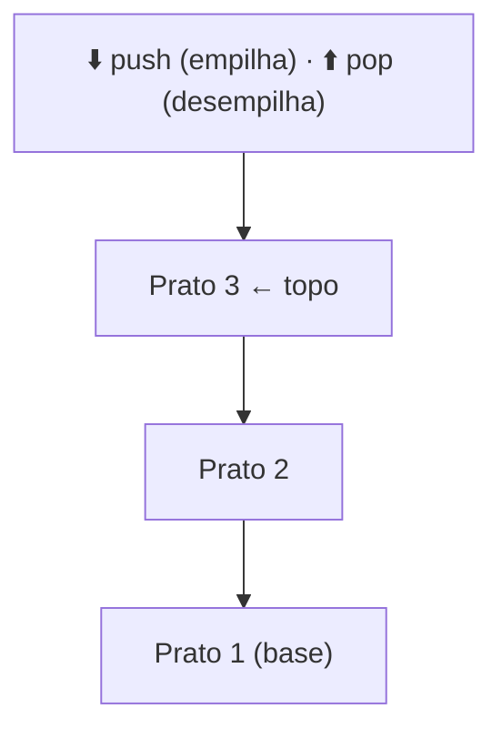

# 2.19 · Pilhas (LIFO)

> **Em uma frase:** uma pilha é como uma **pilha de pratos**: o último que entra é o primeiro que sai (*LIFO: Last In, First Out*), e você só mexe no **topo**.

## 🍽️ Como funciona



Pilhas aparecem em todo lugar na computação:

- o **Ctrl+Z** de um editor (desfaz a última ação primeiro);
- o botão **voltar** do navegador;
- a **pilha de chamadas** de métodos do próprio Java (o famoso *stack trace*);
- conferir se parênteses `( [ { } ] )` estão balanceados.

## 🧰 Operações

| Operação | O que faz |
| --- | --- |
| `push(elemento)` | Coloca no topo |
| `pop()` | Remove e devolve o topo |
| `peek()` (ou `top()`) | Devolve o topo **sem remover** |
| `isEmpty()` | Diz se a pilha está vazia |

## 🛠️ Implementando com nós

Cada nó aponta para o que está **abaixo** dele; a pilha só guarda a referência para o **topo**.

```java
public class Pilha<T> {

    private No<T> topo;   // usa a classe No<T> da aula anterior

    public void push(T conteudo) {
        No<T> novo = new No<>(conteudo);
        novo.setProximo(topo);   // o novo aponta para o antigo topo
        topo = novo;             // e vira o topo
    }

    public T pop() {
        if (isEmpty()) {
            throw new IllegalStateException("A pilha está vazia");
        }
        T removido = topo.getConteudo();
        topo = topo.getProximo();   // o de baixo vira o topo
        return removido;
    }

    public T peek() {
        return isEmpty() ? null : topo.getConteudo();
    }

    public boolean isEmpty() {
        return topo == null;
    }

    @Override
    public String toString() {
        StringBuilder sb = new StringBuilder("topo → ");
        for (No<T> atual = topo; atual != null; atual = atual.getProximo()) {
            sb.append(atual.getConteudo()).append(" → ");
        }
        return sb.append("null").toString();
    }
}
```

```java
Pilha<String> pilha = new Pilha<>();
pilha.push("A");
pilha.push("B");
pilha.push("C");
System.out.println(pilha);        // topo → C → B → A → null
System.out.println(pilha.pop());  // C
System.out.println(pilha.peek()); // B
```

Todas as operações são **O(1)**: levam o mesmo tempo, não importa o tamanho da pilha.

> [!TIP]
> Na prática, você não precisa criar sua própria pilha: o Java já tem o `ArrayDeque` (aula [2.26](./26-stack-e-deque.md)). Implementar uma vez serve para entender como funciona por dentro.

## 📌 Resumindo

- Pilha = LIFO: o último a entrar é o primeiro a sair.
- Operações: `push`, `pop`, `peek`, `isEmpty`, todas O(1).
- Implementação com nós: cada nó aponta para o de baixo, e guardamos só o topo.

## 🏋️ Mão na massa

**1.** Empilhe 1, 2 e 3, depois faça `pop()`, `push(4)` e `pop()`. O que sobra na pilha?

<details>
<summary>Ver resposta</summary>

Depois dos `push`: topo 3, 2, 1. `pop()` remove o 3. `push(4)` → topo 4, 2, 1. `pop()` remove o 4. Sobra **topo 2, 1**.

</details>

**2.** Use uma pilha para inverter a palavra `"JAVA"`.

<details>
<summary>Ver resposta</summary>

```java
Pilha<Character> pilha = new Pilha<>();
for (char c : "JAVA".toCharArray()) {
    pilha.push(c);
}
StringBuilder invertida = new StringBuilder();
while (!pilha.isEmpty()) {
    invertida.append(pilha.pop());
}
System.out.println(invertida);   // AVAJ
```

</details>

**3.** Escreva um método que confira se os parênteses de uma expressão estão balanceados, por exemplo `(a + (b * c))` → `true` e `(a + b))` → `false`.

<details>
<summary>Ver resposta</summary>

```java
public static boolean balanceado(String expressao) {
    Pilha<Character> pilha = new Pilha<>();
    for (char c : expressao.toCharArray()) {
        if (c == '(') {
            pilha.push(c);
        } else if (c == ')') {
            if (pilha.isEmpty()) return false;   // fechou sem ter aberto
            pilha.pop();
        }
    }
    return pilha.isEmpty();                      // sobrou algum aberto?
}
```

</details>

---

<div align="center">

[⬅️ 2.18 Estruturas de dados](./18-estruturas-de-dados.md) &nbsp;|&nbsp; [🏠 Índice](../../README.md) &nbsp;|&nbsp; [2.20 Filas (FIFO) ➡️](./20-filas.md)

</div>
