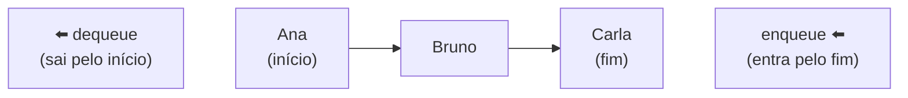

# 2.20 · Filas (FIFO)

> **Em uma frase:** uma fila funciona como a **fila do banco**: quem chega primeiro é atendido primeiro (*FIFO: First In, First Out*); entra-se pelo **fim** e sai-se pelo **início**.

## 🧍 Como funciona



Exemplos reais: fila de impressão, atendimento de chamados, pedidos de um e-commerce, mensagens aguardando processamento.

## 🧰 Operações

| Operação | O que faz |
| --- | --- |
| `enqueue(elemento)` | Coloca no **fim** da fila |
| `dequeue()` | Remove e devolve o **primeiro** |
| `first()` (ou `peek()`) | Devolve o primeiro **sem remover** |
| `isEmpty()` | Diz se a fila está vazia |

## 🛠️ Implementando com nós

Guardamos **duas** referências: o **início** (de onde sai) e o **fim** (onde entra). Assim, tanto entrar quanto sair são operações **O(1)**.

```java
public class Fila<T> {

    private No<T> inicio;   // primeiro da fila (usa a classe No<T> da aula 2.18)
    private No<T> fim;      // último da fila

    public void enqueue(T conteudo) {
        No<T> novo = new No<>(conteudo);
        if (isEmpty()) {
            inicio = novo;              // fila vazia: o novo é início e fim
        } else {
            fim.setProximo(novo);       // o antigo último aponta para o novo
        }
        fim = novo;
    }

    public T dequeue() {
        if (isEmpty()) {
            throw new IllegalStateException("A fila está vazia");
        }
        T removido = inicio.getConteudo();
        inicio = inicio.getProximo();
        if (inicio == null) {
            fim = null;                 // a fila esvaziou
        }
        return removido;
    }

    public T first() {
        return isEmpty() ? null : inicio.getConteudo();
    }

    public boolean isEmpty() {
        return inicio == null;
    }

    @Override
    public String toString() {
        StringBuilder sb = new StringBuilder("início → ");
        for (No<T> atual = inicio; atual != null; atual = atual.getProximo()) {
            sb.append(atual.getConteudo()).append(" → ");
        }
        return sb.append("null").toString();
    }
}
```

```java
Fila<String> fila = new Fila<>();
fila.enqueue("Ana");
fila.enqueue("Bruno");
fila.enqueue("Carla");
System.out.println(fila);            // início → Ana → Bruno → Carla → null
System.out.println(fila.dequeue());  // Ana
fila.enqueue("Daniel");
System.out.println(fila.first());    // Bruno
System.out.println(fila);            // início → Bruno → Carla → Daniel → null
```

> [!NOTE]
> No curso, a fila foi construída guardando só a referência de **entrada** e percorrendo toda a corrente para achar o primeiro a cada `dequeue`. Funciona, mas cada remoção vira **O(n)** (fica mais lenta quanto maior a fila). Guardar também a referência do outro extremo, como acima, deixa tudo O(1).

### A evolução feita no curso

1. Primeiro, a fila recebia objetos `No` prontos: `fila.enqueue(new No("primeiro"))`.
2. Depois, a própria fila passou a criar o nó: `fila.enqueue("primeiro")`. Quem usa não precisa saber que existem nós (isso é **encapsulamento**).
3. Por fim, com **generics**, a fila ganhou um tipo: `Fila<String>` só aceita Strings, e o compilador barra `fila.enqueue(1)`.

> [!TIP]
> No dia a dia, use as filas prontas do Java: `ArrayDeque`, `LinkedList` ou `PriorityQueue` (aula [2.27](./27-queue.md)).

## 📌 Resumindo

- Fila = FIFO: o primeiro a entrar é o primeiro a sair.
- Entra pelo fim (`enqueue`), sai pelo início (`dequeue`).
- Guardando referências para início **e** fim, todas as operações são O(1).

## 🏋️ Mão na massa

**1.** Qual a diferença entre uma pilha e uma fila? Dê um exemplo de cada no mundo real.

<details>
<summary>Ver resposta</summary>

Na **pilha** (LIFO), o último a entrar sai primeiro (ex.: pilha de pratos, Ctrl+Z). Na **fila** (FIFO), o primeiro a entrar sai primeiro (ex.: fila do banco, fila de impressão).

</details>

**2.** Simule no papel: `enqueue(1)`, `enqueue(2)`, `dequeue()`, `enqueue(3)`, `enqueue(4)`, `dequeue()`. Como fica a fila?

<details>
<summary>Ver resposta</summary>

[1] → [1, 2] → sai o 1: [2] → [2, 3] → [2, 3, 4] → sai o 2: **[3, 4]** (3 no início, 4 no fim).

</details>

**3.** Acrescente à classe `Fila<T>` um método `size()` que devolva quantos elementos ela tem, sem percorrer a fila.

<details>
<summary>Ver resposta</summary>

Guarde um contador atualizado nas operações:

```java
private int tamanho;

// no fim do enqueue:  tamanho++;
// no dequeue, antes do return:  tamanho--;

public int size() {
    return tamanho;
}
```

</details>

---

<div align="center">

[⬅️ 2.19 Pilhas (LIFO)](./19-pilhas.md) &nbsp;|&nbsp; [🏠 Índice](../../README.md) &nbsp;|&nbsp; [2.21 Listas encadeadas ➡️](./21-listas-encadeadas.md)

</div>
