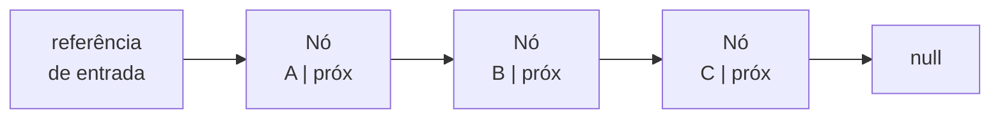
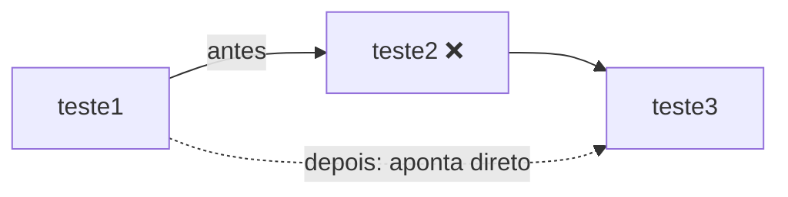

# 2.20 · Listas encadeadas

> **Em uma frase:** uma lista encadeada é uma corrente de nós em que você pode **inserir, buscar e remover em qualquer posição**; ela cresce à vontade, mas para chegar ao elemento de índice `n` é preciso percorrer os `n` anteriores.

## 🔗 Estrutura



Diferente da pilha e da fila (que só mexem nas pontas), a lista permite trabalhar com **índices**: `add`, `get(i)`, `remove(i)`.

## ⚖️ Lista encadeada × array

| | Array | Lista encadeada |
| --- | --- | --- |
| Tamanho | Fixo | Cresce e diminui à vontade |
| Acessar o índice `i` | **Instantâneo** (O(1)) | Precisa percorrer (O(n)) |
| Inserir/remover no início | Precisa deslocar todos (O(n)) | Só troca referências (O(1)) |
| Memória | Só os valores | Valores + uma referência por nó |

> [!NOTE]
> Uma ideia comum, mas errada, é dizer que listas encadeadas são "melhores para acesso aleatório". É o contrário: para acessar posições por índice, o **array** (ou o `ArrayList`) é muito mais rápido.

## 🛠️ Implementação

```java
public class ListaEncadeada<T> {

    private No<T> inicio;   // usa a classe No<T> da aula 2.17
    private int tamanho;

    public void add(T conteudo) {            // adiciona no fim
        No<T> novo = new No<>(conteudo);
        if (inicio == null) {
            inicio = novo;
        } else {
            getNo(tamanho - 1).setProximo(novo);
        }
        tamanho++;
    }

    public T get(int indice) {
        return getNo(indice).getConteudo();
    }

    public T remove(int indice) {
        No<T> alvo = getNo(indice);
        if (indice == 0) {
            inicio = alvo.getProximo();
        } else {
            No<T> anterior = getNo(indice - 1);
            anterior.setProximo(alvo.getProximo());   // "pula" o nó removido
        }
        tamanho--;
        return alvo.getConteudo();
    }

    public int size() { return tamanho; }

    public boolean isEmpty() { return tamanho == 0; }

    private No<T> getNo(int indice) {
        if (indice < 0 || indice >= tamanho) {
            throw new IndexOutOfBoundsException(
                "Índice " + indice + " inválido para lista de tamanho " + tamanho);
        }
        No<T> atual = inicio;
        for (int i = 0; i < indice; i++) {
            atual = atual.getProximo();
        }
        return atual;
    }

    @Override
    public String toString() {
        StringBuilder sb = new StringBuilder();
        for (No<T> atual = inicio; atual != null; atual = atual.getProximo()) {
            sb.append("[").append(atual.getConteudo()).append("] → ");
        }
        return sb.append("null").toString();
    }
}
```

```java
ListaEncadeada<String> lista = new ListaEncadeada<>();
lista.add("teste1");
lista.add("teste2");
lista.add("teste3");
lista.add("teste4");

System.out.println(lista.get(2));      // teste3
System.out.println(lista);             // [teste1] → [teste2] → [teste3] → [teste4] → null
System.out.println(lista.remove(1));   // teste2
System.out.println(lista);             // [teste1] → [teste3] → [teste4] → null
```

### Como a remoção funciona



Basta fazer o nó **anterior** apontar para o **seguinte** do removido. O nó removido fica sem ninguém apontando para ele, e o *Garbage Collector* libera a memória.

> [!TIP]
> Guardar o `tamanho` em um atributo evita percorrer a lista toda só para contar os nós.

## 📌 Resumindo

- Lista encadeada = corrente de nós com operações por índice.
- Inserir/remover nas pontas é barato; acessar por índice exige percorrer.
- Remover = fazer o anterior apontar para o próximo do removido.

## 🏋️ Mão na massa

**1.** Acrescente à `ListaEncadeada` um método `addFirst(T conteudo)` que insira no início em O(1).

<details>
<summary>Ver resposta</summary>

```java
public void addFirst(T conteudo) {
    No<T> novo = new No<>(conteudo);
    novo.setProximo(inicio);
    inicio = novo;
    tamanho++;
}
```

</details>

**2.** Crie um método `contains(T valor)` que diga se o valor está na lista.

<details>
<summary>Ver resposta</summary>

```java
public boolean contains(T valor) {
    for (No<T> atual = inicio; atual != null; atual = atual.getProximo()) {
        if (atual.getConteudo().equals(valor)) {
            return true;
        }
    }
    return false;
}
```

Repare no uso de `.equals()` para comparar conteúdos.

</details>

**3.** Seu programa faz milhares de `get(i)` com índices aleatórios. Lista encadeada ou array/`ArrayList`?

<details>
<summary>Ver resposta</summary>

**Array/`ArrayList`**, porque o acesso por índice é O(1). Na lista encadeada, cada `get(i)` precisa percorrer até `i` nós.

</details>

---

<div align="center">

[⬅️ 2.19 Filas (FIFO)](./19-filas.md) &nbsp;|&nbsp; [🏠 Índice](../../README.md) &nbsp;|&nbsp; [2.21 Listas duplamente encadeadas ➡️](./21-listas-duplamente-encadeadas.md)

</div>
