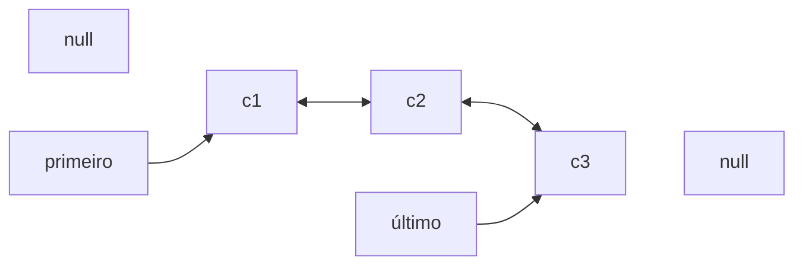

# 2.21 · Listas duplamente encadeadas

> **Em uma frase:** na lista duplamente encadeada, cada nó conhece o **próximo e o anterior**, então dá para percorrer nos dois sentidos e inserir ou remover nas duas pontas de forma rápida.

## ↔️ Estrutura



Cada **nó duplo** tem três partes: a referência para o **anterior**, o **conteúdo** e a referência para o **próximo**. A lista guarda o **primeiro** e o **último** nó.

| | Lista simples | Lista dupla |
| --- | --- | --- |
| Percorrer de trás para frente | ❌ | ✅ |
| Inserir/remover no fim | Precisa achar o penúltimo (O(n)) | O(1) |
| Memória por nó | 1 referência | 2 referências |

> [!NOTE]
> A `LinkedList` do Java é uma lista **duplamente** encadeada.

## 🛠️ Implementação

```java
public class NoDuplo<T> {
    T conteudo;
    NoDuplo<T> anterior;
    NoDuplo<T> proximo;

    NoDuplo(T conteudo) { this.conteudo = conteudo; }
}
```

```java
public class ListaDupla<T> {

    private NoDuplo<T> primeiro;
    private NoDuplo<T> ultimo;
    private int tamanho;

    public void add(T elemento) {                 // adiciona no fim
        NoDuplo<T> novo = new NoDuplo<>(elemento);
        novo.anterior = ultimo;
        if (ultimo == null) {
            primeiro = novo;                      // lista estava vazia
        } else {
            ultimo.proximo = novo;
        }
        ultimo = novo;
        tamanho++;
    }

    public void add(int indice, T elemento) {     // insere numa posição
        if (indice == tamanho) {                  // no fim: reaproveita o add
            add(elemento);
            return;
        }
        NoDuplo<T> atual = getNo(indice);         // quem está hoje na posição
        NoDuplo<T> novo = new NoDuplo<>(elemento);
        novo.proximo = atual;
        novo.anterior = atual.anterior;
        if (atual.anterior == null) {
            primeiro = novo;                      // inserindo no início
        } else {
            atual.anterior.proximo = novo;
        }
        atual.anterior = novo;
        tamanho++;
    }

    public T remove(int indice) {
        NoDuplo<T> alvo = getNo(indice);
        if (alvo.anterior == null) primeiro = alvo.proximo;
        else alvo.anterior.proximo = alvo.proximo;

        if (alvo.proximo == null) ultimo = alvo.anterior;
        else alvo.proximo.anterior = alvo.anterior;

        tamanho--;
        return alvo.conteudo;
    }

    public T get(int indice) { return getNo(indice).conteudo; }

    public int size() { return tamanho; }

    private NoDuplo<T> getNo(int indice) {
        if (indice < 0 || indice >= tamanho) {
            throw new IndexOutOfBoundsException("Índice inválido: " + indice);
        }
        // otimização: começa pela ponta mais próxima
        if (indice < tamanho / 2) {
            NoDuplo<T> atual = primeiro;
            for (int i = 0; i < indice; i++) atual = atual.proximo;
            return atual;
        }
        NoDuplo<T> atual = ultimo;
        for (int i = tamanho - 1; i > indice; i--) atual = atual.anterior;
        return atual;
    }

    @Override
    public String toString() {
        StringBuilder sb = new StringBuilder("null ⇄ ");
        for (NoDuplo<T> n = primeiro; n != null; n = n.proximo) {
            sb.append(n.conteudo).append(" ⇄ ");
        }
        return sb.append("null").toString();
    }
}
```

```java
ListaDupla<String> lista = new ListaDupla<>();
for (int i = 1; i <= 7; i++) lista.add("c" + i);
System.out.println(lista);        // null ⇄ c1 ⇄ c2 ⇄ c3 ⇄ c4 ⇄ c5 ⇄ c6 ⇄ c7 ⇄ null

lista.remove(3);                  // remove c4
lista.add(3, "99");               // coloca 99 no lugar
System.out.println(lista.get(3)); // 99
```

> [!WARNING]
> Ao inserir ou remover, é preciso atualizar **as duas** referências dos vizinhos (`anterior` e `proximo`). Esquecer uma delas é o bug mais comum: a lista "funciona" num sentido e quebra no outro.

## 📌 Resumindo

- Cada nó tem `anterior`, `conteúdo` e `proximo`.
- A lista guarda `primeiro` e `ultimo`: inserir e remover nas pontas é O(1).
- Pode ser percorrida nos dois sentidos; gasta um pouco mais de memória.

## 🏋️ Mão na massa

**1.** Escreva um método que imprima a lista **de trás para frente**.

<details>
<summary>Ver resposta</summary>

```java
public void imprimirInvertido() {
    for (NoDuplo<T> n = ultimo; n != null; n = n.anterior) {
        System.out.print(n.conteudo + " ");
    }
    System.out.println();
}
```

</details>

**2.** Ao remover o **último** nó, quais referências precisam ser atualizadas?

<details>
<summary>Ver resposta</summary>

O `proximo` do penúltimo nó passa a ser `null`, e o atributo `ultimo` da lista passa a apontar para esse penúltimo.

</details>

**3.** Por que a `getNo` começa pela ponta mais próxima do índice?

<details>
<summary>Ver resposta</summary>

Porque, como dá para andar nos dois sentidos, começar pelo fim quando o índice está na segunda metade corta o caminho pela metade no pior caso. É exatamente o que a `LinkedList` do Java faz.

</details>

---

<div align="center">

[⬅️ 2.20 Listas encadeadas](./20-listas-encadeadas.md) &nbsp;|&nbsp; [🏠 Índice](../../README.md) &nbsp;|&nbsp; [2.22 Listas circulares ➡️](./22-listas-circulares.md)

</div>
