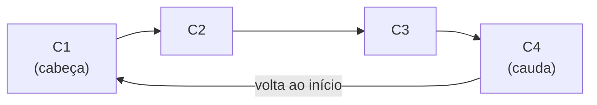

# 2.22 · Listas circulares

> **Em uma frase:** numa lista circular, o último nó aponta de volta para o **primeiro** em vez de `null`, formando um ciclo que pode ser percorrido sem fim, como os ponteiros de um relógio.

## 🔄 Estrutura



- **Cabeça:** o primeiro nó.
- **Cauda:** o último nó, cujo `proximo` aponta para a cabeça.

Na verdade, basta guardar a **cauda**: a cabeça é sempre `cauda.proximo`.

Usos típicos:

- **rodízio** de tarefas (*round-robin*): cada processo recebe um pouco de CPU, e depois do último volta-se ao primeiro;
- **playlists** em modo repetir;
- a vez de cada jogador em um jogo de tabuleiro.

## 🛠️ Implementação

```java
public class ListaCircular<T> {

    private No<T> cauda;     // usa a classe No<T> da aula 2.17
    private int tamanho;

    public void add(T conteudo) {               // adiciona no fim
        No<T> novo = new No<>(conteudo);
        if (cauda == null) {
            novo.setProximo(novo);              // um nó só aponta para si mesmo
        } else {
            novo.setProximo(cauda.getProximo()); // o novo aponta para a cabeça
            cauda.setProximo(novo);
        }
        cauda = novo;                           // e vira a nova cauda
        tamanho++;
    }

    public T get(int indice) {
        if (tamanho == 0) {
            throw new IndexOutOfBoundsException("A lista está vazia");
        }
        No<T> atual = cauda.getProximo();       // começa na cabeça
        for (int i = 0; i < indice; i++) {
            atual = atual.getProximo();         // índices maiores "dão a volta"
        }
        return atual.getConteudo();
    }

    public T remove(int indice) {
        if (indice < 0 || indice >= tamanho) {
            throw new IndexOutOfBoundsException("Índice inválido: " + indice);
        }
        No<T> anterior = cauda;                 // o anterior da cabeça é a cauda
        for (int i = 0; i < indice; i++) {
            anterior = anterior.getProximo();
        }
        No<T> alvo = anterior.getProximo();
        if (tamanho == 1) {
            cauda = null;
        } else {
            anterior.setProximo(alvo.getProximo());
            if (alvo == cauda) cauda = anterior;
        }
        tamanho--;
        return alvo.getConteudo();
    }

    public int size() { return tamanho; }

    @Override
    public String toString() {
        if (tamanho == 0) return "[]";
        StringBuilder sb = new StringBuilder();
        No<T> atual = cauda.getProximo();
        for (int i = 0; i < tamanho; i++) {     // conta as voltas: senão seria infinito!
            sb.append("[").append(atual.getConteudo()).append("] → ");
            atual = atual.getProximo();
        }
        return sb.append("(volta ao início)").toString();
    }
}
```

```java
ListaCircular<String> lista = new ListaCircular<>();
lista.add("C1");
lista.add("C2");
lista.add("C3");
System.out.println(lista);        // [C1] → [C2] → [C3] → (volta ao início)

for (int i = 0; i < 7; i++) {
    System.out.print(lista.get(i) + " ");   // C1 C2 C3 C1 C2 C3 C1
}
```

> [!CAUTION]
> Como não existe `null` no fim, qualquer laço do tipo `while (atual != null)` vira **infinito**. Sempre percorra contando até `tamanho`.

## 📌 Resumindo

- O último nó (cauda) aponta para o primeiro (cabeça).
- Basta guardar a cauda: a cabeça é `cauda.proximo`.
- Ótima para rodízios; cuidado com laços infinitos ao percorrer.

## 🏋️ Mão na massa

**1.** Numa lista circular com `A, B, C`, o que retorna `get(10)`?

<details>
<summary>Ver resposta</summary>

`B`. Com 3 elementos, o índice 10 equivale a `10 % 3 = 1`, que é o `B`.

</details>

**2.** Otimize o `get` para não dar voltas desnecessárias quando o índice for muito grande.

<details>
<summary>Ver resposta</summary>

Use o resto da divisão pelo tamanho antes de percorrer:

```java
int passos = indice % tamanho;
for (int i = 0; i < passos; i++) { ... }
```

</details>

**3.** Simule um rodízio: 3 tarefas e 7 "fatias de tempo". Qual tarefa executa em cada fatia?

<details>
<summary>Ver resposta</summary>

```java
ListaCircular<String> tarefas = new ListaCircular<>();
tarefas.add("Tarefa A");
tarefas.add("Tarefa B");
tarefas.add("Tarefa C");
for (int fatia = 0; fatia < 7; fatia++) {
    System.out.println("Fatia " + fatia + ": " + tarefas.get(fatia));
}
// A, B, C, A, B, C, A
```

</details>

---

<div align="center">

[⬅️ 2.21 Listas duplamente encadeadas](./21-listas-duplamente-encadeadas.md) &nbsp;|&nbsp; [🏠 Índice](../../README.md) &nbsp;|&nbsp; [2.23 Árvores e árvores binárias de busca ➡️](./23-arvores-binarias.md)

</div>
