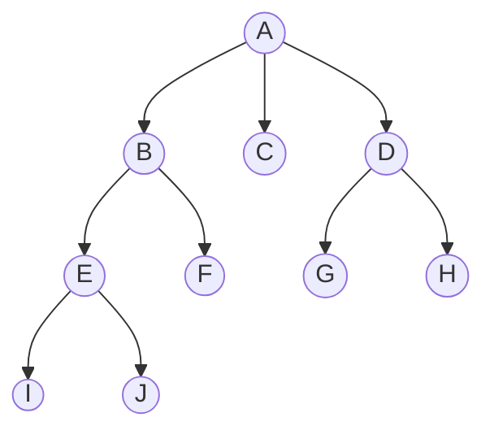
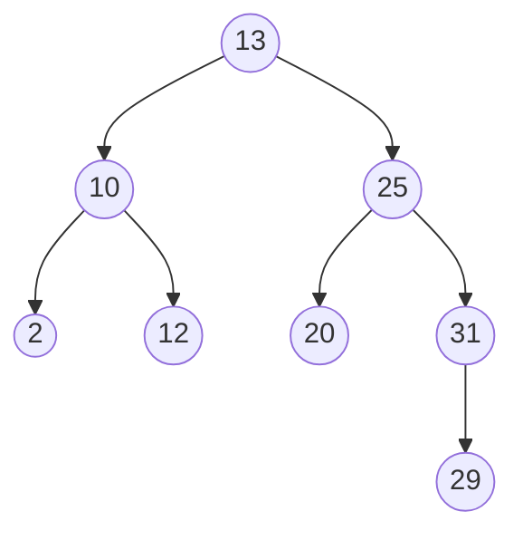
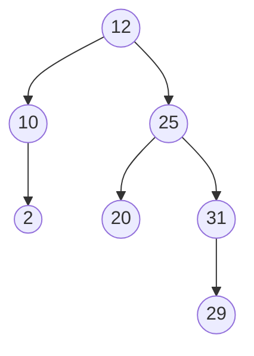

# 2.23 · Árvores e árvores binárias de busca

> **Em uma frase:** uma árvore organiza dados em **hierarquia** (como pastas de um computador); na **árvore binária de busca**, cada nó tem no máximo dois filhos, com os **menores à esquerda** e os **maiores à direita**, o que torna a busca muito rápida.

## 🌳 Vocabulário



| Termo | Significado | No desenho |
| --- | --- | --- |
| **Raiz** | O nó do topo, sem pai | `A` |
| **Pai / filho** | Um nó e os nós logo abaixo dele | `B` é pai de `E` e `F` |
| **Irmãos** | Filhos do mesmo pai | `E` e `F` |
| **Folha** | Nó sem filhos | `I`, `J`, `F`, `C`, `G`, `H` |
| **Profundidade** | Quantas arestas da raiz até o nó | `E` tem profundidade 2 |
| **Altura** | Maior caminho do nó até uma folha | a altura da árvore é 3 |

Árvores aparecem em pastas de arquivos, menus, organogramas, no HTML (DOM) e em índices de bancos de dados. Existem vários tipos: binária, de busca, **AVL** e **rubro-negra** (que se autobalanceiam), **B** e **B+** (usadas em bancos de dados), entre outras.

## 🔎 Árvore binária de busca (BST)

Regra: para **qualquer** nó, tudo à **esquerda** é **menor** e tudo à **direita** é **maior ou igual**.

Inserindo, nesta ordem, `13, 10, 25, 2, 12, 20, 31, 29`:



Para buscar o `29`: 29 > 13 → direita; 29 > 25 → direita; 29 < 31 → esquerda; achou! Em vez de olhar 8 elementos, olhamos 4. Em uma árvore **balanceada** com 1 milhão de elementos, bastam cerca de **20 comparações** (complexidade O(log n)).

> [!WARNING]
> Se você inserir valores já ordenados (1, 2, 3, 4...), a BST vira uma "linha" e perde a vantagem: a busca volta a ser O(n). É por isso que existem árvores **autobalanceadas** (AVL, rubro-negra). O `TreeMap` e o `TreeSet` do Java usam uma rubro-negra.

## 🍎 Comparando objetos: a interface `Comparable`

Para saber o que é "menor" e "maior", os objetos precisam ser comparáveis. Classes como `Integer` e `String` já implementam `Comparable`. Nas suas classes, implemente o método `compareTo`, que deve retornar:

- um número **negativo** se `this` for menor que o outro;
- **zero** se forem iguais;
- um número **positivo** se `this` for maior.

```java
public class Aluno implements Comparable<Aluno> {
    private final String nome;
    private final double nota;

    public Aluno(String nome, double nota) { this.nome = nome; this.nota = nota; }

    @Override
    public int compareTo(Aluno outro) {
        return Double.compare(this.nota, outro.nota);   // compara pela nota
    }

    @Override
    public String toString() { return nome + "(" + nota + ")"; }
}
```

## 🚶 Percursos (*traversals*)

| Percurso | Ordem de visita | Resultado na árvore acima | Uso típico |
| --- | --- | --- | --- |
| **Em ordem** (*in-order*) | esquerda → **raiz** → direita | 2, 10, 12, 13, 20, 25, 29, 31 | Listar em **ordem crescente** |
| **Pré-ordem** (*pre-order*) | **raiz** → esquerda → direita | 13, 10, 2, 12, 25, 20, 31, 29 | Copiar a árvore |
| **Pós-ordem** (*post-order*) | esquerda → direita → **raiz** | 2, 12, 10, 20, 29, 31, 25, 13 | Apagar a árvore (filhos antes do pai) |

> [!TIP]
> Para lembrar: o nome diz **onde a raiz entra**. *Pré* = antes, *em* = no meio, *pós* = depois.

## 🛠️ Implementação

```java
public class ArvoreBinaria<T extends Comparable<T>> {

    private static class No<T> {
        T valor;
        No<T> esquerda, direita;
        No(T valor) { this.valor = valor; }
    }

    private No<T> raiz;

    // ---------- inserção ----------
    public void inserir(T valor) {
        raiz = inserir(raiz, valor);
    }

    private No<T> inserir(No<T> atual, T valor) {
        if (atual == null) return new No<>(valor);          // achou o lugar
        if (valor.compareTo(atual.valor) < 0) {
            atual.esquerda = inserir(atual.esquerda, valor);  // menor: esquerda
        } else {
            atual.direita = inserir(atual.direita, valor);    // maior/igual: direita
        }
        return atual;
    }

    // ---------- busca ----------
    public boolean contem(T valor) {
        No<T> atual = raiz;
        while (atual != null) {
            int cmp = valor.compareTo(atual.valor);
            if (cmp == 0) return true;
            atual = cmp < 0 ? atual.esquerda : atual.direita;
        }
        return false;
    }

    // ---------- percursos ----------
    public void emOrdem()  { emOrdem(raiz);  System.out.println(); }
    public void preOrdem() { preOrdem(raiz); System.out.println(); }
    public void posOrdem() { posOrdem(raiz); System.out.println(); }

    private void emOrdem(No<T> n) {
        if (n == null) return;
        emOrdem(n.esquerda);
        System.out.print(n.valor + " ");
        emOrdem(n.direita);
    }

    private void preOrdem(No<T> n) {
        if (n == null) return;
        System.out.print(n.valor + " ");
        preOrdem(n.esquerda);
        preOrdem(n.direita);
    }

    private void posOrdem(No<T> n) {
        if (n == null) return;
        posOrdem(n.esquerda);
        posOrdem(n.direita);
        System.out.print(n.valor + " ");
    }

    // ---------- remoção ----------
    public void remover(T valor) {
        raiz = remover(raiz, valor);
    }

    private No<T> remover(No<T> atual, T valor) {
        if (atual == null) return null;                      // não encontrado
        int cmp = valor.compareTo(atual.valor);
        if (cmp < 0) {
            atual.esquerda = remover(atual.esquerda, valor);
        } else if (cmp > 0) {
            atual.direita = remover(atual.direita, valor);
        } else {
            // Caso 1 e 2: zero ou um filho → o filho (ou null) ocupa o lugar
            if (atual.esquerda == null) return atual.direita;
            if (atual.direita == null) return atual.esquerda;
            // Caso 3: dois filhos → substitui pelo MAIOR da subárvore esquerda
            No<T> maiorDaEsquerda = atual.esquerda;
            while (maiorDaEsquerda.direita != null) {
                maiorDaEsquerda = maiorDaEsquerda.direita;
            }
            atual.valor = maiorDaEsquerda.valor;
            atual.esquerda = remover(atual.esquerda, maiorDaEsquerda.valor);
        }
        return atual;
    }
}
```

```java
ArvoreBinaria<Integer> arvore = new ArvoreBinaria<>();
for (int v : new int[]{13, 10, 25, 2, 12, 20, 31, 29}) arvore.inserir(v);

arvore.emOrdem();    // 2 10 12 13 20 25 29 31
arvore.preOrdem();   // 13 10 2 12 25 20 31 29
arvore.posOrdem();   // 2 12 10 20 29 31 25 13

arvore.remover(13);  // remove a raiz (tem dois filhos)
arvore.emOrdem();    // 2 10 12 20 25 29 31
```

### Os três casos da remoção

| Caso | O que fazer |
| --- | --- |
| Nó **folha** | Basta apagá-lo (o pai passa a apontar para `null`). |
| Nó com **um filho** | O filho ocupa o lugar dele. |
| Nó com **dois filhos** | Troque o valor pelo **maior da subárvore esquerda** (ou pelo menor da direita) e remova esse nó lá embaixo. |

No exemplo, remover o `13` (raiz) coloca no lugar dele o `12`, o maior valor à sua esquerda:



> [!NOTE]
> Os métodos acima usam **recursão**: um método que chama a si mesmo com um problema menor (a subárvore), até chegar ao caso mais simples (`null`). Árvores são o exemplo perfeito para recursão.

## 📌 Resumindo

- Árvore = hierarquia de nós (raiz, pais, filhos, folhas).
- BST: menores à esquerda, maiores à direita; busca em O(log n) se balanceada.
- Objetos precisam implementar `Comparable` (`compareTo`).
- Percursos: em ordem (crescente), pré-ordem e pós-ordem.
- Remoção tem 3 casos; com dois filhos, use o maior da esquerda.

## 🏋️ Mão na massa

**1.** Desenhe a BST resultante de inserir `50, 30, 70, 20, 40, 60, 80` e escreva o percurso em ordem.

<details>
<summary>Ver resposta</summary>

```text
        50
      /    \
    30      70
   /  \    /  \
  20  40  60  80
```

Em ordem: `20 30 40 50 60 70 80` (sempre crescente numa BST).

</details>

**2.** Acrescente à `ArvoreBinaria` os métodos `minimo()` e `maximo()`.

<details>
<summary>Ver resposta</summary>

O menor está no nó mais à esquerda; o maior, no mais à direita:

```java
public T minimo() {
    No<T> n = raiz;
    while (n.esquerda != null) n = n.esquerda;
    return n.valor;
}

public T maximo() {
    No<T> n = raiz;
    while (n.direita != null) n = n.direita;
    return n.valor;
}
```

(Em código real, trate a árvore vazia antes: se `raiz == null`, lance uma exceção ou retorne `null`.)

</details>

**3.** Por que inserir `1, 2, 3, 4, 5` nessa ordem deixa a árvore lenta?

<details>
<summary>Ver resposta</summary>

Cada valor é maior que o anterior, então todos vão para a direita e a árvore vira uma "lista" de altura 5. A busca deixa de ser O(log n) e passa a ser O(n). Árvores autobalanceadas (AVL, rubro-negra) evitam esse problema.

</details>

---

<div align="center">

[⬅️ 2.22 Listas circulares](./22-listas-circulares.md) &nbsp;|&nbsp; [🏠 Índice](../../README.md) &nbsp;|&nbsp; [2.24 equals() e hashCode() ➡️](./24-equals-e-hashcode.md)

</div>
