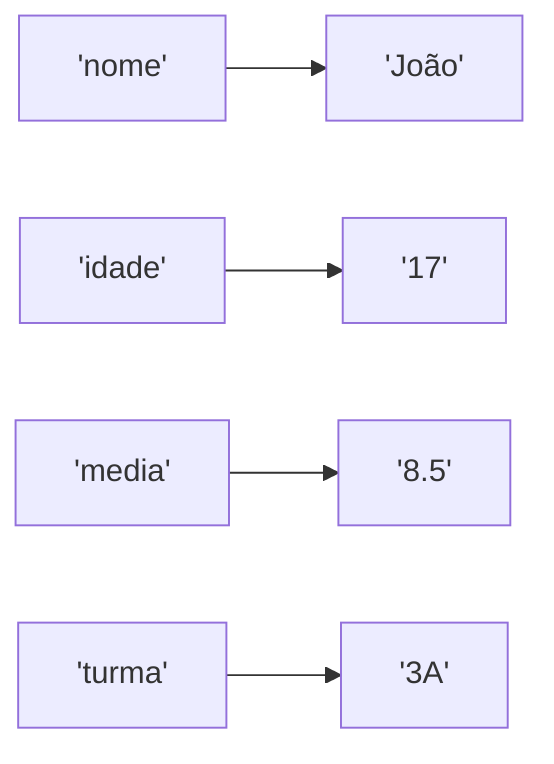

# 2.29 · Mapas: a interface `Map`

> **Em uma frase:** um `Map` guarda pares **chave → valor**, como um dicionário (palavra → significado); cada chave é única e serve para encontrar o valor rapidamente.

## 📖 A ideia



- As **chaves** não se repetem (colocar de novo uma chave existente **substitui** o valor).
- **Valores** podem se repetir.
- Assinatura: `Map<K, V>`, onde `K` é o tipo da chave e `V` o do valor.

> [!NOTE]
> `Map` **não** é uma `Collection` (não herda dessa interface), mas faz parte do mesmo *framework* de coleções.

## 🧰 Principais métodos

| Método | O que faz |
| --- | --- |
| `put(k, v)` | Associa o valor à chave (substitui se já existir) |
| `get(k)` / `getOrDefault(k, padrão)` | Devolve o valor (ou `null` / o padrão) |
| `containsKey(k)` / `containsValue(v)` | Tem essa chave? / tem esse valor? |
| `remove(k)` | Remove o par |
| `keySet()` / `values()` / `entrySet()` | Todas as chaves / todos os valores / todos os pares |
| `size()` / `isEmpty()` / `clear()` | Tamanho / vazio? / esvazia |

## 🏗️ Implementações

| Classe | Ordem das chaves | Velocidade |
| --- | --- | --- |
| **`HashMap`** | Nenhuma garantida; aceita uma chave `null` | O(1) em média |
| **`LinkedHashMap`** | Ordem de **inserção** | Quase igual ao `HashMap` |
| **`TreeMap`** | **Ordenadas**; oferece `firstKey()`, `lastKey()`, `headMap()`, `tailMap()` | O(log n) |

```java
Map<String, String> aluno = new HashMap<>();
aluno.put("nome", "João");
aluno.put("idade", "17");
aluno.put("media", "8.5");
aluno.put("turma", "3A");

System.out.println(aluno.get("nome"));          // João
System.out.println(aluno.keySet());             // as chaves
System.out.println(aluno.values());             // os valores
System.out.println(aluno.containsKey("nome"));  // true

for (Map.Entry<String, String> par : aluno.entrySet()) {
    System.out.println(par.getKey() + " = " + par.getValue());
}
```

> [!TIP]
> No exemplo acima, um mapa faz o papel de um "objeto aluno". Funciona, mas em Java o ideal é criar uma **classe** (ou `record`) `Aluno` com atributos tipados (`int idade`, `double media`). Use `Map` quando as chaves forem **dados** (ex.: CPF → Cliente, palavra → quantidade de vezes).

### Exemplo útil: contar ocorrências

```java
String frase = "o rato roeu a roupa do rei de roma";
Map<Character, Integer> contagem = new TreeMap<>();
for (char c : frase.replace(" ", "").toCharArray()) {
    contagem.merge(c, 1, Integer::sum);   // soma 1 (ou começa em 1)
}
System.out.println(contagem);   // {a=4, d=2, e=3, i=1, m=1, o=6, ...}
```

Mais exemplos e exercícios na aula [4.10 · Map](../04-poo/10-map.md).

## 📌 Resumindo

- `Map<K, V>` guarda pares chave → valor, com chaves únicas.
- `HashMap` (rápido, sem ordem), `LinkedHashMap` (ordem de inserção), `TreeMap` (chaves ordenadas).
- Percorra com `entrySet()`; use `getOrDefault` e `merge` para evitar `null`.

## 🏋️ Mão na massa

**1.** Crie um mapa de estados (sigla → nome) e imprima o nome de `"SP"`.

<details>
<summary>Ver resposta</summary>

```java
Map<String, String> estados = new HashMap<>();
estados.put("RJ", "Rio de Janeiro");
estados.put("SP", "São Paulo");
System.out.println(estados.get("SP"));   // São Paulo
```

</details>

**2.** O que acontece com `mapa.put("RJ", "Rio")` se a chave `"RJ"` já existir?

<details>
<summary>Ver resposta</summary>

O valor antigo é **substituído** por `"Rio"`, e o método devolve o valor antigo.

</details>

**3.** Conte quantas vezes cada palavra aparece em `"java é legal e java é rápido"`.

<details>
<summary>Ver resposta</summary>

```java
Map<String, Integer> contagem = new LinkedHashMap<>();
for (String palavra : "java é legal e java é rápido".split(" ")) {
    contagem.merge(palavra, 1, Integer::sum);
}
System.out.println(contagem);   // {java=2, é=2, legal=1, e=1, rápido=1}
```

</details>

---

<div align="center">

[⬅️ 2.28 Conjuntos](./28-set.md) &nbsp;|&nbsp; [🏠 Índice](../../README.md) &nbsp;|&nbsp; [2.30 Métodos ➡️](./30-metodos-conceitos.md)

</div>
