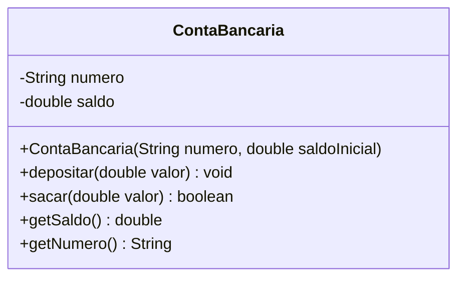

# 4.1 · Classes, objetos, atributos, métodos e encapsulamento

> **Em uma frase:** uma **classe** é a "planta" ou a "forma de bolo" que descreve atributos e comportamentos; um **objeto** é cada bolo feito com essa forma, com seus próprios valores.

## 🍰 Classe × objeto

| Conceito | Analogia | Em código |
| --- | --- | --- |
| **Classe** | A planta de uma casa / a forma de bolo | `public class ContaBancaria { ... }` |
| **Objeto** (instância) | Cada casa construída / cada bolo | `new ContaBancaria("1234-5", 1000)` |
| **Atributo** | Características (cor da casa, sabor do bolo) | `private double saldo;` |
| **Método** | Ações (abrir a porta, fatiar o bolo) | `public void depositar(double valor)` |
| **Mensagem** | Pedir para um objeto fazer algo | `conta.depositar(500);` |



## 🛠️ Na prática

```java
public class ContaBancaria {

    // atributos: o ESTADO de cada objeto
    private final String numero;
    private double saldo;

    // construtor: deixa o objeto pronto para uso
    public ContaBancaria(String numero, double saldoInicial) {
        this.numero = numero;
        this.saldo = saldoInicial;
    }

    // métodos: o COMPORTAMENTO
    public void depositar(double valor) {
        if (valor <= 0) {
            throw new IllegalArgumentException("O depósito deve ser positivo");
        }
        saldo += valor;
    }

    public boolean sacar(double valor) {
        if (valor <= 0 || valor > saldo) {
            return false;            // saque recusado
        }
        saldo -= valor;
        return true;
    }

    public double getSaldo() { return saldo; }
    public String getNumero() { return numero; }
}
```

```java
public class Banco {
    public static void main(String[] args) {
        ContaBancaria conta1 = new ContaBancaria("1234-5", 1000.0);
        ContaBancaria conta2 = new ContaBancaria("5678-9", 500.0);

        conta1.depositar(500.0);     // mensagem para conta1
        conta2.sacar(100.0);         // mensagem para conta2

        System.out.println(conta1.getNumero() + ": " + conta1.getSaldo());  // 1500.0
        System.out.println(conta2.getNumero() + ": " + conta2.getSaldo());  // 400.0
    }
}
```

Cada objeto tem **seu próprio** saldo: depositar em `conta1` não muda `conta2`.

> [!NOTE]
> Para simplificar os exemplos, usamos `double` no saldo. Em um sistema bancário de verdade, use `BigDecimal` (aula [2.4](../02-java/04-tipos-e-variaveis.md)).

## 🔒 Encapsulamento

Repare que os atributos são `private` e que o saldo só muda pelos métodos `depositar` e `sacar`. Isso é **encapsulamento**: o objeto **protege seu estado** e só permite alterações que respeitam as regras (não dá para depositar valor negativo nem sacar mais que o saldo).

Se o atributo fosse `public`, qualquer parte do código poderia fazer `conta.saldo = -1000000;`.

> [!TIP]
> **Regra prática:** atributos `private`; crie **getters** só para o que precisa ser lido e **setters** só para o que realmente pode mudar livremente. Muitas vezes, um método com nome de negócio (`depositar`) é melhor que um `setSaldo`.

## 🧱 Os 4 pilares da Orientação a Objetos

| Pilar | Ideia | Onde estudar |
| --- | --- | --- |
| **Abstração** | Representar só o que importa do mundo real (uma conta tem número e saldo; a cor da agência não importa). | Esta aula |
| **Encapsulamento** | Esconder o estado e expor só operações seguras. | Esta aula |
| **Herança** | Reaproveitar características de uma classe em outra ("é um"). | [4.2](./02-heranca-e-polimorfismo.md) |
| **Polimorfismo** | O mesmo comando se comporta de jeitos diferentes conforme o objeto. | [4.2](./02-heranca-e-polimorfismo.md) |

## 📌 Resumindo

- Classe = molde; objeto = instância criada com `new`.
- Atributos guardam o estado; métodos definem o comportamento.
- Encapsulamento: atributos `private` e alterações só por métodos que validam as regras.
- Pilares da OO: abstração, encapsulamento, herança e polimorfismo.

## 🏋️ Mão na massa

**1.** Crie a classe `Carro` com cor, modelo e capacidade do tanque, e um método que calcule quanto custa encher o tanque a partir do preço do litro.

<details>
<summary>Ver resposta</summary>

```java
public class Carro {
    private String cor;
    private String modelo;
    private int capacidadeTanque;

    public Carro(String cor, String modelo, int capacidadeTanque) {
        this.cor = cor;
        this.modelo = modelo;
        this.capacidadeTanque = capacidadeTanque;
    }

    public double custoParaEncher(double precoLitro) {
        return capacidadeTanque * precoLitro;
    }

    public String getModelo() { return modelo; }
}

// no main:
Carro carro = new Carro("Prata", "Toyota Etios", 50);
System.out.println("Encher o tanque: R$ " + carro.custoParaEncher(5.89));
```

</details>

**2.** Por que é ruim deixar o atributo `saldo` da conta como `public`?

<details>
<summary>Ver resposta</summary>

Porque qualquer código poderia alterar o saldo diretamente (`conta.saldo = -999`), ignorando as regras de negócio. Com `private` + métodos, toda alteração passa por validações.

</details>

**3.** Acrescente à `ContaBancaria` um método `transferir(ContaBancaria destino, double valor)`.

<details>
<summary>Ver resposta</summary>

```java
public boolean transferir(ContaBancaria destino, double valor) {
    if (!sacar(valor)) {
        return false;          // saldo insuficiente ou valor inválido
    }
    destino.depositar(valor);
    return true;
}
```

O método reaproveita `sacar` e `depositar`, mantendo as validações num lugar só.

</details>

---

<div align="center">

[⬅️ 3.5 Fibonacci](../03-desafios-basicos/05-fibonacci.md) &nbsp;|&nbsp; [🏠 Índice](../../README.md) &nbsp;|&nbsp; [4.2 Herança, upcast/downcast e polimorfismo ➡️](./02-heranca-e-polimorfismo.md)

</div>
