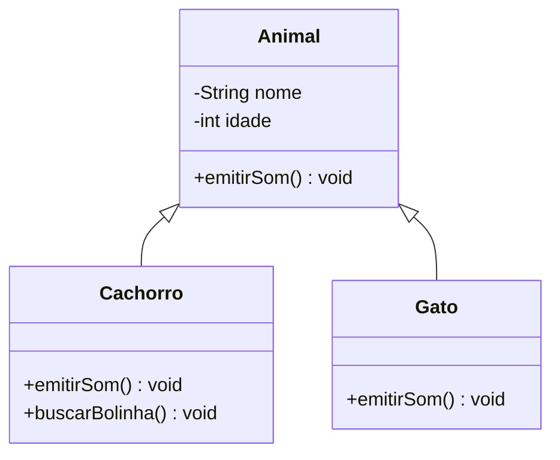
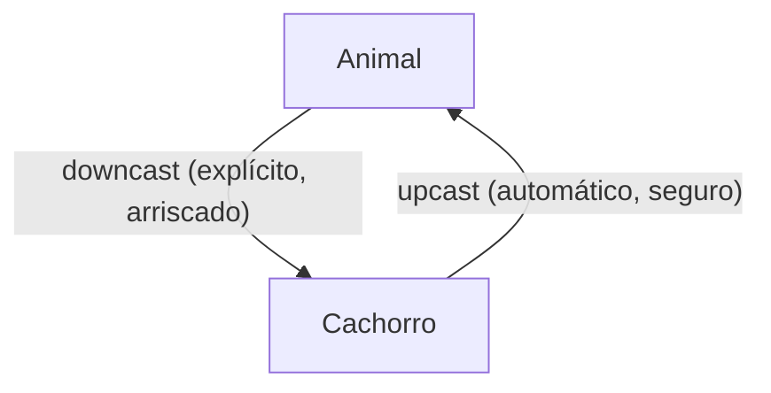

# 4.2 · Herança, upcast/downcast e polimorfismo

> **Em uma frase:** **herança** cria uma classe filha que reaproveita atributos e métodos da classe pai (relação "**é um**"); **polimorfismo** permite tratar objetos diferentes pelo tipo do pai, e cada um responde do seu jeito.

## 🧬 Herança com `extends`

```java
// superclasse (classe pai)
public class Animal {
    private final String nome;
    private final int idade;

    public Animal(String nome, int idade) {
        this.nome = nome;
        this.idade = idade;
    }

    public String getNome() { return nome; }
    public int getIdade() { return idade; }

    public void emitirSom() {
        System.out.println("O animal faz um som.");
    }
}
```

```java
// subclasse (classe filha): Cachorro "é um" Animal
public class Cachorro extends Animal {

    public Cachorro(String nome, int idade) {
        super(nome, idade);            // chama o construtor do pai
    }

    @Override
    public void emitirSom() {          // sobrescreve o método do pai
        System.out.println(getNome() + " late: Au au!");
    }

    public void buscarBolinha() {      // comportamento só do cachorro
        System.out.println(getNome() + " foi buscar a bolinha.");
    }
}
```

```java
public class Gato extends Animal {
    public Gato(String nome, int idade) { super(nome, idade); }

    @Override
    public void emitirSom() {
        System.out.println(getNome() + " mia: Miau!");
    }
}
```

```java
Cachorro rex = new Cachorro("Rex", 3);
System.out.println(rex.getNome());   // Rex (herdado)
rex.emitirSom();                     // Rex late: Au au! (sobrescrito)
rex.buscarBolinha();                 // método próprio
```



> [!NOTE]
> - O `super(...)` chama o construtor da classe pai e precisa ser a **primeira linha** do construtor da filha.
> - A filha herda os membros `private`, mas não consegue acessá-los diretamente: usa os getters (ou membros `protected`).
> - Toda classe Java herda, direta ou indiretamente, de **`Object`** (por isso todo objeto tem `toString()`, `equals()` e `hashCode()`).

## 🚫 Herança múltipla

Java **não** permite que uma classe estenda duas classes (`class Pato extends Animal, Ave` não compila). Para combinar vários comportamentos, uma classe pode **implementar várias interfaces**:

```java
interface Nadador { void nadar(); }
interface Voador  { void voar(); }

class Pato extends Animal implements Nadador, Voador {
    Pato(String nome) { super(nome, 1); }
    public void nadar() { System.out.println("Nadando..."); }
    public void voar()  { System.out.println("Voando..."); }
}
```

Interfaces são o assunto da aula [4.4](./04-interfaces.md).

## ⬆️⬇️ Upcast e downcast



- **Upcast**: tratar a filha como o pai. É **automático** e sempre seguro (todo cachorro é um animal).
- **Downcast**: tratar o pai como a filha. Exige *casting* explícito e **pode falhar** (nem todo animal é um cachorro).

```java
Animal animal = new Cachorro("Rex", 3);   // upcast automático
animal.emitirSom();                        // Rex late: Au au!
// animal.buscarBolinha();                 ❌ não compila: o tipo da variável é Animal

if (animal instanceof Cachorro cachorro) { // testa E converte (Java 16+)
    cachorro.buscarBolinha();              // ✅ seguro
}

Animal outro = new Gato("Mia", 2);
Cachorro erro = (Cachorro) outro;          // 💥 ClassCastException em tempo de execução
```

> [!TIP]
> Antes de um downcast, **sempre** confira com `instanceof`. Se você precisa fazer muitos downcasts, provavelmente o design pode melhorar com polimorfismo.

## 🎭 Polimorfismo

"Muitas formas": a **mesma chamada** executa comportamentos diferentes, dependendo do **objeto real**.

```java
List<Animal> animais = List.of(new Cachorro("Rex", 3), new Gato("Mia", 2));

for (Animal a : animais) {
    a.emitirSom();     // cada objeto responde do seu jeito
}
// Rex late: Au au!
// Mia mia: Miau!
```

O código do laço não precisa saber quais animais existem. Se amanhã surgir a classe `Vaca`, ele continua funcionando sem mudar nada. Essa é a grande vantagem do polimorfismo.

### Sobrescrita × polimorfismo

- **Sobrescrita** é o **mecanismo**: a filha reescreve um método do pai (com `@Override`).
- **Polimorfismo** é o **efeito**: chamar esse método por uma referência do tipo pai executa a versão do objeto real.

## ⚠️ Quando **não** usar herança

Use herança só quando a relação "**é um**" for verdadeira **sempre**. Para "**tem um**" (um carro *tem um* motor), use **associação** (aula [4.3](./03-associacao.md)). Uma frase famosa resume: *"prefira composição a herança"*.

## 📌 Resumindo

- `extends` cria a herança; `super(...)` chama o construtor do pai.
- Java não tem herança múltipla de classes, mas uma classe pode implementar várias interfaces.
- Upcast é automático; downcast é explícito, arriscado e deve vir com `instanceof`.
- Polimorfismo: a mesma chamada, comportamentos diferentes conforme o objeto real.

## 🏋️ Mão na massa

**1.** Crie as classes `Funcionario` (nome, salário, método `bonificacao()` que retorna 10% do salário) e `Gerente` (bonificação de 20%).

<details>
<summary>Ver resposta</summary>

```java
public class Funcionario {
    protected final String nome;
    protected final double salario;

    public Funcionario(String nome, double salario) {
        this.nome = nome;
        this.salario = salario;
    }

    public double bonificacao() { return salario * 0.10; }
}

public class Gerente extends Funcionario {
    public Gerente(String nome, double salario) { super(nome, salario); }

    @Override
    public double bonificacao() { return salario * 0.20; }
}
```

</details>

**2.** Usando as classes do exercício 1, some a bonificação de uma lista com 2 funcionários (salário 3000) e 1 gerente (salário 8000).

<details>
<summary>Ver resposta</summary>

```java
List<Funcionario> equipe = List.of(
        new Funcionario("Ana", 3000),
        new Funcionario("Bruno", 3000),
        new Gerente("Carla", 8000));

double total = 0;
for (Funcionario f : equipe) total += f.bonificacao();
System.out.println(total);   // 300 + 300 + 1600 = 2200.0
```

Graças ao polimorfismo, cada objeto calcula a própria bonificação.

</details>

**3.** "Um `Carro` estende `Motor` porque usa um motor." Essa herança faz sentido?

<details>
<summary>Ver resposta</summary>

**Não.** Um carro não **é** um motor, ele **tem** um motor. O correto é uma associação (composição): a classe `Carro` tem um atributo `Motor motor`.

</details>

---

<div align="center">

[⬅️ 4.1 Classes, objetos, atributos, métodos e encapsulamento](./01-classes-e-objetos.md) &nbsp;|&nbsp; [🏠 Índice](../../README.md) &nbsp;|&nbsp; [4.3 Associação ➡️](./03-associacao.md)

</div>
