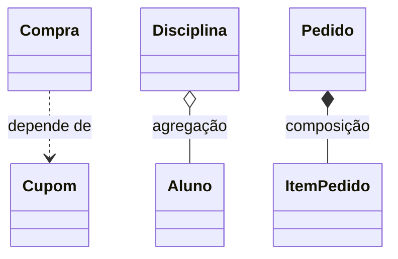

# 4.3 · Associação: dependência, agregação e composição

> **Em uma frase:** associação é quando uma classe **usa** ou **tem** objetos de outra; ela pode ser uma simples **dependência** ("usa"), uma **agregação** ("tem, mas a parte vive sozinha") ou uma **composição** ("tem, e a parte não existe sem o todo").

## 🔗 Os três tipos

| Tipo | Relação | Exemplo | A "parte" vive sozinha? |
| --- | --- | --- | --- |
| **Dependência** | "usa / depende de" | Uma `Compra` **usa** um `Cupom` no método `finalizar(Cupom cupom)` | — (nem é guardada) |
| **Agregação** | "tem, sem posse" | Uma `Disciplina` **tem** `Aluno`s | ✅ Sim: o aluno existe sem a disciplina |
| **Composição** | "é feito de" | Um `Pedido` **é feito de** `ItemPedido`s | ❌ Não: o item não faz sentido sem o pedido |



No diagrama UML: a linha **tracejada** é dependência, o **losango vazio** é agregação e o **losango cheio** é composição.

## 🛠️ Em código

### Dependência

O objeto só aparece como **parâmetro** ou variável local, sem ser guardado:

```java
public class Compra {
    public void finalizar(Cupom cupom) {          // usa Cupom só aqui
        double desconto = cupom.getPercentual();
        // ...
    }
}
```

### Agregação

O objeto é **recebido de fora** e guardado como atributo; ele continua existindo independentemente:

```java
public class Disciplina {
    private final List<Aluno> alunos = new ArrayList<>();

    public void matricular(Aluno aluno) {         // o aluno já existia antes
        alunos.add(aluno);
    }
}
```

### Composição

O todo **cria e controla** as partes; quando o todo deixa de existir, as partes também:

```java
public class Pedido {
    private final List<ItemPedido> itens = new ArrayList<>();

    public void adicionarItem(String produto, int quantidade, double preco) {
        itens.add(new ItemPedido(produto, quantidade, preco));   // criado pelo Pedido
    }
}
```

### Exemplo completo: pessoa e endereço

```java
public class Endereco {
    private final String logradouro;
    private final int numero;
    private final String bairro;

    public Endereco(String logradouro, int numero, String bairro) {
        this.logradouro = logradouro;
        this.numero = numero;
        this.bairro = bairro;
    }

    @Override
    public String toString() {
        return logradouro + ", " + numero + " - " + bairro;
    }
}

public class Pessoa {
    private final String nome;
    private final Endereco endereco;          // Pessoa TEM UM Endereco

    public Pessoa(String nome, Endereco endereco) {
        this.nome = nome;
        this.endereco = endereco;
    }

    public void apresentar() {
        System.out.println("Olá, sou " + nome + " e moro em " + endereco);
    }
}
```

```java
Endereco endereco = new Endereco("Rua 1", 123, "Centro");
Pessoa pessoa = new Pessoa("Fulano", endereco);
pessoa.apresentar();   // Olá, sou Fulano e moro em Rua 1, 123 - Centro
```

> [!NOTE]
> Se o endereço é cadastrado à parte e pode ser compartilhado, é **agregação**. Se ele só existe como parte daquela pessoa, é **composição**. A diferença está na **regra de negócio**, não na sintaxe: o código é muito parecido.

> [!TIP]
> Associação ("tem um") costuma ser mais flexível que herança ("é um"). Na dúvida, prefira compor objetos.

## 📌 Resumindo

- **Dependência**: usa outro objeto temporariamente (parâmetro).
- **Agregação**: tem outro objeto, que vive de forma independente.
- **Composição**: o todo cria e controla as partes, que não existem sem ele.

## 🏋️ Mão na massa

**1.** Classifique: (a) `Carro` e `Motor` (o motor é parte do carro); (b) `Time` e `Jogador`; (c) `Relatorio` que recebe uma `Impressora` no método `imprimir`.

<details>
<summary>Ver resposta</summary>

(a) **Composição** (no modelo do sistema, o motor é parte do carro). (b) **Agregação** (o jogador existe sem o time e pode mudar de time). (c) **Dependência** (a impressora só é usada no método).

</details>

**2.** Crie as classes `Turma` e `Aluno`, onde uma turma pode ter vários alunos, com um método que lista os nomes.

<details>
<summary>Ver resposta</summary>

```java
public class Aluno {
    private final String nome;
    public Aluno(String nome) { this.nome = nome; }
    public String getNome() { return nome; }
}

public class Turma {
    private final List<Aluno> alunos = new ArrayList<>();

    public void adicionar(Aluno aluno) { alunos.add(aluno); }

    public void listar() {
        for (Aluno a : alunos) System.out.println(a.getNome());
    }
}
```

</details>

**3.** Por que a relação `Pessoa` → `Endereco` é melhor como associação do que como herança?

<details>
<summary>Ver resposta</summary>

Porque uma pessoa não **é** um endereço; ela **tem** um endereço. Usar herança obrigaria a pessoa a herdar coisas sem sentido (como `getLogradouro()` em uma pessoa) e impediria ter mais de um endereço.

</details>

---

<div align="center">

[⬅️ 4.2 Herança, upcast/downcast e polimorfismo](./02-heranca-e-polimorfismo.md) &nbsp;|&nbsp; [🏠 Índice](../../README.md) &nbsp;|&nbsp; [4.4 Interfaces ➡️](./04-interfaces.md)

</div>
