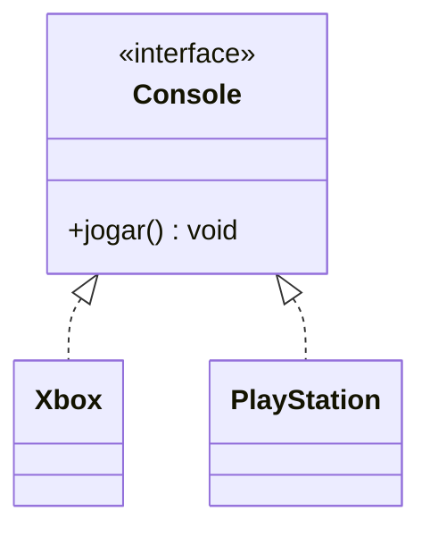

# 4.4 · Interfaces

> **Em uma frase:** uma interface é um **contrato**: ela diz **o que** uma classe deve saber fazer, sem dizer **como**; qualquer classe que assine o contrato (`implements`) pode ser usada no lugar dela.

## 📝 O contrato

```java
public interface Console {
    void jogar();                    // o que todo console deve saber fazer
}
```

```java
public class Xbox implements Console {
    @Override
    public void jogar() {
        System.out.println("Jogando no Xbox...");
    }
}

public class PlayStation implements Console {
    @Override
    public void jogar() {
        System.out.println("Jogando no PlayStation...");
    }
}
```

```java
List<Console> consoles = List.of(new Xbox(), new PlayStation());
for (Console c : consoles) {
    c.jogar();     // polimorfismo por interface
}
```



> [!TIP]
> **Analogia:** a tomada da parede é uma interface. Ela define o formato do encaixe; não importa se o que você liga é um carregador, uma TV ou um secador, desde que siga o padrão.

## 🧰 O que uma interface pode ter

| Elemento | Desde | Observação |
| --- | --- | --- |
| Métodos abstratos | sempre | Sem corpo; quem implementa é obrigado a escrever |
| Constantes | sempre | Implicitamente `public static final` |
| Métodos `default` | Java 8 | Têm corpo; quem implementa **pode** sobrescrever |
| Métodos `static` | Java 8 | Utilitários ligados à interface |
| Métodos `private` | Java 9 | Ajudam a organizar os `default` |

```java
public interface Notificador {
    void enviar(String mensagem);                 // abstrato

    default void enviarUrgente(String mensagem) { // comportamento padrão
        enviar("[URGENTE] " + mensagem);
    }
}
```

> [!NOTE]
> Ao contrário do que muitos materiais antigos dizem, interfaces **podem** ter código (métodos `default` e `static`). O que elas não têm é **estado**: não existem atributos de instância.

## ⚖️ Herança × interface

| | Herança (`extends`) | Interface (`implements`) |
| --- | --- | --- |
| Relação | "**é um**" | "**sabe fazer**" / "**pode**" |
| Quantas por classe | Só **uma** classe pai | **Várias** interfaces |
| Herda estado (atributos)? | Sim | Não |
| Herda implementação? | Sim | Só dos métodos `default` |

Uma classe pode fazer os dois ao mesmo tempo:

```java
public class Pato extends Animal implements Nadador, Voador { ... }
```

> [!IMPORTANT]
> Quem implementa uma interface precisa implementar **todos** os métodos abstratos dela (ou ser declarada `abstract`).

### Classe abstrata × interface

Uma **classe abstrata** (`abstract class`) fica no meio do caminho: não pode ser instanciada, pode ter métodos abstratos **e** atributos e construtores. Use-a quando várias classes compartilham **estado e código**; use interface quando compartilham só um **contrato**. Os detalhes, com exemplos, estão na próxima aula ([4.5](./05-abstratas-static-enum.md)).

## 💡 Por que interfaces são tão usadas

Elas permitem **trocar a implementação** sem mudar quem usa. No Spring (Módulo 6), você vai escrever coisas como:

```java
public interface ClienteRepository { ... }   // o contrato
// o Spring cria a implementação; seu código depende só da interface
```

Isso é o princípio de **programar para interfaces, não para implementações**.

## 📌 Resumindo

- Interface = contrato do que fazer; a classe implementa o como.
- Uma classe estende **uma** classe e pode implementar **várias** interfaces.
- Interfaces podem ter métodos `default`, `static` e `private`, mas não estado.
- Programar para interfaces deixa o código flexível e fácil de testar.

## 🏋️ Mão na massa

**1.** Crie a interface `FormaGeometrica` com o método `double area()` e implemente-a em `Quadrado` e `Circulo`.

<details>
<summary>Ver resposta</summary>

```java
public interface FormaGeometrica {
    double area();
}

public class Quadrado implements FormaGeometrica {
    private final double lado;
    public Quadrado(double lado) { this.lado = lado; }
    @Override public double area() { return lado * lado; }
}

public class Circulo implements FormaGeometrica {
    private final double raio;
    public Circulo(double raio) { this.raio = raio; }
    @Override public double area() { return Math.PI * raio * raio; }
}
```

</details>

**2.** Some as áreas de uma lista de formas sem saber quais tipos ela contém.

<details>
<summary>Ver resposta</summary>

```java
List<FormaGeometrica> formas = List.of(new Quadrado(2), new Circulo(1));
double total = 0;
for (FormaGeometrica f : formas) total += f.area();
System.out.println(total);   // 4 + 3.14159... = 7.14159...
```

</details>

**3.** Acrescente à `FormaGeometrica` um método `default` que descreva a forma usando a área, sem quebrar as classes existentes.

<details>
<summary>Ver resposta</summary>

```java
default String descrever() {
    return getClass().getSimpleName() + " com área " + String.format("%.2f", area());
}
```

Como é `default`, `Quadrado` e `Circulo` ganham o método automaticamente, sem precisar alterá-las.

</details>

---

<div align="center">

[⬅️ 4.3 Associação](./03-associacao.md) &nbsp;|&nbsp; [🏠 Índice](../../README.md) &nbsp;|&nbsp; [4.5 Classes abstratas, membros static e enum ➡️](./05-abstratas-static-enum.md)

</div>
