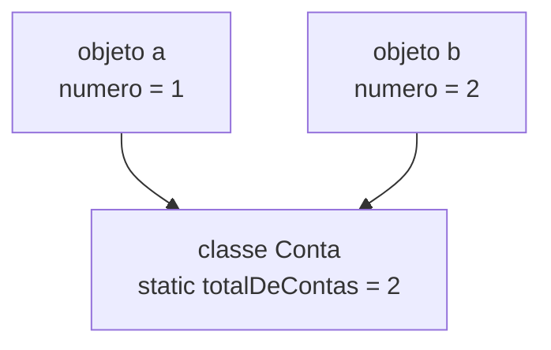

# 4.5 · Classes abstratas, membros `static` e `enum`

> **Em uma frase:** uma **classe abstrata** é um molde incompleto que só serve de base para outras classes; um membro **`static`** pertence à classe, e não a cada objeto; e um **`enum`** é um tipo com um conjunto **fechado** de valores possíveis, como os dias da semana ou os status de um pedido.

> [!NOTE]
> Esta aula complementa o curso original com três recursos que aparecem o tempo todo em projetos Java e Spring.

## 🧩 Classes abstratas

Na aula [4.2](./02-heranca-e-polimorfismo.md), `Conta` era a classe pai de `ContaCorrente` e `ContaPoupanca`. Mas faz sentido criar uma "conta" genérica, que não é nem corrente nem poupança? Não. Quando a classe pai existe só para **ser herdada**, ela deve ser **abstrata**:

```java
public abstract class Conta {
    protected double saldo;

    public void depositar(double valor) {          // método concreto: já vem pronto
        saldo += valor;
    }

    public abstract double calcularTarifa();       // método abstrato: sem corpo
}

public class ContaCorrente extends Conta {
    @Override
    public double calcularTarifa() { return 12.90; }
}

public class ContaPoupanca extends Conta {
    @Override
    public double calcularTarifa() { return 0; }
}
```

```java
Conta c = new ContaCorrente();     // ✅ upcast normal
Conta x = new Conta();             // ❌ erro: Conta is abstract; cannot be instantiated
```

| Regra | Por quê |
| --- | --- |
| Não pode ser instanciada com `new` | É um molde incompleto |
| Pode ter métodos **abstratos** (sem corpo) | Obriga as filhas a implementá-los |
| Pode ter métodos concretos, atributos e construtores | Compartilha código e estado com as filhas |
| A filha concreta **precisa** implementar todos os abstratos | Senão, ela também tem de ser `abstract` |

### Classe abstrata × interface

| | Classe abstrata | Interface (aula [4.4](./04-interfaces.md)) |
| --- | --- | --- |
| Herança | Uma classe estende **uma** só | Uma classe implementa **várias** |
| Atributos (estado) | Pode ter | Não pode (só constantes) |
| Construtor | Pode ter | Não tem |
| Ideia | "**é um** tipo de..." com código comum | "**sabe fazer**..." (um contrato) |
| Exemplo | `Conta` → corrente, poupança | `Pagavel`, `Comparable` |

> [!TIP]
> Na dúvida, prefira **interface**. Use classe abstrata quando as filhas compartilham **atributos e código** de verdade.

## 📌 Membros `static`: da classe, não do objeto

Normalmente, cada objeto tem os seus atributos: cada conta tem o **seu** saldo. Um atributo `static` é **um só**, compartilhado pela classe inteira.

```java
public class Conta {
    private static int totalDeContas = 0;     // um único contador para TODAS as contas
    private final int numero;                 // cada conta tem o seu número

    public Conta() {
        totalDeContas++;
        this.numero = totalDeContas;
    }

    public static int getTotalDeContas() {    // método estático: chamado pela classe
        return totalDeContas;
    }

    public int getNumero() { return numero; }
}
```

```java
Conta a = new Conta();
Conta b = new Conta();
System.out.println(a.getNumero());              // 1
System.out.println(b.getNumero());              // 2
System.out.println(Conta.getTotalDeContas());   // 2 (chamado pela CLASSE, sem objeto)
```



Você já usa `static` desde o primeiro programa: `public static void main`, `Math.sqrt(...)`, `Integer.parseInt(...)`. São métodos que **não dependem de um objeto**: você chama direto pela classe.

| Uso típico | Exemplo |
| --- | --- |
| Constantes | `public static final double TAXA_JUROS = 0.02;` |
| Métodos utilitários | `Math.max(a, b)`, `Objects.equals(a, b)` |
| Contadores compartilhados | `totalDeContas` |
| Métodos de fábrica | `List.of(...)`, `LocalDate.of(2026, 10, 18)` |

> [!WARNING]
> Um método `static` **não enxerga** os atributos de instância (não existe `this` nele). Escrever `saldo` dentro de um método estático dá o erro *non-static variable saldo cannot be referenced from a static context*. É o erro mais comum de quem cria métodos dentro da classe do `main`.

## 🚦 `enum`: um conjunto fechado de valores

Imagine o status de um pedido guardado como `String`:

```java
pedido.setStatus("PAGO");
pedido.setStatus("Pago");     // é o mesmo? 🤔
pedido.setStatus("PGO");      // erro de digitação, e o compilador aceita 😱
```

Um `enum` cria um **tipo** com valores fixos. Qualquer coisa fora da lista não compila:

```java
public enum StatusPedido {
    ABERTO, PAGO, ENVIADO, ENTREGUE, CANCELADO
}

pedido.setStatus(StatusPedido.PAGO);    // ✅
pedido.setStatus(StatusPedido.PGO);     // ❌ não compila
```

### Usando enums

```java
StatusPedido status = StatusPedido.ENVIADO;

if (status == StatusPedido.ENVIADO) { ... }         // enums podem ser comparados com ==

switch (status) {                                   // combinam muito bem com switch
    case ABERTO, PAGO -> System.out.println("Em preparação");
    case ENVIADO      -> System.out.println("A caminho");
    case ENTREGUE     -> System.out.println("Chegou!");
    case CANCELADO    -> System.out.println("Cancelado");
}

StatusPedido.values();              // todos os valores, na ordem declarada
StatusPedido.valueOf("PAGO");       // String → enum (lança exceção se não existir)
status.name();                      // "ENVIADO"
status.ordinal();                   // 2 (posição, começando em 0)
```

### Enums com atributos e métodos

Um `enum` é uma classe especial: pode ter atributos, construtor e métodos.

```java
public enum Plano {
    BASICO(29.90, 1),
    PADRAO(44.90, 2),
    PREMIUM(59.90, 4);

    private final double preco;
    private final int telas;

    Plano(double preco, int telas) {      // o construtor é sempre privado
        this.preco = preco;
        this.telas = telas;
    }

    public double getPreco() { return preco; }
    public int getTelas() { return telas; }
}
```

```java
for (Plano p : Plano.values()) {
    System.out.printf("%s: R$ %.2f, %d tela(s)%n", p, p.getPreco(), p.getTelas());
}
// BASICO: R$ 29,90, 1 tela(s)
// PADRAO: R$ 44,90, 2 tela(s)
// PREMIUM: R$ 59,90, 4 tela(s)
```

> [!TIP]
> No JPA, use `@Enumerated(EnumType.STRING)` para gravar o **nome** do enum no banco (`'PAGO'`). O padrão grava o `ordinal()` (0, 1, 2...), e incluir um novo valor no meio da lista bagunçaria os dados antigos.

## 📌 Resumindo

- **Classe abstrata**: não pode ser instanciada; pode ter métodos abstratos (que as filhas implementam), atributos e código comum.
- Interface = contrato ("sabe fazer"); classe abstrata = base comum ("é um tipo de").
- **`static`**: pertence à classe; é compartilhado por todos os objetos e chamado pelo nome da classe; não enxerga `this`.
- **`enum`**: tipo com valores fixos, seguro contra erros de digitação; pode ter atributos e métodos e combina com `switch`.

## 🏋️ Mão na massa

**1.** Crie a classe abstrata `Funcionario` com nome e salário base e o método abstrato `calcularSalario()`. Crie `Vendedor` (salário base + 5% de comissão sobre as vendas) e `Gerente` (salário base + bônus fixo de R$ 2.000).

<details>
<summary>Ver resposta</summary>

```java
public abstract class Funcionario {
    protected final String nome;
    protected final double salarioBase;

    protected Funcionario(String nome, double salarioBase) {
        this.nome = nome;
        this.salarioBase = salarioBase;
    }

    public abstract double calcularSalario();
}

public class Vendedor extends Funcionario {
    private final double vendas;

    public Vendedor(String nome, double salarioBase, double vendas) {
        super(nome, salarioBase);
        this.vendas = vendas;
    }

    @Override
    public double calcularSalario() { return salarioBase + vendas * 0.05; }
}

public class Gerente extends Funcionario {
    public Gerente(String nome, double salarioBase) { super(nome, salarioBase); }

    @Override
    public double calcularSalario() { return salarioBase + 2000; }
}
```

`new Vendedor("Ana", 3000, 20000).calcularSalario()` devolve `4000.0`.

</details>

**2.** Por que este código não compila, e como corrigir?

```java
public class Calculadora {
    private int ultimoResultado;

    public static int somar(int a, int b) {
        ultimoResultado = a + b;
        return ultimoResultado;
    }
}
```

<details>
<summary>Ver resposta</summary>

O método `somar` é `static`, mas `ultimoResultado` é um atributo de **instância** (cada objeto tem o seu), e um método estático não sabe de qual objeto seria. Corrija tirando o `static` do método (e chamando-o por um objeto) ou tornando o atributo também `static`, se ele for mesmo único para todos.

</details>

**3.** Crie um enum `DiaDaSemana` com um método `ehFimDeSemana()`.

<details>
<summary>Ver resposta</summary>

```java
public enum DiaDaSemana {
    SEGUNDA, TERCA, QUARTA, QUINTA, SEXTA, SABADO, DOMINGO;

    public boolean ehFimDeSemana() {
        return this == SABADO || this == DOMINGO;
    }
}

DiaDaSemana.SABADO.ehFimDeSemana();   // true
DiaDaSemana.QUARTA.ehFimDeSemana();   // false
```

</details>

---

<div align="center">

[⬅️ 4.4 Interfaces](./04-interfaces.md) &nbsp;|&nbsp; [🏠 Índice](../../README.md) &nbsp;|&nbsp; [4.6 Pacotes ➡️](./06-pacotes.md)

</div>
