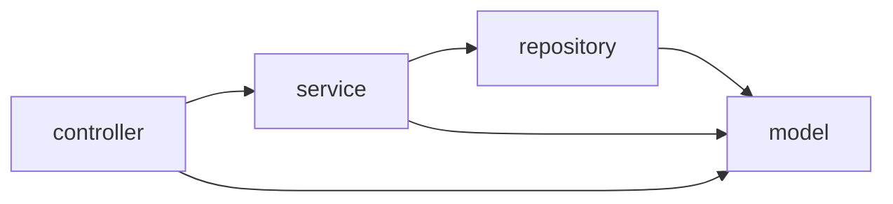

# 4.6 · Pacotes

> **Em uma frase:** pacotes são as "pastas" do código Java: agrupam classes relacionadas, evitam conflito de nomes (duas classes `Cliente` podem existir em pacotes diferentes) e definem quem enxerga o quê.

## 📁 Como funcionam

- A primeira linha do arquivo declara o pacote: `package com.minhaempresa.banco.modelo;`
- O pacote corresponde a **pastas**: `com/minhaempresa/banco/modelo/Cliente.java`.
- Por convenção, o nome começa pelo **domínio invertido** da empresa e é todo em minúsculas.
- Para usar uma classe de outro pacote, faça `import`:

```java
package com.minhaempresa.banco;

import com.minhaempresa.banco.modelo.Cliente;   // uma classe
import java.util.*;                             // todas as classes de java.util (evite)

public class Main {
    public static void main(String[] args) {
        Cliente cliente = new Cliente("Ana");
    }
}
```

> [!NOTE]
> As classes do pacote `java.lang` (`String`, `Math`, `System`, `Integer`...) são importadas automaticamente.

## 🗂️ Organização típica de um projeto

```text
src/main/java/com/minhaempresa/banco/
├── BancoApplication.java
├── controller/      ← recebe as requisições (Módulo 6)
│   └── ContaController.java
├── service/         ← regras de negócio
│   └── ContaService.java
├── repository/      ← acesso ao banco de dados
│   └── ContaRepository.java
├── model/           ← entidades (Conta, Cliente)
│   ├── Cliente.java
│   └── Conta.java
└── exception/
    └── SaldoInsuficienteException.java
```



> [!TIP]
> Duas formas comuns de organizar: **por camada** (como acima: `controller`, `service`...) ou **por funcionalidade** (`conta/`, `cliente/`, `cartao/`, cada uma com suas camadas). Em projetos grandes, organizar por funcionalidade costuma escalar melhor.

## 🔐 Pacotes e visibilidade

Membros **sem modificador de acesso** (o "padrão" ou *package-private*) só são visíveis para classes do **mesmo pacote**. Isso permite esconder detalhes internos de uma parte do sistema. Veja a tabela completa na [próxima aula](./07-modificadores-de-acesso.md).

## 📌 Resumindo

- Pacote = pasta; declarado com `package` na primeira linha.
- Nome em minúsculas, começando pelo domínio invertido (`com.empresa.projeto`).
- `import` traz classes de outros pacotes; `java.lang` é automático.
- Organize por camada ou por funcionalidade.

## 🏋️ Mão na massa

**1.** Qual o nome **qualificado** de uma classe `Conta` no pacote `br.com.pan.banco.model`? E em qual pasta fica o arquivo?

<details>
<summary>Ver resposta</summary>

Nome qualificado: `br.com.pan.banco.model.Conta`. Arquivo: `br/com/pan/banco/model/Conta.java` (dentro da pasta de código-fonte, como `src/main/java`).

</details>

**2.** Você precisa usar duas classes `Date`: `java.util.Date` e `java.sql.Date`. Como fazer no mesmo arquivo?

<details>
<summary>Ver resposta</summary>

Importe uma delas e use o nome qualificado completo para a outra:

```java
import java.util.Date;

Date agora = new Date();
java.sql.Date dataSql = new java.sql.Date(agora.getTime());
```

</details>

**3.** No `treino-java`, reorganize suas classes nos pacotes `model` e `app`.

<details>
<summary>Ver resposta</summary>

No IntelliJ: botão direito em `src` → **New → Package** (`com.treino.model` e `com.treino.app`) e arraste as classes para lá. A IDE atualiza as declarações `package` e os `import`s automaticamente.

</details>

---

<div align="center">

[⬅️ 4.5 Classes abstratas, membros static e enum](./05-abstratas-static-enum.md) &nbsp;|&nbsp; [🏠 Índice](../../README.md) &nbsp;|&nbsp; [4.7 Modificadores de acesso ➡️](./07-modificadores-de-acesso.md)

</div>
