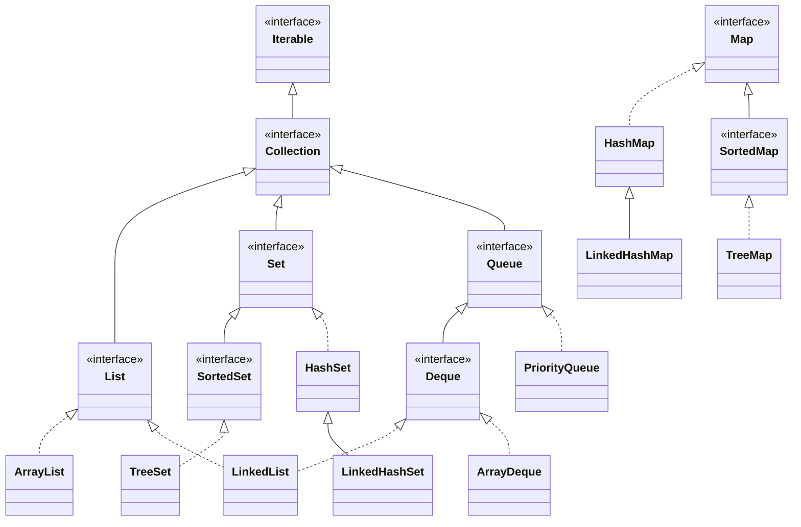
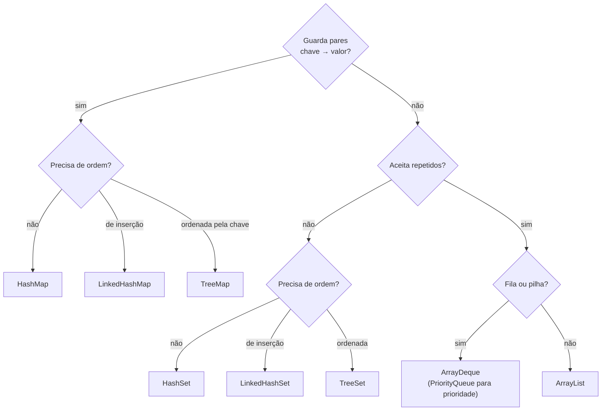

# 4.8 · O framework Collections

> **Em uma frase:** Collections é o conjunto de interfaces e classes do Java para guardar e manipular **grupos de objetos**: listas (`List`), conjuntos (`Set`), filas (`Queue`) e mapas (`Map`).

📦 Referência usada no curso: [cami-la/curso-dio-intro-collections](https://github.com/cami-la/curso-dio-intro-collections).

## 🗺️ A hierarquia



> [!NOTE]
> `Map` fica separado: ele **não** herda de `Collection`, porque guarda pares chave → valor em vez de elementos soltos. Mesmo assim, faz parte do framework.

## 🧭 Qual usar?



## 🔁 Percorrendo coleções

```java
List<Integer> numeros = new ArrayList<>(List.of(10, 20, 30));

for (Integer n : numeros) {               // for-each: o mais comum
    System.out.println(n);
}

numeros.forEach(n -> System.out.println(n));   // com lambda (aula 4.12)

Iterator<Integer> it = numeros.iterator();     // com Iterator: permite remover durante o laço
while (it.hasNext()) {
    if (it.next() < 15) it.remove();
}
```

> [!CAUTION]
> Remover elementos de uma coleção **dentro de um for-each** lança `ConcurrentModificationException`. Use o `Iterator` (como acima) ou, mais simples, `numeros.removeIf(n -> n < 15)`.

## 🧰 A classe utilitária `Collections`

Não confunda: `Collection` (interface) × `Collections` (classe com métodos prontos).

```java
Collections.sort(lista);          // ordena
Collections.shuffle(lista);       // embaralha
Collections.max(lista);           // maior
Collections.min(lista);           // menor
Collections.reverse(lista);       // inverte
Collections.unmodifiableList(lista);   // versão somente leitura
```

## 📌 Resumindo

- `Collection` é a raiz de `List`, `Set` e `Queue`; `Map` é uma hierarquia à parte.
- Escolha pela pergunta: pares chave-valor? aceita repetidos? precisa de ordem?
- Para remover durante a iteração, use `Iterator` ou `removeIf`.
- `Collections` (com "s") tem métodos prontos como `sort`, `max` e `shuffle`.

## 🏋️ Mão na massa

**1.** Qual coleção usar para: (a) os CPFs já cadastrados, para checar duplicidade; (b) o carrinho de compras, na ordem em que os itens foram adicionados; (c) o estoque, consultado pelo código do produto?

<details>
<summary>Ver resposta</summary>

(a) `HashSet<String>` (sem repetidos, busca rápida); (b) `ArrayList<Item>` (ordem, aceita repetidos); (c) `HashMap<String, Produto>` (consulta pela chave).

</details>

**2.** Qual a diferença entre `Collection` e `Collections`?

<details>
<summary>Ver resposta</summary>

`Collection` é a **interface** raiz das listas, conjuntos e filas. `Collections` é uma **classe utilitária** com métodos estáticos que operam sobre coleções (`sort`, `max`, `shuffle`...).

</details>

**3.** Remova os números ímpares de uma `List<Integer>` com `[1, 2, 3, 4, 5]` sem causar `ConcurrentModificationException`.

<details>
<summary>Ver resposta</summary>

```java
List<Integer> numeros = new ArrayList<>(List.of(1, 2, 3, 4, 5));
numeros.removeIf(n -> n % 2 != 0);
System.out.println(numeros);   // [2, 4]
```

</details>

---

<div align="center">

[⬅️ 4.7 Modificadores de acesso](./07-modificadores-de-acesso.md) &nbsp;|&nbsp; [🏠 Índice](../../README.md) &nbsp;|&nbsp; [4.9 List ➡️](./09-list.md)

</div>
