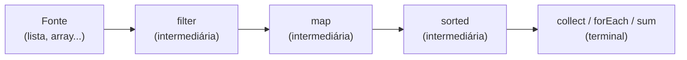

# 4.11 · Lambdas, referências de método e Stream API

> **Em uma frase:** a Stream API (Java 8) permite processar coleções de forma **declarativa**, encadeando operações como `filter`, `map` e `collect`; ela se apoia em **lambdas**, que são funções curtas passadas como parâmetro.

## 🧩 Os blocos de construção

### Classe anônima

Uma classe sem nome, criada e usada no mesmo lugar, geralmente para implementar uma interface uma única vez:

```java
Comparator<String> porTamanho = new Comparator<String>() {
    @Override
    public int compare(String a, String b) {
        return Integer.compare(a.length(), b.length());
    }
};
```

### Interface funcional

Uma interface com **um único método abstrato** (*SAM: Single Abstract Method*). A anotação `@FunctionalInterface` é opcional, mas faz o compilador conferir.

```java
@FunctionalInterface
interface Operacao {
    int calcular(int x, int y);
}
```

O Java já traz várias prontas em `java.util.function`:

| Interface | Recebe → devolve | Método | Exemplo de uso |
| --- | --- | --- | --- |
| `Predicate<T>` | T → `boolean` | `test` | `filter` |
| `Function<T, R>` | T → R | `apply` | `map` |
| `Consumer<T>` | T → nada | `accept` | `forEach` |
| `Supplier<T>` | nada → T | `get` | `orElseGet` |
| `BinaryOperator<T>` | (T, T) → T | `apply` | `reduce` |

### Expressão lambda

Uma forma curta de implementar uma interface funcional: `(parâmetros) -> corpo`.

```java
Operacao soma = (x, y) -> x + y;
Operacao subtracao = (x, y) -> x - y;
System.out.println(soma.calcular(5, 3));        // 8

Comparator<String> porTamanho = (a, b) -> Integer.compare(a.length(), b.length());
```

### Referência de método

Quando a lambda só chama um método existente, dá para encurtar ainda mais com `::`:

| Lambda | Referência de método |
| --- | --- |
| `s -> System.out.println(s)` | `System.out::println` |
| `s -> Integer.parseInt(s)` | `Integer::parseInt` |
| `s -> s.toUpperCase()` | `String::toUpperCase` |
| `() -> new ArrayList<>()` | `ArrayList::new` |

## 🌊 Streams

Um stream é uma **sequência de elementos** que passa por um "encanamento" de operações:



- **Operações intermediárias** (`filter`, `map`, `sorted`, `distinct`, `limit`, `skip`) devolvem um novo stream e são **preguiçosas**: só rodam quando chega uma terminal.
- **Operações terminais** (`collect`, `toList`, `forEach`, `count`, `sum`, `min`, `max`, `reduce`) produzem o resultado e encerram o stream.
- O stream **não altera** a coleção original.

```java
List<String> nomes = List.of("João", "Maria", "José", "Pedro", "Lucas");

List<String> comJ = nomes.stream()
        .filter(nome -> nome.startsWith("J"))   // mantém só os que começam com J
        .map(String::toUpperCase)               // transforma cada um
        .sorted()                               // ordena
        .toList();                              // coleta numa lista (Java 16+)
System.out.println(comJ);                       // [JOSÉ, JOÃO]

int letras = nomes.stream().mapToInt(String::length).sum();   // 23
```

> [!TIP]
> Um stream só pode ser consumido **uma vez**. Para processar de novo, chame `.stream()` outra vez na coleção.

> [!NOTE]
> `.toList()` (Java 16+) devolve uma lista **imutável**. Se precisar alterá-la depois, use `.collect(Collectors.toList())` ou `new ArrayList<>(...)`.

### Agrupando com `Collectors`

```java
Map<Boolean, List<Integer>> paresEImpares = Stream.of(1, 2, 3, 4, 5)
        .collect(Collectors.partitioningBy(n -> n % 2 == 0));
// {false=[1, 3, 5], true=[2, 4]}

Map<Integer, List<String>> porTamanho = nomes.stream()
        .collect(Collectors.groupingBy(String::length));
// {4=[João, José], 5=[Maria, Pedro, Lucas]}
```

## 📌 Resumindo

- Interface funcional = um método abstrato; lambda = implementação curta dela.
- Referências de método (`Classe::metodo`) encurtam lambdas simples.
- Stream: fonte → operações intermediárias (preguiçosas) → uma operação terminal.
- `Collectors.groupingBy` e `partitioningBy` agrupam resultados.

## 🏋️ Mão na massa

> Exercícios do curso, agora com todas as respostas.

**1.** Agenda com `id → contato`: 1 → Simba (2222), 4 → Cami (5555), 3 → Jon (1111). Mostre em ordem aleatória, de inserção, por id, por telefone e por nome.

<details>
<summary>Ver resposta</summary>

```java
record Contato(String nome, int telefone) { }

Map<Integer, Contato> agenda = new LinkedHashMap<>();
agenda.put(1, new Contato("Simba", 2222));
agenda.put(4, new Contato("Cami", 5555));
agenda.put(3, new Contato("Jon", 1111));

System.out.println("Aleatória: " + new HashMap<>(agenda));
System.out.println("Inserção:  " + agenda);
System.out.println("Por id:    " + new TreeMap<>(agenda));

agenda.entrySet().stream()
        .sorted(Comparator.comparingInt(e -> e.getValue().telefone()))
        .forEach(e -> System.out.println(e.getKey() + " - " + e.getValue()));

agenda.entrySet().stream()
        .sorted(Comparator.comparing(e -> e.getValue().nome()))
        .forEach(e -> System.out.println(e.getKey() + " - " + e.getValue()));
```

A evolução vista no curso, da forma mais longa para a mais curta:

```java
// 1) Classe anônima
Comparator<Map.Entry<Integer, Contato>> c1 = new Comparator<>() {
    @Override
    public int compare(Map.Entry<Integer, Contato> a, Map.Entry<Integer, Contato> b) {
        return Integer.compare(a.getValue().telefone(), b.getValue().telefone());
    }
};

// 2) Lambda
Comparator<Map.Entry<Integer, Contato>> c2 =
        (a, b) -> Integer.compare(a.getValue().telefone(), b.getValue().telefone());

// 3) Comparator.comparing + lambda
Comparator<Map.Entry<Integer, Contato>> c3 =
        Comparator.comparingInt(e -> e.getValue().telefone());
```

</details>

**2.** Com a lista de Strings `"1", "0", "4", "1", "2", "3", "9", "6", "5"`, use streams para: (1) imprimir todos; (2) colocar os 5 primeiros num `Set`; (3) converter em inteiros; (4) pegar os pares maiores que 2; (5) calcular a média; (6) remover os ímpares; (7) ignorar os 3 primeiros; (8) retirar os repetidos; (9) achar o menor e (10) o maior; (11) somar os ímpares; (12) ordenar; (13) separar os ímpares múltiplos de 3.

<details>
<summary>Ver resposta</summary>

```java
List<String> textos = List.of("1", "0", "4", "1", "2", "3", "9", "6", "5");

textos.forEach(System.out::print);                                        // 1) 104123965
System.out.println();

Set<String> cincoPrimeiros = textos.stream().limit(5).collect(Collectors.toSet());
System.out.println(cincoPrimeiros);                                       // 2) [0, 1, 2, 4]

List<Integer> numeros = textos.stream().map(Integer::parseInt).toList(); // 3)
System.out.println(numeros);                                              // [1, 0, 4, 1, 2, 3, 9, 6, 5]

System.out.println(numeros.stream().filter(n -> n % 2 == 0 && n > 2).toList());   // 4) [4, 6]

numeros.stream().mapToInt(Integer::intValue).average()
        .ifPresent(media -> System.out.printf("%.2f%n", media));         // 5) 3,44

List<Integer> semImpares = new ArrayList<>(numeros);
semImpares.removeIf(n -> n % 2 != 0);
System.out.println(semImpares);                                           // 6) [0, 4, 2, 6]

System.out.println(numeros.stream().skip(3).toList());                    // 7) [1, 2, 3, 9, 6, 5]
System.out.println(numeros.stream().distinct().toList());                 // 8) [1, 0, 4, 2, 3, 9, 6, 5]
System.out.println(numeros.stream().min(Integer::compare).orElseThrow()); // 9) 0
System.out.println(numeros.stream().max(Integer::compare).orElseThrow()); // 10) 9

int somaImpares = numeros.stream().filter(n -> n % 2 != 0).mapToInt(Integer::intValue).sum();
System.out.println(somaImpares);                                          // 11) 19

System.out.println(numeros.stream().sorted().toList());                   // 12) [0, 1, 1, 2, 3, 4, 5, 6, 9]

Map<Boolean, List<Integer>> grupos = numeros.stream()
        .collect(Collectors.partitioningBy(n -> n % 2 != 0 && n % 3 == 0));
System.out.println(grupos.get(true));                                     // 13) [3, 9]
```

Repare que `average()` devolve um `OptionalDouble` (a lista poderia estar vazia), por isso o `ifPresent`. O mesmo vale para `min`/`max`, que devolvem `Optional` (o `orElseThrow()` pega o valor ou lança exceção se estiver vazio).

</details>

**3.** Dada a lista de nomes `["ana", "Bruno", "carla", "Daniel"]`, gere uma lista com os nomes com a primeira letra maiúscula e que tenham mais de 4 letras.

<details>
<summary>Ver resposta</summary>

```java
List<String> resultado = Stream.of("ana", "Bruno", "carla", "Daniel")
        .filter(n -> n.length() > 4)
        .map(n -> n.substring(0, 1).toUpperCase() + n.substring(1))
        .toList();
System.out.println(resultado);   // [Bruno, Carla, Daniel]
```

</details>

---

<div align="center">

[⬅️ 4.10 Map](./10-map.md) &nbsp;|&nbsp; [🏠 Índice](../../README.md) &nbsp;|&nbsp; [4.12 Debugging ➡️](./12-debugging.md)

</div>
