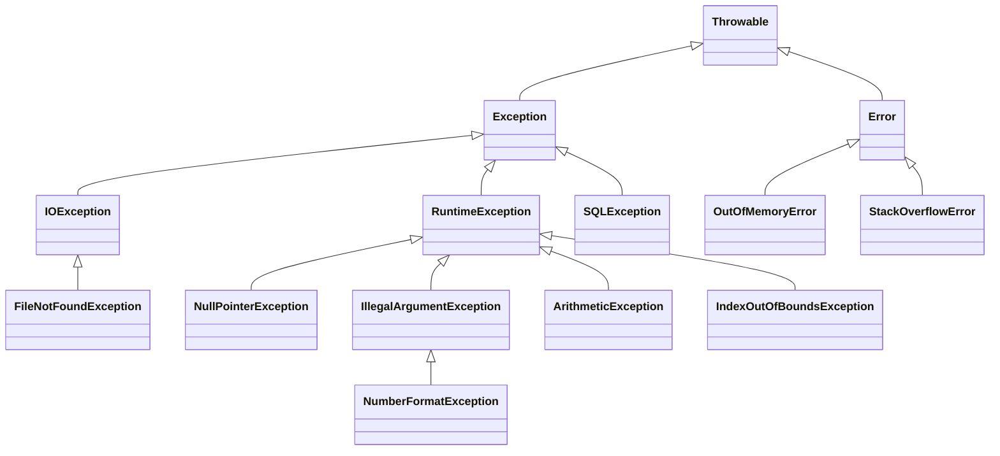

# 4.14 · Tratamento de exceções

> **Em uma frase:** uma exceção é um evento que interrompe o fluxo normal do programa; com `try/catch/finally` você decide o que fazer quando ela acontece, em vez de deixar o programa quebrar.

## 🌳 A hierarquia



| Tipo | O que é | Precisa tratar? | Exemplos |
| --- | --- | --- | --- |
| **`Error`** | Problema grave da JVM ou do ambiente. Não se trata. | Não | `OutOfMemoryError`, `StackOverflowError` |
| **Checked** (filhas de `Exception`, menos `RuntimeException`) | Situações esperadas e fora do seu controle (arquivo sumiu, rede caiu). | **Sim**: o compilador obriga a tratar (`catch`) ou declarar (`throws`) | `IOException`, `SQLException` |
| **Unchecked** (filhas de `RuntimeException`) | Normalmente **bugs** que dá para evitar com código correto. | Não é obrigatório | `NullPointerException`, `IllegalArgumentException`, `ArithmeticException` |

## 🧱 `try`, `catch` e `finally`

```java
try {
    int numero = Integer.parseInt(texto);   // pode lançar NumberFormatException
    int resultado = 10 / numero;            // pode lançar ArithmeticException
    System.out.println(resultado);
} catch (NumberFormatException e) {
    System.out.println("Digite um número inteiro válido.");
} catch (ArithmeticException e) {
    System.out.println("Não é possível dividir por zero.");
} catch (Exception e) {
    System.out.println("Erro inesperado: " + e.getMessage());
} finally {
    System.out.println("Sempre executa (com ou sem erro).");
}
```

- **`try`**: o código que pode dar erro. Se uma exceção acontece, o resto do `try` é pulado.
- **`catch`**: trata um tipo de exceção. Só o **primeiro** `catch` compatível executa.
- **`finally`**: opcional; executa **sempre** (exceto se a JVM for encerrada, como com `System.exit`). Usado para liberar recursos.
- Um `try` precisa de pelo menos um `catch` **ou** um `finally`.

> [!IMPORTANT]
> Ordene os `catch` do **mais específico para o mais genérico**. Se `catch (Exception e)` viesse primeiro, ele capturaria tudo, e o compilador nem deixaria os seguintes existirem.

### Vários tipos no mesmo `catch` (Java 7+)

```java
catch (NumberFormatException | ArithmeticException e) {
    System.out.println("Entrada inválida: " + e.getMessage());
}
```

### `try-with-resources` (Java 7+)

Recursos que precisam ser fechados (arquivos, conexões) podem ser abertos no próprio `try`, e o Java os fecha automaticamente, mesmo com erro:

```java
try (BufferedReader leitor = new BufferedReader(new FileReader("romances.txt"))) {
    String linha;
    while ((linha = leitor.readLine()) != null) {
        System.out.println(linha);
    }
} catch (FileNotFoundException e) {
    System.out.println("Arquivo não encontrado: " + e.getMessage());
} catch (IOException e) {
    System.out.println("Erro ao ler o arquivo: " + e.getMessage());
}
```

> [!TIP]
> Prefira sempre o `try-with-resources` a um `finally` com `close()`. É mais curto e não esquece de fechar nada.

## 📢 `throw` e `throws`

- **`throw`** (no corpo) **lança** uma exceção.
- **`throws`** (na assinatura) **avisa** que o método pode lançar exceções checked; quem chamar terá de tratar ou repassar.

```java
public static double dividir(int a, int b) {
    if (b == 0) {
        throw new IllegalArgumentException("O divisor não pode ser zero");
    }
    return (double) a / b;
}

public static String lerPrimeiraLinha(String arquivo) throws IOException {
    try (BufferedReader leitor = new BufferedReader(new FileReader(arquivo))) {
        return leitor.readLine();
    }
}
```

Quando uma exceção é lançada, a JVM procura um `catch` compatível no método atual; se não encontrar, sobe para quem o chamou, e assim por diante na pilha. Se chegar ao `main` sem tratamento, o programa termina e imprime o stack trace.

## 🛠️ Exceções personalizadas

Crie as suas quando nenhuma exceção pronta expressa bem o problema de negócio:

```java
public class SaldoInsuficienteException extends RuntimeException {
    public SaldoInsuficienteException(double saldo, double valor) {
        super("Saldo insuficiente: saldo R$ " + saldo + ", saque de R$ " + valor);
    }
}
```

```java
public void sacar(double valor) {
    if (valor > saldo) {
        throw new SaldoInsuficienteException(saldo, valor);
    }
    saldo -= valor;
}
```

- Estenda `RuntimeException` para uma exceção **unchecked** (a escolha mais comum hoje) ou `Exception` para **checked**.
- Antes de criar a sua, confira se já existe uma pronta: `IllegalArgumentException`, `IllegalStateException`, `UnsupportedOperationException`...

## 🚫 Erros comuns

- **"Engolir" a exceção**: `catch (Exception e) { }` vazio esconde o problema. No mínimo, registre o erro.
- Usar exceções para controlar o fluxo normal (como sair de um laço).
- Capturar `Exception` genérica em todo lugar, em vez dos tipos específicos.
- Perder a causa original: ao relançar, passe a exceção original: `throw new MinhaException("msg", e);`.

## 📌 Resumindo

- `Throwable` → `Error` (não tratar) e `Exception` (checked e unchecked).
- Checked: o compilador obriga a tratar ou declarar; unchecked: geralmente bugs.
- `try/catch/finally`; `catch` do específico para o genérico; `try-with-resources` para recursos.
- `throw` lança, `throws` declara; crie exceções próprias estendendo `RuntimeException`.

## 🏋️ Mão na massa

**1.** Peça dois números (numerador e denominador) e mostre a divisão inteira. Trate entrada inválida e divisão por zero, repetindo até dar certo.

<details>
<summary>Ver resposta</summary>

```java
Scanner entrada = new Scanner(System.in);
boolean concluido = false;

while (!concluido) {
    try {
        System.out.print("Numerador: ");
        int a = Integer.parseInt(entrada.nextLine());
        System.out.print("Denominador: ");
        int b = Integer.parseInt(entrada.nextLine());
        System.out.println("Resultado: " + a / b);
        concluido = true;
    } catch (NumberFormatException e) {
        System.out.println("Digite apenas números inteiros.");
    } catch (ArithmeticException e) {
        System.out.println("O denominador não pode ser zero.");
    }
}
```

</details>

**2.** Divida cada elemento de `numerador = {4, 5, 8, 10}` pelo correspondente em `denominador = {2, 4, 0, 2, 8}`, lançando uma exceção personalizada `DivisaoNaoExataException` quando o resultado não for exato, e tratando a divisão por zero e o índice inexistente.

<details>
<summary>Ver resposta</summary>

```java
public class DivisaoNaoExataException extends Exception {
    public DivisaoNaoExataException(int numerador, int denominador) {
        super(numerador + " / " + denominador + " não é uma divisão exata");
    }
}
```

```java
int[] numerador = {4, 5, 8, 10};
int[] denominador = {2, 4, 0, 2, 8};

for (int i = 0; i < denominador.length; i++) {
    try {
        if (denominador[i] != 0 && numerador[i] % denominador[i] != 0) {
            throw new DivisaoNaoExataException(numerador[i], denominador[i]);
        }
        System.out.println(numerador[i] / denominador[i]);
    } catch (DivisaoNaoExataException e) {
        System.out.println("Aviso: " + e.getMessage());
    } catch (ArithmeticException e) {
        System.out.println("Divisão por zero na posição " + i);
    } catch (ArrayIndexOutOfBoundsException e) {
        System.out.println("Não há numerador na posição " + i);
    }
}
// 2 | Aviso: 5 / 4 não é uma divisão exata | Divisão por zero na posição 2 | 5 | Não há numerador na posição 4
```

No curso, a regra testava `numerador % 2`, que não verifica se a divisão é exata; o correto é testar o resto da divisão pelo **denominador**. A classe da exceção também estava faltando no material original.

</details>

**3.** Leia e imprima um arquivo de texto usando `try-with-resources`, mostrando uma mensagem amigável se ele não existir.

<details>
<summary>Ver resposta</summary>

```java
try (BufferedReader leitor = new BufferedReader(new FileReader("dados.txt"))) {
    leitor.lines().forEach(System.out::println);
} catch (FileNotFoundException e) {
    System.out.println("O arquivo dados.txt não foi encontrado na pasta do projeto.");
} catch (IOException e) {
    System.out.println("Erro ao ler o arquivo. Procure o suporte.");
}
```

Uma versão ainda mais curta com a API moderna: `Files.readAllLines(Path.of("dados.txt"))`, que também lança `IOException`.

</details>

📚 Referências: [cami-la/exceptions-java](https://github.com/cami-la/exceptions-java) · [Documentação de exceções (Oracle)](https://docs.oracle.com/javase/tutorial/essential/exceptions/) · [DevMedia: trabalhando com exceções](https://www.devmedia.com.br/trabalhando-com-excecoes-em-java/27601)

---

<div align="center">

[⬅️ 4.13 Debugging](./13-debugging.md) &nbsp;|&nbsp; [🏠 Índice](../../README.md) &nbsp;|&nbsp; [4.15 O que é o Apache Maven ➡️](./15-maven.md)

</div>
