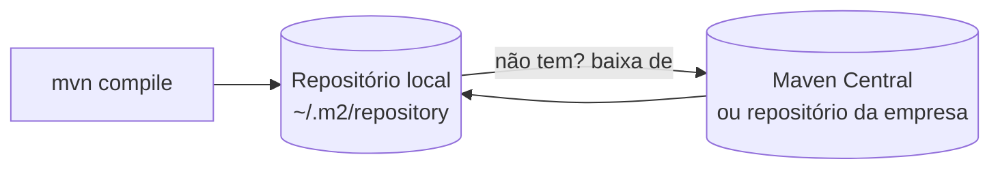

# 4.15 · O que é o Apache Maven

> **Em uma frase:** o Maven é a ferramenta que **baixa as bibliotecas** que seu projeto usa e **automatiza o build** (compilar, testar, empacotar), tudo configurado em um arquivo chamado `pom.xml`.

## 🤔 Por que usar?

Sem o Maven, você precisaria baixar cada `.jar` de biblioteca na mão, colocar no projeto, descobrir de quais outras bibliotecas ela depende, e montar o comando de compilação do zero. Com o Maven, basta declarar "quero a biblioteca X na versão Y" e rodar `mvn package`.

| Função | O que faz |
| --- | --- |
| **Gerenciar dependências** | Baixa as bibliotecas (e as dependências delas) de repositórios. |
| **Padronizar o projeto** | Toda aplicação Maven tem a mesma estrutura de pastas. |
| **Automatizar o build** | Compila, roda os testes e empacota (`.jar`, `.war`). |
| **Publicar artefatos** | Envia o pacote para um repositório, para outros projetos usarem. |
| **Gerar documentação** | Relatórios e Javadoc. |

> [!NOTE]
> O Maven nasceu por volta de 2002, dentro do projeto Jakarta Turbine da Apache, criado por Jason van Zyl; a versão 1.0 saiu em 2004. A principal alternativa hoje é o **Gradle** (usado, por exemplo, no Android). O Spring Initializr permite escolher qualquer um dos dois.

## 📁 Estrutura padrão (convenção sobre configuração)

```text
meu-projeto/
├── pom.xml                  ← configuração do projeto
├── src/
│   ├── main/
│   │   ├── java/            ← código da aplicação
│   │   └── resources/       ← arquivos de configuração (ex.: application.properties)
│   └── test/
│       └── java/            ← testes
└── target/                  ← gerado pelo build (não vai para o Git)
```

## 📄 O `pom.xml` (*Project Object Model*)

```xml
<project xmlns="http://maven.apache.org/POM/4.0.0"
         xmlns:xsi="http://www.w3.org/2001/XMLSchema-instance"
         xsi:schemaLocation="http://maven.apache.org/POM/4.0.0 https://maven.apache.org/xsd/maven-4.0.0.xsd">
    <modelVersion>4.0.0</modelVersion>

    <!-- Coordenadas: identificam o projeto de forma única -->
    <groupId>br.com.treino</groupId>          <!-- organização (domínio invertido) -->
    <artifactId>calculadora</artifactId>      <!-- nome do projeto -->
    <version>1.0.0-SNAPSHOT</version>         <!-- SNAPSHOT = em desenvolvimento -->

    <properties>
        <maven.compiler.release>21</maven.compiler.release>   <!-- versão do Java -->
        <project.build.sourceEncoding>UTF-8</project.build.sourceEncoding>
    </properties>

    <dependencies>
        <dependency>
            <groupId>org.junit.jupiter</groupId>
            <artifactId>junit-jupiter</artifactId>
            <version>5.13.4</version>
            <scope>test</scope>              <!-- só para os testes -->
        </dependency>
    </dependencies>
</project>
```

> [!TIP]
> As três "coordenadas" `groupId:artifactId:version` (o famoso **GAV**) identificam qualquer biblioteca do mundo Maven. Encontre-as em [mvnrepository.com](https://mvnrepository.com/) ou no [Maven Central](https://central.sonatype.com/).

> [!NOTE]
> As versões nos exemplos são as estáveis na época em que este material foi escrito. Sempre confira a versão mais recente no Maven Central.

### O Super POM

Todo `pom.xml` herda, sem você ver, de um **Super POM** padrão do Maven. É ele que define as convenções (as pastas `src/main/java`, `target` etc.) e o repositório central. Para ver o POM completo, já com tudo o que foi herdado, rode `mvn help:effective-pom`.

## 🗄️ Repositórios



- **Local**: a pasta `.m2/repository` no seu usuário (`C:\Users\<voce>\.m2` no Windows, `~/.m2` no Linux/macOS). Funciona como um cache.
- **Remoto**: o **Maven Central** (público) ou repositórios privados da empresa (Nexus, Artifactory), configurados no `pom.xml` ou no `~/.m2/settings.xml`.

O Maven procura primeiro no local; se não achar, baixa do remoto e guarda no local para as próximas vezes.

## 💻 Instalando

1. Baixe em [maven.apache.org/download.cgi](https://maven.apache.org/download.cgi) e descompacte.
2. Adicione a pasta `bin` ao `PATH` (e tenha a variável `JAVA_HOME` apontando para o JDK).
3. Confira:

```bash
mvn --version
```

> [!TIP]
> Você nem sempre precisa instalar o Maven: projetos criados pelo Spring Initializr trazem o **Maven Wrapper** (`mvnw` / `mvnw.cmd`), que baixa a versão certa automaticamente. Use `./mvnw package` (Linux/macOS) ou `mvnw.cmd package` (Windows). O IntelliJ também já vem com um Maven embutido.

## 📌 Resumindo

- Maven = gerenciador de dependências + automação de build.
- Tudo é configurado no `pom.xml`; bibliotecas são identificadas por `groupId:artifactId:version`.
- Estrutura padrão: `src/main/java`, `src/test/java`, `target`.
- Bibliotecas vêm do Maven Central e ficam em cache em `~/.m2`.

## 🏋️ Mão na massa

**1.** Quais são as coordenadas (GAV) da biblioteca Apache Commons Lang 3 na versão 3.18.0?

<details>
<summary>Ver resposta</summary>

`org.apache.commons:commons-lang3:3.18.0`, ou seja, `groupId` = `org.apache.commons`, `artifactId` = `commons-lang3`, `version` = `3.18.0`.

</details>

**2.** Onde fica o seu repositório Maven local e para que ele serve?

<details>
<summary>Ver resposta</summary>

Na pasta `.m2/repository` dentro do seu usuário. Ele guarda as bibliotecas já baixadas, para não baixá-las de novo a cada build.

</details>

**3.** Instale o Maven (ou use o embutido do IntelliJ) e rode `mvn --version`. O que a saída mostra?

<details>
<summary>Ver resposta</summary>

A versão do Maven, a pasta onde ele está instalado, a versão do Java que ele está usando (e onde está o JDK), além do sistema operacional. Se aparecer um erro sobre `JAVA_HOME`, configure essa variável apontando para o JDK.

</details>

---

<div align="center">

[⬅️ 4.14 Tratamento de exceções](./14-excecoes.md) &nbsp;|&nbsp; [🏠 Índice](../../README.md) &nbsp;|&nbsp; [4.16 Criando projetos e comandos do Maven ➡️](./16-maven-comandos.md)

</div>
