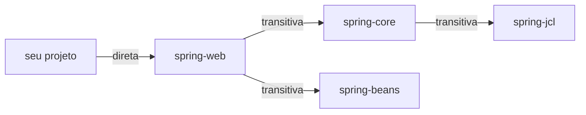

# 4.16 · Gerenciamento de dependências: transitividade, escopos e exclusões

> **Em uma frase:** ao declarar uma biblioteca, o Maven também traz as bibliotecas **das quais ela depende** (dependências transitivas); o **escopo** diz em que momento cada uma é necessária (compilar, testar, rodar).

## 🔗 Diretas × transitivas

- **Direta**: você declarou no seu `pom.xml`.
- **Transitiva**: veio "de carona", porque uma dependência sua precisa dela.



```xml
<dependency>
    <groupId>org.springframework</groupId>
    <artifactId>spring-web</artifactId>
    <version>6.2.10</version>
</dependency>
<!-- spring-core e spring-beans vêm junto automaticamente -->
```

Veja a árvore completa com `mvn dependency:tree`.

> [!NOTE]
> Se duas dependências trazem **versões diferentes** da mesma biblioteca, o Maven escolhe a **mais próxima** do seu projeto na árvore (e, empatando, a declarada primeiro). Para forçar uma versão, declare-a diretamente ou use `<dependencyManagement>`.

## 🎯 Escopos

| Escopo | Disponível para compilar | Para testar | Ao rodar | Vai no pacote final? | Exemplo |
| --- | --- | --- | --- | --- | --- |
| `compile` (padrão) | ✅ | ✅ | ✅ | ✅ | `commons-lang3`, `spring-web` |
| `provided` | ✅ | ✅ | ❌ (o servidor fornece) | ❌ | `jakarta.servlet-api`, Lombok |
| `runtime` | ❌ | ✅ | ✅ | ✅ | Drivers JDBC (`postgresql`) |
| `test` | ❌ (só o código de teste) | ✅ | ❌ | ❌ | JUnit, Mockito |
| `system` | ✅ | ✅ | ❌ | ❌ | `.jar` local via `<systemPath>` (**evite**) |
| `import` | — | — | — | — | Importa um **BOM** dentro de `<dependencyManagement>` |

```xml
<dependency>
    <groupId>org.postgresql</groupId>
    <artifactId>postgresql</artifactId>
    <version>42.7.7</version>
    <scope>runtime</scope>          <!-- o código não usa a classe direto; só precisa ao rodar -->
</dependency>

<dependency>
    <groupId>org.junit.jupiter</groupId>
    <artifactId>junit-jupiter</artifactId>
    <version>5.13.4</version>
    <scope>test</scope>
</dependency>
```

### `import` e BOMs

Um **BOM** (*Bill of Materials*) é um POM que só define versões compatíveis entre si. Importando-o, você declara as dependências **sem versão**:

```xml
<dependencyManagement>
    <dependencies>
        <dependency>
            <groupId>org.junit</groupId>
            <artifactId>junit-bom</artifactId>
            <version>5.13.4</version>
            <type>pom</type>
            <scope>import</scope>
        </dependency>
    </dependencies>
</dependencyManagement>

<dependencies>
    <dependency>
        <groupId>org.junit.jupiter</groupId>
        <artifactId>junit-jupiter</artifactId>   <!-- versão vem do BOM -->
        <scope>test</scope>
    </dependency>
</dependencies>
```

> [!TIP]
> É exatamente assim que o **Spring Boot** funciona: o `spring-boot-starter-parent` traz as versões de centenas de bibliotecas testadas juntas, e você quase nunca precisa escrever `<version>`.

## ❔ Dependências opcionais

Marcar `<optional>true</optional>` significa: "**eu** preciso dela, mas quem usar a minha biblioteca **não** vai recebê-la automaticamente". É usado por quem publica bibliotecas com recursos opcionais.

```xml
<dependency>
    <groupId>com.exemplo</groupId>
    <artifactId>suporte-a-pdf</artifactId>
    <version>1.0</version>
    <optional>true</optional>
</dependency>
```

Quem quiser o recurso precisa declarar a dependência explicitamente no próprio `pom.xml`.

## ✂️ Exclusões

Quando uma dependência transitiva causa conflito, você pode cortá-la:

```xml
<dependency>
    <groupId>com.exemplo</groupId>
    <artifactId>minha-biblioteca</artifactId>
    <version>1.0</version>
    <exclusions>
        <exclusion>
            <groupId>com.exemplo</groupId>
            <artifactId>biblioteca-antiga</artifactId>
        </exclusion>
    </exclusions>
</dependency>
```

Exemplo real: excluir o Tomcat do `spring-boot-starter-web` para usar o Jetty no lugar.

## 📌 Resumindo

- Diretas você declara; transitivas vêm junto. Veja tudo com `mvn dependency:tree`.
- Escopos: `compile` (padrão), `provided`, `runtime`, `test`, `system` (evite) e `import` (BOMs).
- `optional` não repassa a dependência; `exclusions` corta uma transitiva.

## 🏋️ Mão na massa

**1.** Qual escopo usar para: (a) JUnit; (b) o driver do PostgreSQL; (c) a API de Servlet num projeto que roda dentro do Tomcat; (d) o Jackson (biblioteca de JSON) usado no código?

<details>
<summary>Ver resposta</summary>

(a) `test`; (b) `runtime`; (c) `provided`; (d) `compile` (o padrão, nem precisa escrever).

</details>

**2.** Rode `mvn dependency:tree` em um projeto Spring Boot e encontre de onde vem a biblioteca `jackson-databind`.

<details>
<summary>Ver resposta</summary>

A saída mostra algo como:

```text
+- org.springframework.boot:spring-boot-starter-web:jar
|  +- org.springframework.boot:spring-boot-starter-json:jar
|  |  +- com.fasterxml.jackson.core:jackson-databind:jar
```

Ou seja, ela é transitiva: vem do `starter-web` → `starter-json`.

</details>

**3.** Para que serve um BOM?

<details>
<summary>Ver resposta</summary>

Para centralizar as **versões** de um conjunto de bibliotecas que funcionam bem juntas. Importando o BOM (escopo `import`), você declara as dependências sem `<version>`, evitando conflitos de versão.

</details>

---

<div align="center">

[⬅️ 4.15 Criando projetos e comandos do Maven](./15-maven-comandos.md) &nbsp;|&nbsp; [🏠 Índice](../../README.md) &nbsp;|&nbsp; [4.17 Ciclo de vida do build (build lifecycle) ➡️](./17-maven-ciclo-de-vida.md)

</div>
