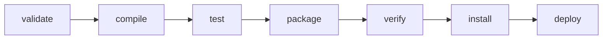

# 4.17 · Ciclo de vida do build (*build lifecycle*)

> **Em uma frase:** o Maven organiza o build em **fases** que acontecem sempre na mesma ordem; ao pedir uma fase (ex.: `mvn package`), todas as anteriores são executadas antes.

## 🔄 Os três ciclos de vida

| Ciclo | Para quê |
| --- | --- |
| **default** | Construir e distribuir o projeto (compilar → testar → empacotar → instalar → publicar). |
| **clean** | Limpar o que foi gerado em builds anteriores. |
| **site** | Gerar a documentação/relatórios do projeto. |

## 🪜 As fases principais do ciclo `default`



| Fase | O que acontece |
| --- | --- |
| `validate` | Confere se o projeto está correto e tem tudo o que precisa. |
| `compile` | Compila o código de `src/main/java`. |
| `test` | Roda os testes unitários (não precisam do pacote pronto). |
| `package` | Empacota o código compilado (`.jar`, `.war`). |
| `verify` | Roda verificações extras, como testes de integração e análise de qualidade. |
| `install` | Copia o pacote para o repositório **local** (`~/.m2`). |
| `deploy` | Envia o pacote para um repositório **remoto** (para outras pessoas/projetos). |

Entre elas existem fases intermediárias (`process-resources`, `test-compile`, `prepare-package`, `integration-test`...), que você raramente chama diretamente. O ciclo `clean` tem `pre-clean`, `clean` e `post-clean`; o `site` tem `pre-site`, `site`, `post-site` e `site-deploy`.

## ⚙️ Fases × goals (metas)

As fases são só "etapas"; quem trabalha de verdade são os **goals** dos **plugins**, que ficam "pendurados" nas fases:

| Fase | Goal executado (projeto `.jar`) |
| --- | --- |
| `process-resources` | `resources:resources` |
| `compile` | `compiler:compile` |
| `test` | `surefire:test` |
| `package` | `jar:jar` |
| `install` | `install:install` |
| `deploy` | `deploy:deploy` |

## ⌨️ Como chamar

```bash
mvn package                 # executa uma FASE (e todas as anteriores)
mvn clean package           # executa duas: o ciclo clean e depois o default até package
mvn dependency:tree         # executa um GOAL específico de um plugin (plugin:goal)
mvn compiler:compile        # só o goal de compilar, sem passar pelas outras fases
```

> [!NOTE]
> A sintaxe para um goal é `plugin:goal` (sem espaço). Já `mvn clean` sozinho chama a **fase** `clean`, que por sua vez executa o goal `clean:clean`.

## 📌 Resumindo

- Três ciclos: `default`, `clean` e `site`.
- Fases principais: validate → compile → test → package → verify → install → deploy.
- Pedir uma fase executa todas as anteriores.
- Goals de plugins fazem o trabalho; chame um goal direto com `plugin:goal`.

## 🏋️ Mão na massa

**1.** Quais fases rodam quando você executa `mvn install`?

<details>
<summary>Ver resposta</summary>

Todas as anteriores do ciclo `default` até `install`: `validate`, `compile`, `test`, `package`, `verify` e `install` (além das intermediárias).

</details>

**2.** Por que `mvn package` falha quando há um teste quebrado?

<details>
<summary>Ver resposta</summary>

Porque a fase `test` vem antes de `package` e também é executada. Se algum teste falha, o build para ali. (Dá para pular com `-DskipTests`, mas o ideal é corrigir o teste.)

</details>

**3.** Qual a diferença entre `mvn clean install` e `mvn install`?

<details>
<summary>Ver resposta</summary>

O primeiro apaga a pasta `target/` antes, garantindo um build "do zero", sem arquivos velhos de compilações anteriores. O segundo reaproveita o que já existe.

</details>

---

<div align="center">

[⬅️ 4.16 Gerenciamento de dependências](./16-maven-dependencias.md) &nbsp;|&nbsp; [🏠 Índice](../../README.md) &nbsp;|&nbsp; [4.18 Projetos multimódulos ➡️](./18-maven-multi-modulos.md)

</div>
