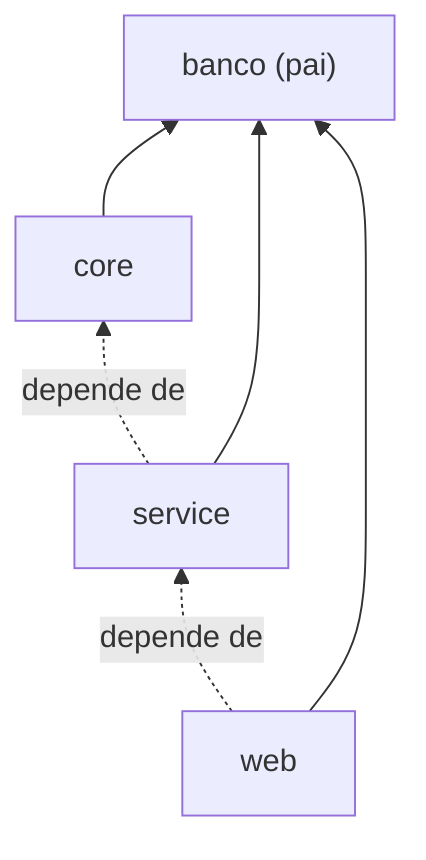

# 4.18 · Projetos multimódulos

> **Em uma frase:** um projeto multimódulo é um projeto "pai" que agrupa vários módulos Maven (cada um com seu `pom.xml`), permitindo construir tudo de uma vez e compartilhar configurações e versões.

## 🧩 Estrutura

```text
banco/                     ← projeto pai (packaging pom)
├── pom.xml
├── core/                  ← regras de negócio
│   └── pom.xml
├── service/               ← serviços que usam o core
│   └── pom.xml
└── web/                   ← API web que usa o service
    └── pom.xml
```



## 📄 O POM pai

```xml
<project>
    <modelVersion>4.0.0</modelVersion>
    <groupId>br.com.banco</groupId>
    <artifactId>banco</artifactId>
    <version>1.0.0</version>
    <packaging>pom</packaging>          <!-- o pai não gera .jar -->

    <modules>
        <module>core</module>
        <module>service</module>
        <module>web</module>
    </modules>
</project>
```

## 📄 O POM de um módulo

```xml
<project>
    <modelVersion>4.0.0</modelVersion>
    <parent>
        <groupId>br.com.banco</groupId>
        <artifactId>banco</artifactId>
        <version>1.0.0</version>
    </parent>
    <artifactId>service</artifactId>

    <dependencies>
        <dependency>
            <groupId>br.com.banco</groupId>
            <artifactId>core</artifactId>
            <version>${project.version}</version>
        </dependency>
    </dependencies>
</project>
```

Rodando `mvn install` na pasta do pai, o Maven descobre a ordem certa (o chamado *reactor*): primeiro `core`, depois `service`, depois `web`.

## ✅ Vantagens

- Organiza sistemas grandes em partes menores e independentes.
- Cada módulo pode ser testado separadamente.
- Versões e plugins ficam centralizados no pai (com `<dependencyManagement>` e `<pluginManagement>`).
- Um único comando constrói tudo na ordem correta.

> [!TIP]
> Para construir só um módulo e o que ele precisa: `mvn -pl web -am install` (`-pl` escolhe o módulo, `-am` inclui as dependências dele).

## 📌 Resumindo

- O pai tem `<packaging>pom</packaging>` e lista os `<modules>`.
- Cada módulo declara o pai em `<parent>` e pode depender de outros módulos.
- `mvn install` no pai constrói todos na ordem correta.

## 🏋️ Mão na massa

**1.** Qual `packaging` o POM pai precisa ter? Por quê?

<details>
<summary>Ver resposta</summary>

`pom`, porque o pai não tem código próprio para empacotar: ele só agrupa e configura os módulos.

</details>

**2.** O módulo `web` usa classes do `service`, que usa classes do `core`. Em que ordem o Maven os constrói?

<details>
<summary>Ver resposta</summary>

`core` → `service` → `web`. O Maven analisa as dependências entre os módulos e constrói primeiro quem não depende de ninguém.

</details>

**3.** Como evitar repetir a versão do JUnit em todos os módulos?

<details>
<summary>Ver resposta</summary>

Declare a versão uma vez no POM pai, dentro de `<dependencyManagement>` (ou importe o BOM do JUnit ali). Os módulos declaram a dependência **sem** `<version>`.

</details>

---

<div align="center">

[⬅️ 4.17 Ciclo de vida do build (build lifecycle)](./17-maven-ciclo-de-vida.md) &nbsp;|&nbsp; [🏠 Índice](../../README.md) &nbsp;|&nbsp; [4.19 Plugins do Maven ➡️](./19-maven-plugins.md)

</div>
