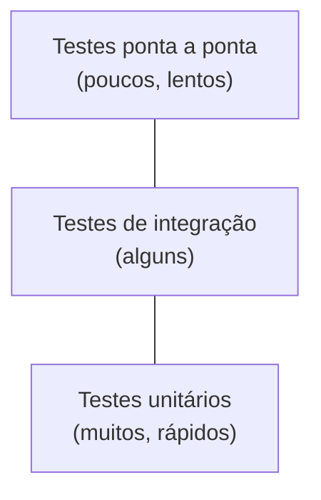

# 4.20 · Testes unitários e JUnit

> **Em uma frase:** um teste unitário é um pequeno programa que verifica, automaticamente, se **uma unidade** do código (geralmente um método) faz o que deveria; o **JUnit** é o framework padrão para escrevê-los em Java.

## 🤔 Por que testar?

- Detectar erros **cedo**, antes de chegarem ao usuário.
- Mudar o código com **segurança**: se algo quebrar, um teste avisa na hora.
- **Documentar** o comportamento esperado: o teste mostra como o método deve ser usado.
- Rodar centenas de verificações em segundos, a cada alteração.



Essa é a famosa **pirâmide de testes**: a base, com mais testes, é formada pelos unitários, que são rápidos e baratos.

## ☕ Sobre o JUnit

O JUnit foi criado em **1997 por Kent Beck e Erich Gamma**, inspirado no SUnit, um framework de testes para Smalltalk que Beck havia escrito antes. A geração atual é o **JUnit 5 (Jupiter)**, e o **JUnit 6** (2025) mantém a mesma forma de escrever testes. Tudo o que você vê aqui funciona nas duas versões.

## 🧪 Seu primeiro teste

Código a ser testado (`src/main/java`):

```java
public class Pessoa {
    private final String nome;
    private final int idade;

    public Pessoa(String nome, int idade) {
        this.nome = nome;
        this.idade = idade;
    }

    public boolean ehMaiorDeIdade() {
        return idade >= 18;
    }
}
```

Teste (`src/test/java`, mesmo pacote):

```java
import org.junit.jupiter.api.Test;
import static org.junit.jupiter.api.Assertions.*;

class PessoaTest {

    @Test
    void deveSerMaiorDeIdadeCom25Anos() {
        Pessoa pessoa = new Pessoa("João", 25);
        assertTrue(pessoa.ehMaiorDeIdade());
    }

    @Test
    void naoDeveSerMaiorDeIdadeCom17Anos() {
        Pessoa pessoa = new Pessoa("Ana", 17);
        assertFalse(pessoa.ehMaiorDeIdade());
    }
}
```

Dependência no `pom.xml`:

```xml
<dependency>
    <groupId>org.junit.jupiter</groupId>
    <artifactId>junit-jupiter</artifactId>
    <version>5.13.4</version>
    <scope>test</scope>
</dependency>
```

Rode com `mvn test` ou pelo ▶️ ao lado da classe de teste na IDE. Verde ✅ passou; vermelho ❌ falhou.

> [!TIP]
> Teste os **limites**: para `idade >= 18`, os casos mais importantes são 17 e 18. É nas bordas que os bugs se escondem.

## 📌 Resumindo

- Teste unitário verifica uma pequena parte do código, de forma automática e rápida.
- JUnit: métodos anotados com `@Test`, verificações com `assertTrue`, `assertEquals`...
- Testes ficam em `src/test/java`; rode com `mvn test`.
- Teste os casos de borda.

## 🏋️ Mão na massa

**1.** Escreva testes para um método `Calculadora.somar(int a, int b)`.

<details>
<summary>Ver resposta</summary>

```java
class CalculadoraTest {

    @Test
    void deveSomarDoisPositivos() {
        assertEquals(5, Calculadora.somar(2, 3));
    }

    @Test
    void deveSomarComNegativo() {
        assertEquals(-1, Calculadora.somar(2, -3));
    }
}
```

</details>

**2.** Quais idades você testaria para um método `podeVotar(int idade)` que retorna `true` a partir dos 16 anos?

<details>
<summary>Ver resposta</summary>

Os limites: **15** (`false`) e **16** (`true`). Também vale um valor comum, como 30, e um caso inválido, como idade negativa, para decidir o comportamento esperado (lançar exceção, por exemplo).

</details>

**3.** No projeto [`projetos/04-testes-junit`](../../projetos/04-testes-junit/), rode os testes com `mvn test`. Quantos passaram?

<details>
<summary>Ver resposta</summary>

O resumo aparece no final da saída, no formato `Tests run: X, Failures: 0, Errors: 0, Skipped: 0`. Se aparecer `BUILD SUCCESS`, todos passaram.

</details>

---

<div align="center">

[⬅️ 4.19 Plugins do Maven](./19-maven-plugins.md) &nbsp;|&nbsp; [🏠 Índice](../../README.md) &nbsp;|&nbsp; [4.21 JUnit a fundo ➡️](./21-junit-recursos.md)

</div>
