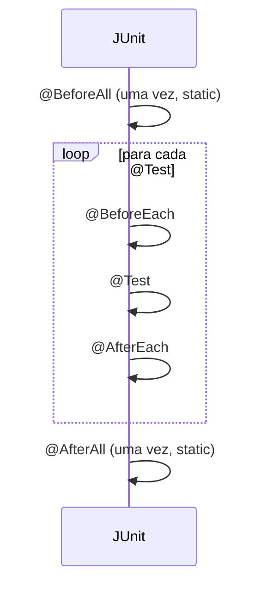

# 4.21 · JUnit a fundo: assertions, assumptions e ciclo de vida

> **Em uma frase:** *assertions* verificam o resultado (e fazem o teste falhar se estiver errado), *assumptions* pulam o teste se uma condição prévia não for atendida, e `@BeforeEach`/`@AfterEach`/`@BeforeAll`/`@AfterAll` preparam e limpam o ambiente.

📦 Referência usada no curso: [willyancaetano/junit5-exemplos](https://github.com/willyancaetano/junit5-exemplos).

> [!TIP]
> Convenções: classes de teste terminam com `Test` (`ContaTest`), ficam em `src/test/java` no **mesmo pacote** da classe testada, e os métodos têm nomes que descrevem o comportamento (`deveRecusarSaqueSemSaldo`).

## ✅ Assertions

| Método | Verifica que... |
| --- | --- |
| `assertEquals(esperado, atual)` | os valores são iguais |
| `assertNotEquals(a, b)` | são diferentes |
| `assertTrue(cond)` / `assertFalse(cond)` | a condição é verdadeira / falsa |
| `assertNull(obj)` / `assertNotNull(obj)` | é / não é `null` |
| `assertSame(a, b)` | são o **mesmo** objeto |
| `assertArrayEquals(a, b)` | os arrays têm o mesmo conteúdo |
| `assertThrows(Tipo.class, () -> ...)` | o código lança aquela exceção |
| `assertAll(...)` | várias verificações, reportando todas as que falharem |
| `assertTimeout(Duration, () -> ...)` | termina dentro do tempo |

```java
@Test
void deveRecusarSaqueSemSaldo() {
    Conta conta = new Conta(100);
    var erro = assertThrows(SaldoInsuficienteException.class, () -> conta.sacar(500));
    assertTrue(erro.getMessage().contains("Saldo insuficiente"));
}

@Test
void deveCriarPessoaComDadosCorretos() {
    Pessoa p = new Pessoa("Ana", 30);
    assertAll(
        () -> assertEquals("Ana", p.getNome()),
        () -> assertEquals(30, p.getIdade())
    );
}
```

> [!NOTE]
> A ordem é `assertEquals(ESPERADO, ATUAL)`. Invertê-la não muda se o teste passa, mas deixa a mensagem de erro confusa.

## ⏭️ Assumptions

Se a suposição for falsa, o teste é **pulado** (aparece como *skipped*), em vez de falhar:

```java
@Test
void soRodaNoWindows() {
    assumeTrue(System.getProperty("os.name").startsWith("Windows"));
    // ... verificações que só fazem sentido no Windows
}
```

Use para testes que dependem do ambiente (sistema operacional, variável de ambiente, serviço externo disponível). Também existem anotações prontas, como `@EnabledOnOs(OS.WINDOWS)` e `@EnabledIfEnvironmentVariable`.

## 🔁 Ciclo de vida



| Anotação | Quando roda | Uso típico |
| --- | --- | --- |
| `@BeforeAll` | Uma vez, antes de todos (método `static`) | Abrir conexão, subir um servidor de teste |
| `@BeforeEach` | Antes de **cada** teste | Criar objetos "limpos" para o teste |
| `@AfterEach` | Depois de **cada** teste | Desfazer alterações (ex.: *rollback*) |
| `@AfterAll` | Uma vez, depois de todos (método `static`) | Fechar conexões |

```java
class ContaTest {

    private Conta conta;

    @BeforeEach
    void prepararConta() {
        conta = new Conta(100);      // cada teste começa com uma conta nova
    }

    @Test
    void deveDepositar() {
        conta.depositar(50);
        assertEquals(150, conta.getSaldo());
    }

    @Test
    void deveSacar() {
        conta.sacar(30);
        assertEquals(70, conta.getSaldo());   // não é afetado pelo teste de depósito
    }
}
```

> [!IMPORTANT]
> Cada teste deve ser **independente**: não pode depender da ordem nem do resultado de outro. O `@BeforeEach` ajuda a garantir isso.

## 🧰 Outros recursos úteis

```java
@DisplayName("Conta corrente")             // nome amigável no relatório
@Disabled("Aguardando correção do bug #42") // desliga um teste temporariamente

@ParameterizedTest                          // o mesmo teste com vários dados
@ValueSource(ints = {18, 30, 65})
void deveSerMaiorDeIdade(int idade) {
    assertTrue(new Pessoa("X", idade).ehMaiorDeIdade());
}

@ParameterizedTest
@CsvSource({"2, 3, 5", "10, -4, 6", "0, 0, 0"})
void deveSomar(int a, int b, int esperado) {
    assertEquals(esperado, Calculadora.somar(a, b));
}
```

> [!TIP]
> Para testar uma classe que depende de outras (um serviço que usa um banco de dados, por exemplo), use **Mockito** para criar "dublês" (*mocks*) dessas dependências. Ele já vem no `spring-boot-starter-test`.

📂 Projeto de exemplo do curso: [`projetos/04-testes-junit`](../../projetos/04-testes-junit/).

## 📌 Resumindo

- Assertions verificam resultados; `assertThrows` testa exceções; `assertAll` agrupa verificações.
- Assumptions pulam o teste quando o ambiente não é adequado.
- `@BeforeEach`/`@AfterEach` (cada teste) e `@BeforeAll`/`@AfterAll` (uma vez, `static`).
- `@ParameterizedTest` roda o mesmo teste com vários dados.

## 🏋️ Mão na massa

**1.** Escreva um teste que verifique que `Integer.parseInt("abc")` lança `NumberFormatException`.

<details>
<summary>Ver resposta</summary>

```java
@Test
void deveFalharAoConverterTexto() {
    assertThrows(NumberFormatException.class, () -> Integer.parseInt("abc"));
}
```

</details>

**2.** Reescreva três testes de soma em um único teste parametrizado.

<details>
<summary>Ver resposta</summary>

```java
@ParameterizedTest
@CsvSource({"1, 1, 2", "2, 3, 5", "-1, 1, 0"})
void deveSomar(int a, int b, int esperado) {
    assertEquals(esperado, Calculadora.somar(a, b));
}
```

(Precisa da dependência `junit-jupiter-params`, que já vem dentro do `junit-jupiter`.)

</details>

**3.** Um teste passa quando roda sozinho, mas falha quando roda com os outros. Qual a causa provável?

<details>
<summary>Ver resposta</summary>

Os testes estão **compartilhando estado** (por exemplo, um atributo `static` ou um objeto criado uma vez só e alterado por vários testes). A solução é recriar os objetos no `@BeforeEach` e não depender da ordem de execução.

</details>

---

<div align="center">

[⬅️ 4.20 Testes unitários e JUnit](./20-testes-unitarios.md) &nbsp;|&nbsp; [🏠 Índice](../../README.md) &nbsp;|&nbsp; [4.22 Boas práticas de testes e TDD ➡️](./22-testes-boas-praticas.md)

</div>
