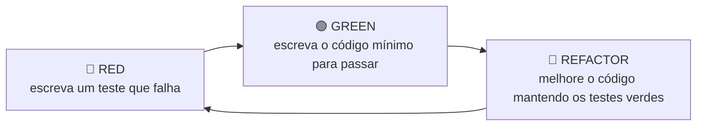

# 4.22 · Boas práticas de testes e TDD

> **Em uma frase:** bons testes são **simples, independentes e determinísticos**, seguem a estrutura *Arrange-Act-Assert*, e o TDD propõe escrever o teste **antes** do código.

## 🧱 Estrutura AAA (*Arrange, Act, Assert*)

```java
@Test
void deveAplicarDescontoDe10PorCentoAcimaDe100Reais() {
    // Arrange (prepara)
    Pedido pedido = new Pedido();
    pedido.adicionarItem("Teclado", 150.0);

    // Act (executa)
    double total = pedido.calcularTotalComDesconto();

    // Assert (verifica)
    assertEquals(135.0, total, 0.001);   // o terceiro argumento é a tolerância para doubles
}
```

## ✅ Princípios FIRST

| Letra | Princípio | Significa |
| --- | --- | --- |
| **F** | *Fast* | Rodam rápido (milissegundos). |
| **I** | *Independent* | Não dependem uns dos outros nem da ordem. |
| **R** | *Repeatable* | Dão o mesmo resultado em qualquer máquina, a qualquer hora. |
| **S** | *Self-validating* | Passam ou falham sozinhos, sem alguém conferir a saída. |
| **T** | *Timely* | São escritos junto com o código (ou antes dele). |

## 🔁 TDD: *Test-Driven Development*



Vantagens: força a pensar no **comportamento** antes da implementação, gera código mais simples e testável, e você termina com uma suíte de testes completa.

## 💡 Dicas práticas

- **Nomes que contam uma história**: `deveRecusarSaqueQuandoSaldoForInsuficiente` em vez de `teste1`.
- **Um comportamento por teste.** Se o nome precisar de um "e", talvez sejam dois testes.
- **Testes determinísticos**: evite depender de data/hora atual, números aleatórios ou internet sem controlá-los.
- **Comece a testar cedo**: quanto mais tarde um bug é descoberto, mais caro é corrigi-lo.
- **Automatize**: rode os testes a cada push (por exemplo, com GitHub Actions) e acompanhe a **cobertura** com o JaCoCo (aula [4.19](./19-maven-plugins.md)).

> [!WARNING]
> Cobertura alta **não garante** bons testes: é possível executar 100% das linhas sem verificar nada. Use a cobertura para encontrar trechos **não testados**, não como meta absoluta.

## 📌 Resumindo

- Estruture os testes em Arrange → Act → Assert.
- Siga o FIRST: rápidos, independentes, repetíveis, autoverificáveis e feitos no tempo certo.
- TDD: vermelho → verde → refatorar.
- Nomes descritivos, um comportamento por teste, nada de aleatoriedade sem controle.

## 🏋️ Mão na massa

**1.** Use TDD para criar um método `ehPalindromo(String)` (palavra que se lê igual de trás para frente). Comece pelos testes.

<details>
<summary>Ver resposta</summary>

Testes primeiro (🔴):

```java
@Test void arara() { assertTrue(Texto.ehPalindromo("arara")); }
@Test void java()  { assertFalse(Texto.ehPalindromo("java")); }
@Test void comMaiusculas() { assertTrue(Texto.ehPalindromo("Ana")); }
```

Código mínimo (🟢):

```java
public static boolean ehPalindromo(String texto) {
    String t = texto.toLowerCase();
    return new StringBuilder(t).reverse().toString().equals(t);
}
```

Depois, refatore se necessário (🔵), por exemplo para ignorar espaços.

</details>

**2.** O que há de errado neste teste?

```java
@Test
void testeData() {
    assertEquals("2026-10-18", LocalDate.now().toString());
}
```

<details>
<summary>Ver resposta</summary>

Ele **não é repetível**: só passa no dia 18/10/2026. Testes não devem depender da data atual; use uma data fixa ou injete um `Clock` controlado.

</details>

**3.** Reescreva o nome `teste2` para um teste que verifica que não é possível depositar valor negativo.

<details>
<summary>Ver resposta</summary>

`deveRecusarDepositoComValorNegativo` (ou, no estilo dado/quando/então: `dadoValorNegativo_quandoDepositar_entaoLancaExcecao`).

</details>

---

<div align="center">

[⬅️ 4.21 JUnit a fundo](./21-junit-recursos.md) &nbsp;|&nbsp; [🏠 Índice](../../README.md) &nbsp;|&nbsp; [4.23 Desafio POO ➡️](./23-desafio-poo.md)

</div>
