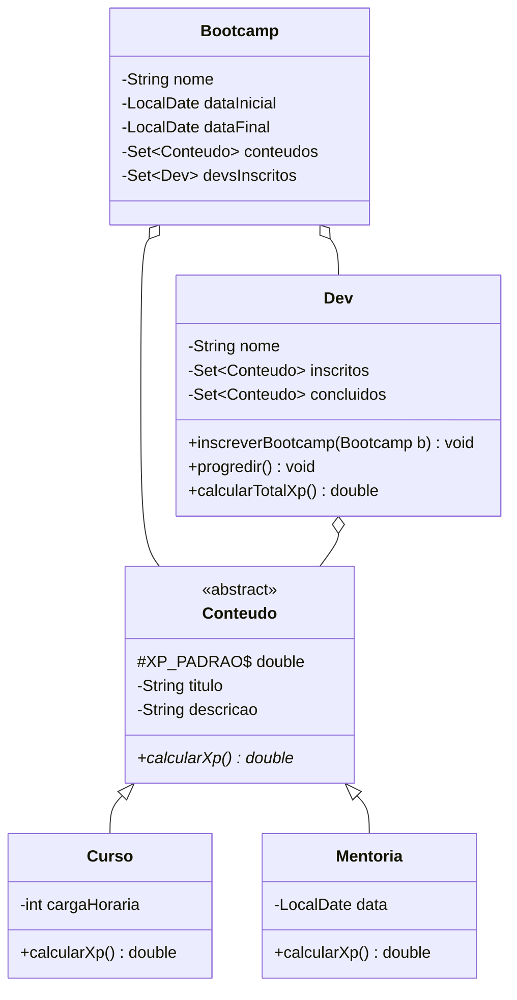

# 4.24 · Desafio POO: o domínio de um bootcamp

> **Em uma frase:** modelar um **bootcamp** com cursos, mentorias e devs inscritos, aplicando os quatro pilares da Orientação a Objetos: abstração, encapsulamento, herança e polimorfismo.

📦 Repositório de referência do desafio: [cami-la/desafio-poo-dio](https://github.com/cami-la/desafio-poo-dio). Gere o `.gitignore` do seu projeto em [gitignore.io](https://www.toptal.com/developers/gitignore/).

> [!NOTE]
> O código do meu projeto original deste desafio não foi preservado (a pasta estava como um submódulo quebrado). Abaixo está uma solução completa e revisada, seguindo o enunciado do curso.

## 📋 O desafio

- Um **Bootcamp** tem nome, descrição, data de início e fim, uma lista de **conteúdos** e uma lista de **devs inscritos**.
- Um **Conteúdo** pode ser um **Curso** (com carga horária) ou uma **Mentoria** (com data). Todo conteúdo gera **XP** para o dev que o conclui.
- Um **Dev** se inscreve em bootcamps, progride nos conteúdos e acumula XP.



## 🧱 Onde estão os pilares

| Pilar | Na solução |
| --- | --- |
| **Abstração** | Só modelamos o que importa: título, XP, carga horária... |
| **Encapsulamento** | Atributos `private`; listas expostas como cópias somente leitura. |
| **Herança** | `Curso` e `Mentoria` estendem `Conteudo`. |
| **Polimorfismo** | `calcularXp()` é chamado em qualquer `Conteudo`, e cada tipo calcula do seu jeito. |

<details>
<summary>Ver a solução completa</summary>

```java
public abstract class Conteudo {
    protected static final double XP_PADRAO = 10d;

    private final String titulo;
    private final String descricao;

    protected Conteudo(String titulo, String descricao) {
        this.titulo = titulo;
        this.descricao = descricao;
    }

    public abstract double calcularXp();

    public String getTitulo() { return titulo; }
    public String getDescricao() { return descricao; }
}
```

```java
public class Curso extends Conteudo {
    private final int cargaHoraria;

    public Curso(String titulo, String descricao, int cargaHoraria) {
        super(titulo, descricao);
        this.cargaHoraria = cargaHoraria;
    }

    @Override
    public double calcularXp() {
        return XP_PADRAO * cargaHoraria;
    }

    @Override
    public String toString() { return "Curso{" + getTitulo() + ", " + cargaHoraria + "h}"; }
}
```

```java
import java.time.LocalDate;

public class Mentoria extends Conteudo {
    private final LocalDate data;

    public Mentoria(String titulo, String descricao, LocalDate data) {
        super(titulo, descricao);
        this.data = data;
    }

    @Override
    public double calcularXp() {
        return XP_PADRAO + 20d;
    }

    @Override
    public String toString() { return "Mentoria{" + getTitulo() + ", " + data + "}"; }
}
```

```java
import java.time.LocalDate;
import java.util.*;

public class Bootcamp {
    private final String nome;
    private final String descricao;
    private final LocalDate dataInicial = LocalDate.now();
    private final LocalDate dataFinal = dataInicial.plusDays(45);
    private final Set<Conteudo> conteudos = new LinkedHashSet<>();
    private final Set<Dev> devsInscritos = new HashSet<>();

    public Bootcamp(String nome, String descricao) {
        this.nome = nome;
        this.descricao = descricao;
    }

    public void adicionarConteudo(Conteudo conteudo) { conteudos.add(conteudo); }
    void registrarDev(Dev dev) { devsInscritos.add(dev); }     // usado por Dev

    public Set<Conteudo> getConteudos() { return Collections.unmodifiableSet(conteudos); }
    public Set<Dev> getDevsInscritos() { return Collections.unmodifiableSet(devsInscritos); }
    public String getNome() { return nome; }
}
```

```java
import java.util.*;

public class Dev {
    private final String nome;
    private final Set<Conteudo> inscritos = new LinkedHashSet<>();
    private final Set<Conteudo> concluidos = new LinkedHashSet<>();

    public Dev(String nome) { this.nome = nome; }

    public void inscreverBootcamp(Bootcamp bootcamp) {
        inscritos.addAll(bootcamp.getConteudos());
        bootcamp.registrarDev(this);
    }

    public void progredir() {
        Iterator<Conteudo> proximo = inscritos.iterator();
        if (!proximo.hasNext()) {
            System.out.println(nome + " não está matriculado em nenhum conteúdo!");
            return;
        }
        Conteudo conteudo = proximo.next();
        concluidos.add(conteudo);
        proximo.remove();
    }

    public double calcularTotalXp() {
        return concluidos.stream().mapToDouble(Conteudo::calcularXp).sum();   // polimorfismo
    }

    public Set<Conteudo> getInscritos() { return Collections.unmodifiableSet(inscritos); }
    public Set<Conteudo> getConcluidos() { return Collections.unmodifiableSet(concluidos); }
    public String getNome() { return nome; }
}
```

```java
import java.time.LocalDate;

public class Main {
    public static void main(String[] args) {
        Curso java = new Curso("Curso Java", "Fundamentos de Java", 8);
        Curso spring = new Curso("Curso Spring", "APIs REST com Spring Boot", 4);
        Mentoria mentoria = new Mentoria("Mentoria de carreira", "Como se preparar", LocalDate.now());

        Bootcamp bootcamp = new Bootcamp("Banco Pan Java Developer", "Bootcamp de Java");
        bootcamp.adicionarConteudo(java);
        bootcamp.adicionarConteudo(spring);
        bootcamp.adicionarConteudo(mentoria);

        Dev camila = new Dev("Camila");
        camila.inscreverBootcamp(bootcamp);
        camila.progredir();
        camila.progredir();

        System.out.println("Inscritos:  " + camila.getInscritos());    // [Mentoria{...}]
        System.out.println("Concluídos: " + camila.getConcluidos());   // [Curso Java, Curso Spring]
        System.out.println("XP: " + camila.calcularTotalXp());          // 80 + 40 = 120.0
    }
}
```

</details>

## 🏋️ Mão na massa

**1.** Crie um novo tipo de conteúdo, `Desafio`, que vale 50 XP fixos, sem alterar `Dev` nem `Bootcamp`.

<details>
<summary>Ver resposta</summary>

```java
public class Desafio extends Conteudo {
    public Desafio(String titulo, String descricao) { super(titulo, descricao); }

    @Override
    public double calcularXp() { return 50d; }
}
```

Como `Dev` só conhece o tipo `Conteudo`, ele passa a aceitar desafios automaticamente. Esse é o poder do polimorfismo.

</details>

**2.** Por que `getConteudos()` devolve `Collections.unmodifiableSet(...)` em vez do próprio `Set`?

<details>
<summary>Ver resposta</summary>

Para preservar o **encapsulamento**: quem chama consegue ler, mas não consegue fazer `bootcamp.getConteudos().clear()` e apagar os conteúdos por fora. Toda alteração passa pelos métodos da própria classe.

</details>

**3.** Escreva um teste JUnit garantindo que um dev que concluiu um curso de 8 horas tem 80 XP.

<details>
<summary>Ver resposta</summary>

```java
@Test
void deveSomarXpDoCursoConcluido() {
    Bootcamp bootcamp = new Bootcamp("Teste", "Teste");
    bootcamp.adicionarConteudo(new Curso("Java", "Java", 8));
    Dev dev = new Dev("Ana");

    dev.inscreverBootcamp(bootcamp);
    dev.progredir();

    assertEquals(80.0, dev.calcularTotalXp(), 0.001);
}
```

</details>

---

<div align="center">

[⬅️ 4.23 Boas práticas de testes e TDD](./23-testes-boas-praticas.md) &nbsp;|&nbsp; [🏠 Índice](../../README.md) &nbsp;|&nbsp; [5.1 O que é um banco de dados (e como preparar o ambiente) ➡️](../05-banco-de-dados/01-o-que-e-banco-de-dados.md)

</div>
