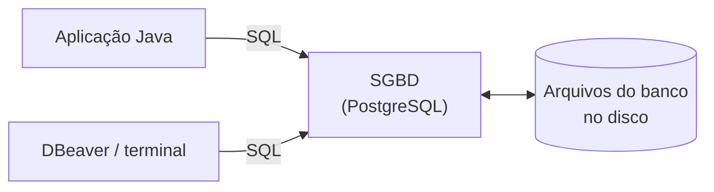
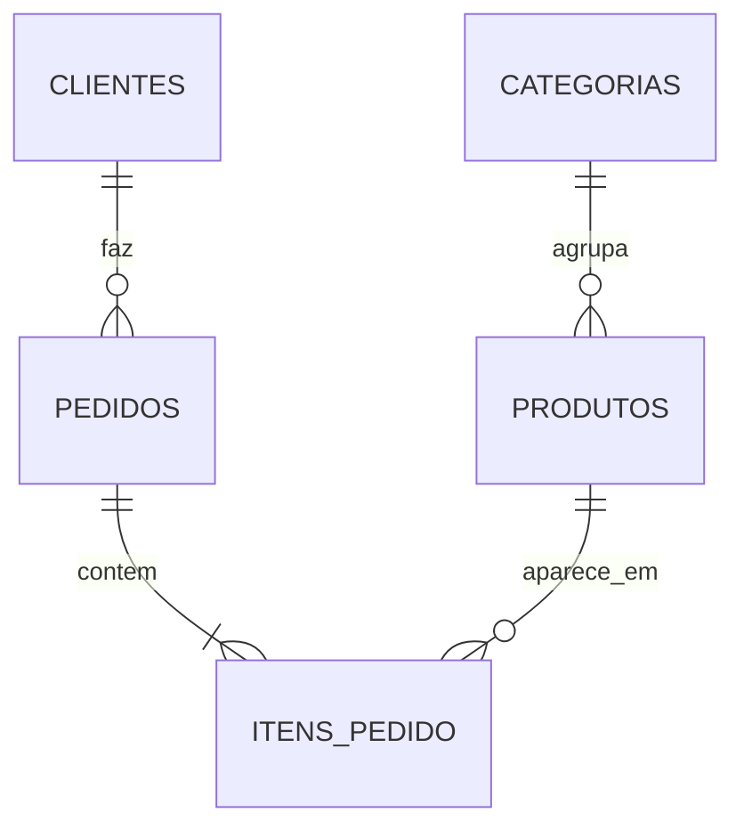

# 5.1 · O que é um banco de dados (e como preparar o ambiente)

> **Em uma frase:** um **banco de dados** é um lugar organizado para guardar informações de forma permanente e segura, e o **SGBD** (como PostgreSQL ou MySQL) é o programa que cuida desse lugar e responde aos pedidos da sua aplicação.

## 🤔 Por que não guardar tudo num arquivo ou numa variável?

Até agora, os dados dos nossos programas viviam em **variáveis** e **listas**: quando o programa terminava, tudo sumia. Uma loja virtual precisa lembrar dos clientes, produtos e pedidos **para sempre**, mesmo que o servidor reinicie.

Você poderia salvar tudo num arquivo de texto ou numa planilha, mas logo apareceriam problemas:

| Problema | Planilha / arquivo | Banco de dados |
| --- | --- | --- |
| Duas pessoas comprando o último produto ao mesmo tempo | Os dois pedidos podem ser aceitos | Controla o acesso simultâneo (**concorrência**) |
| Encontrar um cliente entre 10 milhões | Lê o arquivo inteiro | Usa **índices** e acha em milissegundos |
| Queda de energia no meio de uma gravação | Arquivo corrompido | **Transações** garantem "tudo ou nada" |
| Alguém digita "abc" no campo de preço | Aceita | **Regras** (tipos e restrições) recusam |
| Quem pode ver os salários? | Quem tiver o arquivo | **Usuários e permissões** |

> [!TIP]
> Analogia: a planilha é um caderno de anotações; o banco de dados é uma **biblioteca com bibliotecário**. Você não procura o livro sozinho nas prateleiras: pede ao bibliotecário (o SGBD), que sabe exatamente onde está tudo, impede que dois peguem o mesmo exemplar e anota cada empréstimo.

## 🧩 Conceitos básicos

| Termo | O que é | Exemplo |
| --- | --- | --- |
| **Dado** | Um valor isolado | `"Ana"`, `30`, `2026-10-18` |
| **Informação** | Dados com significado | "Ana, 30 anos, comprou em 18/10" |
| **Banco de dados** | O conjunto organizado de dados | O banco `loja` |
| **SGBD** (Sistema Gerenciador de Banco de Dados) | O programa que guarda, protege e consulta os dados | PostgreSQL, MySQL, SQL Server, Oracle, MongoDB |
| **Cliente** | Quem faz pedidos ao SGBD | Sua aplicação Java, o DBeaver, o terminal |
| **Consulta** (*query*) | Um pedido feito ao banco | "Quais clientes moram no Rio?" |



A sua aplicação **nunca** mexe nos arquivos do banco diretamente: ela envia comandos ao SGBD, que faz o trabalho e devolve o resultado.

## 🗂️ Os dois grandes grupos

| | Relacional (SQL) | Não relacional (NoSQL) |
| --- | --- | --- |
| Organiza os dados em | **Tabelas** com linhas e colunas, ligadas por chaves | Documentos, pares chave-valor, grafos... |
| Linguagem | **SQL**, padronizada | Própria de cada banco |
| Exemplos | PostgreSQL, MySQL, SQL Server, Oracle, SQLite | MongoDB, Redis, DynamoDB, Cassandra |
| Onde aparece no módulo | Aulas 5.2 a 5.9 | Aulas 5.10 a 5.16 |

Vamos começar pelo modelo **relacional**: ele é o mais usado no mercado (bancos, varejo, governo), e os conceitos dele ajudam a entender todos os outros.

## 📖 Um pouco de história

Em **1970**, Edgar F. Codd, pesquisador da IBM, propôs o **modelo relacional**: guardar dados em tabelas e relacioná-las por valores em comum. Para testar a ideia, a IBM criou o protótipo **System R** e a linguagem **SEQUEL**, depois renomeada para **SQL** (*Structured Query Language*, pronuncia-se "és-qui-éle" ou "síquel"). O primeiro banco relacional comercial foi o **Oracle**, em 1979. Desde 1986 o SQL é um padrão (ANSI/ISO), e por isso o que você aprender aqui funciona, com pequenas diferenças, em qualquer banco relacional.

## 💻 Preparando o ambiente

Vamos usar o **PostgreSQL**, gratuito, de código aberto e um dos mais usados com Java e Spring. Escolha **uma** das opções:

### Opção 1: no navegador, sem instalar nada

Abra o [DB Fiddle](https://www.db-fiddle.com/), escolha **PostgreSQL** no menu, escreva os comandos de criação à esquerda e as consultas à direita, e clique em **Run**. Ótimo para os exercícios deste módulo.

### Opção 2: com Docker (recomendado)

```bash
# Sobe um PostgreSQL 17 na porta 5432, com o banco "loja"
docker run -d --name postgres -e POSTGRES_PASSWORD=senha -e POSTGRES_DB=loja -p 5432:5432 postgres:17

# Abre o terminal do banco (psql)
docker exec -it postgres psql -U postgres -d loja
```

Dentro do `psql`, digite os comandos SQL terminando com `;`. Para sair, digite `\q`. Se nunca usou Docker, veja a aula [8.3](../08-extras/03-docker-para-java.md).

### Opção 3: instalação tradicional

Baixe o instalador em [postgresql.org/download](https://www.postgresql.org/download/). Ele já traz o **pgAdmin**, uma interface gráfica.

### Uma interface gráfica

Para ver as tabelas e escrever SQL com conforto, instale o **[DBeaver Community](https://dbeaver.io/)** (gratuito, funciona com qualquer banco). Crie uma conexão **PostgreSQL** com host `localhost`, porta `5432`, banco `loja`, usuário `postgres` e senha `senha`. O IntelliJ Ultimate também tem uma aba **Database** com os mesmos recursos.

> [!NOTE]
> Os comandos deste módulo seguem o padrão SQL e foram escritos para o PostgreSQL. No MySQL, a maior parte funciona igual; quando houver diferença importante, ela será indicada.

## 🗺️ O banco que vamos construir

Ao longo das próximas aulas vamos montar, passo a passo, o banco de uma pequena **loja virtual**:



Não se preocupe se o desenho ainda não fizer sentido: a próxima aula explica cada símbolo.

## 📌 Resumindo

- Banco de dados guarda informações de forma **permanente**, **organizada** e **segura**.
- O **SGBD** é o programa que gerencia o banco; a aplicação conversa com ele por SQL.
- Bancos resolvem concorrência, buscas rápidas, falhas no meio da gravação, validação e permissões.
- Relacionais usam tabelas e SQL; NoSQL usam outros formatos.
- Para praticar: DB Fiddle no navegador, ou PostgreSQL com Docker + DBeaver.

## 🏋️ Mão na massa

**1.** Cite três problemas que surgiriam se uma loja guardasse os pedidos numa planilha compartilhada.

<details>
<summary>Ver resposta</summary>

Duas pessoas alterando ao mesmo tempo e uma sobrescrevendo a outra; dados inválidos (texto no lugar de número, datas erradas); buscas lentas quando a planilha ficar enorme; perda de dados se o arquivo corromper; qualquer pessoa com o arquivo vê tudo.

</details>

**2.** Prepare o ambiente: suba o PostgreSQL (ou abra o DB Fiddle) e rode `SELECT version();`. O que aparece?

<details>
<summary>Ver resposta</summary>

Uma linha com a versão do PostgreSQL, por exemplo `PostgreSQL 17.x on x86_64-pc-linux-gnu...`. Se apareceu, o ambiente está pronto para as próximas aulas.

</details>

**3.** Qual a diferença entre banco de dados e SGBD?

<details>
<summary>Ver resposta</summary>

O **banco de dados** é o conjunto de dados organizados (as tabelas da loja). O **SGBD** é o programa que guarda esses dados, controla quem acessa e executa as consultas (o PostgreSQL). Num mesmo SGBD podem existir vários bancos.

</details>

---

<div align="center">

[⬅️ 4.24 Desafio POO](../04-poo/24-desafio-poo.md) &nbsp;|&nbsp; [🏠 Índice](../../README.md) &nbsp;|&nbsp; [5.2 Modelagem relacional ➡️](./02-modelagem-relacional.md)

</div>
