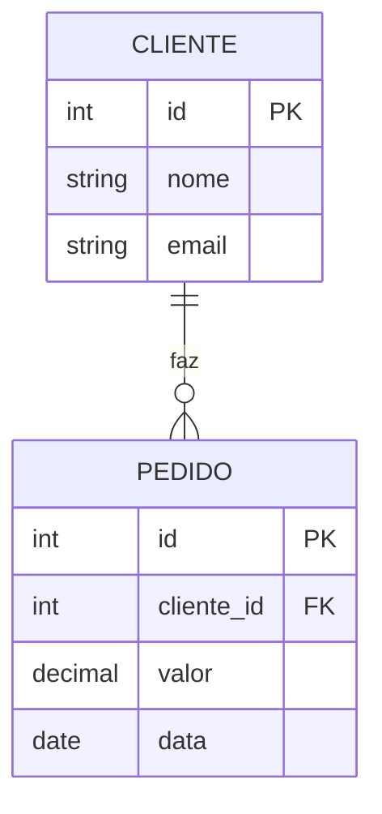

# 5.1 · Primeiros passos com SQL e bancos relacionais

> **Em uma frase:** um banco **relacional** guarda dados em **tabelas** (linhas e colunas) ligadas por **chaves**, e o **SQL** é a linguagem usada para criar essas tabelas e consultar, inserir, alterar e apagar dados.

## 📖 Um pouco de história

Nos anos 1970, Edgar F. Codd (IBM) propôs o **modelo relacional**, baseado na teoria dos conjuntos. Para o protótipo **System R**, Donald Chamberlin e Raymond Boyce criaram a linguagem **SEQUEL**, depois renomeada para **SQL** (*Structured Query Language*). O primeiro banco relacional comercial com SQL foi o **Oracle**, em 1979. Hoje o SQL é um padrão (ANSI/ISO) usado por PostgreSQL, MySQL, SQL Server, Oracle e muitos outros, cada um com pequenas variações.

## 🗂️ Tabelas, linhas, colunas e chaves

| id | nome | email | idade |
| --- | --- | --- | --- |
| 1 | Maria Silva | `maria@email.com` | 30 |
| 2 | João Souza | `joao@email.com` | 25 |

- Cada **tabela** representa uma entidade (clientes, pedidos...).
- Cada **coluna** é um atributo, com um **tipo** definido.
- Cada **linha** é um registro.
- A **chave primária** (*PK*) identifica cada linha de forma única.
- A **chave estrangeira** (*FK*) aponta para a PK de outra tabela, criando o relacionamento.



Lê-se: um cliente faz **zero ou muitos** pedidos; cada pedido pertence a **exatamente um** cliente.

### Modelo ER × modelo relacional

- O **modelo entidade-relacionamento (ER)** é o **desenho** conceitual: entidades, atributos e relacionamentos (1:1, 1:N, N:N), como o diagrama acima.
- O **modelo relacional** é a **implementação** em tabelas, colunas e chaves. Um relacionamento N:N, por exemplo, vira uma tabela intermediária.
- A **normalização** é um conjunto de regras para organizar as tabelas evitando dados duplicados e inconsistentes.

## 🧩 As sublinguagens do SQL

| Sigla | Nome | Para quê | Comandos |
| --- | --- | --- | --- |
| **DDL** | *Data Definition Language* | Criar e alterar a **estrutura** | `CREATE`, `ALTER`, `DROP`, `TRUNCATE` |
| **DML** | *Data Manipulation Language* | Mexer nos **dados** | `INSERT`, `UPDATE`, `DELETE` |
| **DQL** | *Data Query Language* | **Consultar** dados | `SELECT` |
| **DCL** | *Data Control Language* | **Permissões** | `GRANT`, `REVOKE` |
| **TCL** | *Transaction Control Language* | **Transações** | `COMMIT`, `ROLLBACK`, `SAVEPOINT` |

> [!NOTE]
> Algumas referências colocam o `SELECT` dentro da DML. As duas classificações são comuns.

### DDL: criando a estrutura

```sql
CREATE TABLE clientes (
    id     INT PRIMARY KEY,
    nome   VARCHAR(100) NOT NULL,
    email  VARCHAR(100) UNIQUE,
    idade  INT CHECK (idade >= 0)
);

CREATE TABLE pedidos (
    id          INT PRIMARY KEY,
    cliente_id  INT NOT NULL,
    valor       DECIMAL(10, 2) NOT NULL,
    data        DATE NOT NULL,
    FOREIGN KEY (cliente_id) REFERENCES clientes (id)
);

ALTER TABLE clientes ADD COLUMN telefone VARCHAR(20);
```

### DML: inserindo, alterando e apagando

```sql
INSERT INTO clientes (id, nome, email, idade) VALUES
    (1, 'Maria Silva', 'maria@email.com', 30),
    (2, 'João Souza',  'joao@email.com',  25),
    (3, 'Ana Santos',  'ana@email.com',   40);

UPDATE clientes SET idade = 31 WHERE id = 1;

DELETE FROM clientes WHERE id = 3;
```

> [!CAUTION]
> `UPDATE` e `DELETE` **sem `WHERE`** alteram ou apagam **todas as linhas** da tabela. Sempre confira o `WHERE` antes de executar.

### DQL: consultando

```sql
SELECT nome, idade FROM clientes WHERE idade >= 30 ORDER BY nome;

SELECT COUNT(*) AS total, AVG(idade) AS media FROM clientes;

-- JOIN: junta clientes e pedidos pela chave
SELECT c.nome, SUM(p.valor) AS total_gasto
FROM clientes c
JOIN pedidos p ON p.cliente_id = c.id
GROUP BY c.nome
HAVING SUM(p.valor) > 100
ORDER BY total_gasto DESC;
```

| Cláusula | Para quê |
| --- | --- |
| `WHERE` | Filtra **linhas** antes de agrupar |
| `GROUP BY` | Agrupa linhas para funções de agregação (`COUNT`, `SUM`, `AVG`, `MIN`, `MAX`) |
| `HAVING` | Filtra **grupos** depois de agrupar |
| `ORDER BY` | Ordena o resultado (`ASC` ou `DESC`) |
| `JOIN` | Combina linhas de tabelas relacionadas |

### DCL e TCL

```sql
GRANT SELECT, INSERT ON clientes TO usuario_relatorio;

BEGIN;                                           -- inicia uma transação
UPDATE contas SET saldo = saldo - 100 WHERE id = 1;
UPDATE contas SET saldo = saldo + 100 WHERE id = 2;
COMMIT;                                          -- confirma (ou ROLLBACK para desfazer)
```

Uma **transação** garante que um conjunto de operações aconteça **por completo ou não aconteça**: numa transferência, não pode sair dinheiro de uma conta sem entrar na outra. Bancos relacionais seguem as propriedades **ACID** (Atomicidade, Consistência, Isolamento e Durabilidade).

## 🔢 Tipos de dados mais comuns

| Tipo | Guarda | Exemplo |
| --- | --- | --- |
| `INT` / `BIGINT` / `SMALLINT` | Inteiros | `idade INT` |
| `DECIMAL(p, s)` (ou `NUMERIC`) | Decimais **exatos** (use para dinheiro) | `valor DECIMAL(10, 2)` |
| `FLOAT` / `DOUBLE` / `REAL` | Decimais aproximados | `temperatura REAL` |
| `CHAR(n)` | Texto de tamanho **fixo** | `uf CHAR(2)` |
| `VARCHAR(n)` | Texto de tamanho **variável** até `n` | `nome VARCHAR(100)` |
| `TEXT` | Textos longos | `descricao TEXT` |
| `DATE` / `TIME` / `TIMESTAMP` | Data / hora / data e hora | `nascimento DATE` |
| `BOOLEAN` | Verdadeiro/falso | `ativo BOOLEAN` |
| `BLOB` / `BYTEA` | Dados binários | `foto BYTEA` |

> [!NOTE]
> Os nomes variam um pouco entre bancos (o MySQL tem `TINYINT`, `ENUM` e `LONGTEXT`; o PostgreSQL tem `SERIAL`, `JSONB` e `UUID`). Consulte a documentação do banco que você estiver usando.

## 🔒 Constraints (restrições)

| Constraint | Garante que... |
| --- | --- |
| `PRIMARY KEY` | o valor é único e não nulo (identifica a linha) |
| `FOREIGN KEY` | o valor existe na tabela referenciada |
| `UNIQUE` | não há valores repetidos (aceita nulos) |
| `NOT NULL` | a coluna sempre tem valor |
| `CHECK` | o valor obedece a uma condição (ex.: `idade >= 18`) |
| `DEFAULT` | há um valor padrão quando nenhum é informado |

> [!TIP]
> Para praticar sem instalar nada, use um ambiente online como o [DB Fiddle](https://www.db-fiddle.com/) ou o [SQLite Online](https://sqliteonline.com/). Para instalar localmente, o PostgreSQL com Docker é o caminho mais simples (veja o [módulo extra](../08-extras/03-docker-para-java.md)).

## 📌 Resumindo

- Bancos relacionais: tabelas, linhas, colunas, PK e FK.
- DDL (estrutura), DML (dados), DQL (consulta), DCL (permissões), TCL (transações).
- `WHERE` filtra linhas, `GROUP BY` agrupa, `HAVING` filtra grupos, `JOIN` combina tabelas.
- Use `DECIMAL` para dinheiro e constraints para garantir a integridade.

## 🏋️ Mão na massa

**1.** Crie a tabela `produtos` com id, nome (obrigatório), preço (decimal, maior que zero) e estoque (padrão 0).

<details>
<summary>Ver resposta</summary>

```sql
CREATE TABLE produtos (
    id       INT PRIMARY KEY,
    nome     VARCHAR(100) NOT NULL,
    preco    DECIMAL(10, 2) NOT NULL CHECK (preco > 0),
    estoque  INT NOT NULL DEFAULT 0
);
```

</details>

**2.** Liste o nome e o total gasto de cada cliente que fez mais de 2 pedidos, do maior gasto para o menor.

<details>
<summary>Ver resposta</summary>

```sql
SELECT c.nome, SUM(p.valor) AS total_gasto
FROM clientes c
JOIN pedidos p ON p.cliente_id = c.id
GROUP BY c.nome
HAVING COUNT(p.id) > 2
ORDER BY total_gasto DESC;
```

</details>

**3.** Qual a diferença entre `WHERE` e `HAVING`?

<details>
<summary>Ver resposta</summary>

O `WHERE` filtra **linhas** antes do agrupamento; o `HAVING` filtra **grupos** depois do `GROUP BY` e pode usar funções de agregação, como `HAVING SUM(valor) > 100`.

</details>

---

<div align="center">

[⬅️ 4.23 Desafio POO](../04-poo/23-desafio-poo.md) &nbsp;|&nbsp; [🏠 Índice](../../README.md) &nbsp;|&nbsp; [5.2 NoSQL ➡️](./02-nosql.md)

</div>
