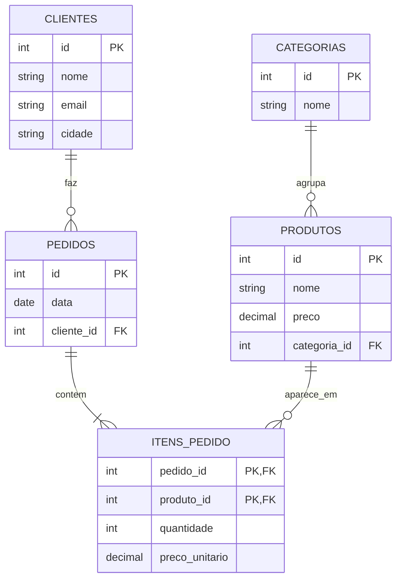
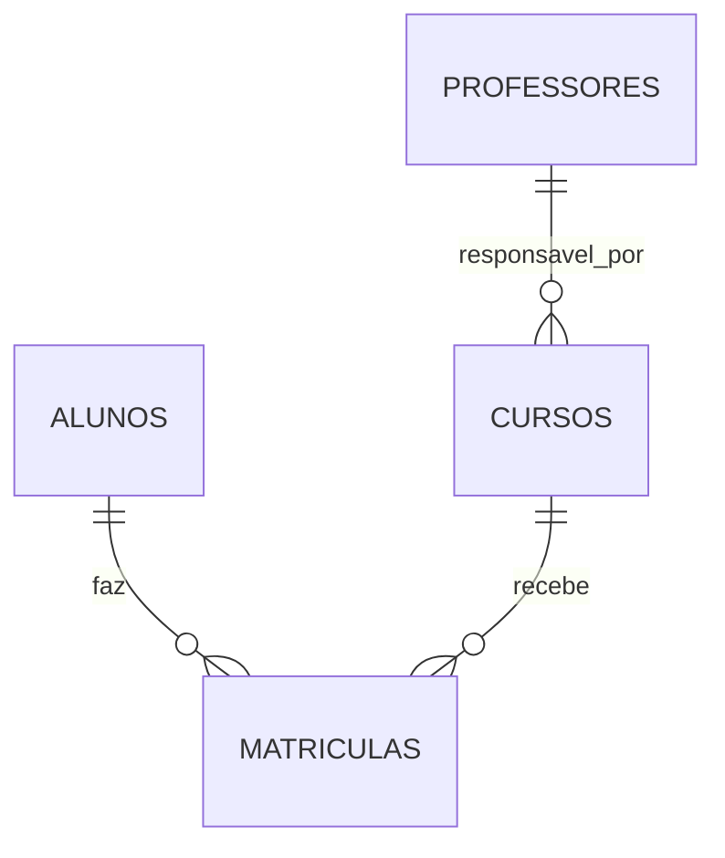
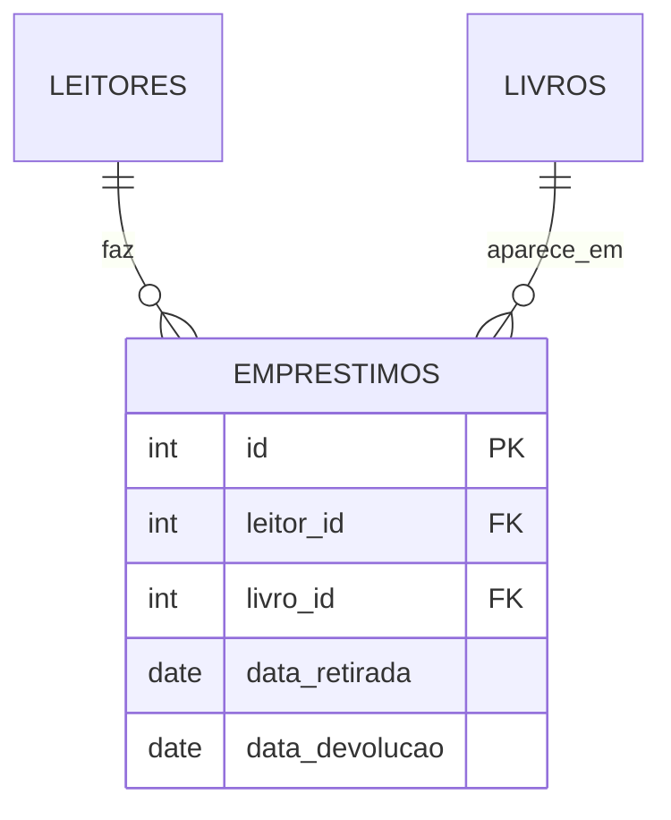

# 5.2 · Modelagem relacional: tabelas, chaves e relacionamentos

> **Em uma frase:** modelar é transformar o mundo real em **tabelas**: cada "coisa" importante (cliente, produto, pedido) vira uma tabela, cada característica vira uma coluna, a **chave primária** identifica cada linha e a **chave estrangeira** liga uma tabela à outra.

## 🧱 Tabela, coluna e linha

Uma **tabela** guarda um tipo de coisa (uma **entidade**). Cada **coluna** é uma característica (um **atributo**), com um tipo definido. Cada **linha** é um registro.

Tabela `clientes`:

| id | nome | email | cidade |
| --- | --- | --- | --- |
| 1 | Ana Lima | `ana@email.com` | Rio de Janeiro |
| 2 | Bruno Reis | `bruno@email.com` | São Paulo |
| 3 | Carla Dias | `carla@email.com` | Rio de Janeiro |

> [!TIP]
> Se você já viu orientação a objetos, a comparação ajuda: **tabela ≈ classe**, **coluna ≈ atributo**, **linha ≈ objeto**. É exatamente essa correspondência que o JPA faz automaticamente na aula [6.25](../06-spring/25-spring-data-jpa.md).

## 🔑 Chave primária (PK)

A **chave primária** (*primary key*) é a coluna que identifica cada linha de forma **única**. Ela nunca se repete e nunca fica vazia.

| Tipo de chave | Exemplo | Prós e contras |
| --- | --- | --- |
| **Natural**: um dado do mundo real | CPF, ISBN de um livro | Tem significado, mas pode mudar ou ser digitada errado |
| **Artificial** (*surrogate*): um número criado só para isso | `id` = 1, 2, 3... | Nunca muda e é simples; **é a escolha mais comum** |

Na prática, quase toda tabela tem uma coluna `id` gerada automaticamente pelo banco. Dados como CPF e e-mail continuam únicos, mas por meio de uma regra `UNIQUE` (aula [5.4](./04-sql-criando-tabelas.md)).

## 🔗 Chave estrangeira (FK) e relacionamentos

Uma **chave estrangeira** (*foreign key*) é uma coluna que guarda a PK de **outra** tabela. É assim que as tabelas se relacionam:

Tabela `pedidos`:

| id | data | cliente_id |
| --- | --- | --- |
| 10 | 2026-10-01 | 1 |
| 11 | 2026-10-03 | 1 |
| 12 | 2026-10-05 | 3 |

A coluna `cliente_id` aponta para `clientes.id`: os pedidos 10 e 11 são da Ana, e o 12 é da Carla. O banco **garante** que não exista um pedido com `cliente_id = 99` se não houver cliente 99.

> [!NOTE]
> Repare que o nome do cliente **não** está repetido em cada pedido: guardamos só o `id`. Se a Ana mudar de nome, alteramos **um** lugar. Essa é a grande ideia do modelo relacional.

## 🔢 Cardinalidade: quantos de cada lado?

A **cardinalidade** diz quantos registros de uma tabela podem se ligar a quantos da outra.

| Tipo | Lê-se | Exemplo | Como implementar |
| --- | --- | --- | --- |
| **1:1** (um para um) | Cada A tem no máximo um B | Pessoa ↔ passaporte | FK com `UNIQUE` em uma das tabelas |
| **1:N** (um para muitos) | Um A tem vários B; cada B tem um A | Cliente → pedidos | FK no lado "muitos" (`pedidos.cliente_id`) |
| **N:N** (muitos para muitos) | Um A tem vários B e vice-versa | Pedidos ↔ produtos | Uma **tabela associativa** no meio |

### O caso N:N

Um pedido tem vários produtos, e um produto aparece em vários pedidos. Não dá para colocar uma FK de cada lado. A solução é uma tabela no meio, que também é o lugar natural para dados **do relacionamento** (quantidade e preço pago):

Tabela `itens_pedido`:

| pedido_id | produto_id | quantidade | preco_unitario |
| --- | --- | --- | --- |
| 10 | 1 | 1 | 149.90 |
| 10 | 2 | 2 | 59.90 |
| 11 | 2 | 1 | 59.90 |

Leitura: o pedido 10 tem 1 teclado (produto 1) e 2 mouses (produto 2); o pedido 11 tem 1 mouse.

> [!TIP]
> Por que guardar `preco_unitario` no item se o produto já tem preço? Porque o preço do produto **muda com o tempo**, e o pedido precisa lembrar quanto o cliente pagou **naquele dia**.

## 🗺️ O diagrama entidade-relacionamento (DER)

Antes de criar as tabelas, desenhamos o modelo. O tipo de diagrama mais usado é o **DER** com notação "pé de galinha" (*crow's foot*):

| Símbolo na ponta da linha | Significa |
| --- | --- |
| <code>&#124;&#124;</code> (dois traços) | Exatamente **um** |
| <code>o&#124;</code> (bola e traço) | **Zero ou um** |
| `o{` (bola e pé de galinha) | **Zero ou muitos** |
| <code>&#124;{</code> (traço e pé de galinha) | **Um ou muitos** |

Lendo `CLIENTES ||--o{ PEDIDOS`: cada pedido pertence a **exatamente um** cliente; cada cliente tem **zero ou muitos** pedidos.

## 🛠️ Do problema ao modelo, passo a passo

Requisito: *"Uma escola tem alunos e cursos. Um aluno pode se matricular em vários cursos, e cada matrícula tem uma data e uma nota final. Cada curso tem um professor responsável."*

1. **Encontre os substantivos importantes** → candidatos a tabelas: aluno, curso, professor, matrícula.
2. **Liste os atributos** de cada um: aluno (nome, e-mail), curso (nome, carga horária), professor (nome).
3. **Descubra as cardinalidades**: professor 1:N curso; aluno N:N curso.
4. **Resolva o N:N** com uma tabela associativa: `matriculas (aluno_id, curso_id, data, nota)`.
5. **Escolha as chaves**: `id` em cada tabela; FKs onde há relacionamento.

## 📌 Resumindo

- Entidade → tabela; atributo → coluna; registro → linha.
- **PK** identifica cada linha (geralmente um `id` automático); **FK** aponta para a PK de outra tabela.
- Cardinalidades: **1:1**, **1:N** (FK no lado "muitos") e **N:N** (tabela associativa).
- O **DER** desenha o modelo antes de virar SQL.

## 🏋️ Mão na massa

**1.** Qual a cardinalidade entre: (a) país e capital; (b) autor e livro (um livro pode ter vários autores); (c) time e jogador (num campeonato, cada jogador joga em um time)?

Ver resposta

(a) **1:1**; (b) **N:N** (precisa de uma tabela `livros_autores`); (c) **1:N** (FK `time_id` na tabela de jogadores).

**2.** Onde fica a chave estrangeira num relacionamento 1:N entre `departamentos` e `funcionarios`?

Ver resposta

Na tabela do lado "muitos": `funcionarios.departamento_id`. Se ficasse em `departamentos`, cada departamento só poderia guardar um funcionário.

**3.** Modele um sistema de biblioteca: livros, leitores e empréstimos (um leitor pega vários livros ao longo do tempo; um livro é emprestado várias vezes; cada empréstimo tem data de retirada e de devolução).

Ver resposta

`emprestimos` é a tabela associativa do N:N entre leitores e livros. Ela tem um `id` próprio porque o mesmo leitor pode pegar o mesmo livro mais de uma vez.

---

[⬅️ 5.1 O que é um banco de dados (e como preparar o ambiente)](./01-o-que-e-banco-de-dados.md) &nbsp;|&nbsp; [🏠 Índice](../../README.md) &nbsp;|&nbsp; [5.3 Normalização ➡️](./03-normalizacao.md)

