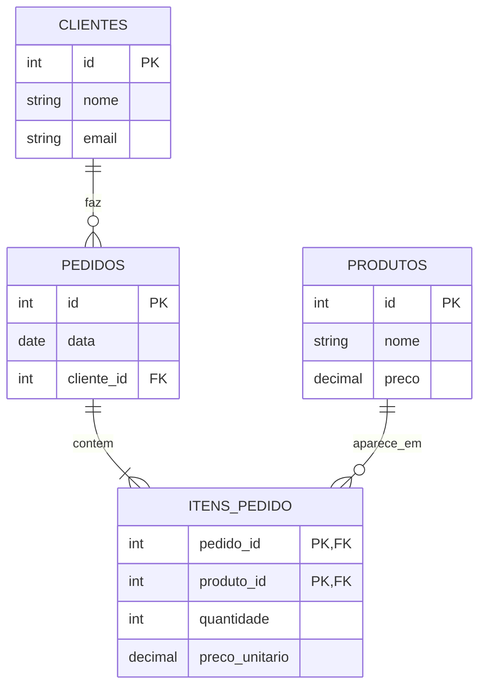

# 5.3 · Normalização: organizando as tabelas sem repetição

> **Em uma frase:** **normalizar** é dividir uma tabela "bagunçada" em tabelas menores e bem ligadas, seguindo regras (as **formas normais**) que evitam dados repetidos e contraditórios.

## 😵 O problema: a planilha que faz tudo

Imagine que a loja começou anotando os pedidos assim:

| pedido | data | cliente | email_cliente | produtos | total |
| --- | --- | --- | --- | --- | --- |
| 10 | 01/10 | Ana Lima | `ana@email.com` | Teclado, Mouse, Mouse | 269,70 |
| 11 | 03/10 | Ana Lima | `ana@mail.com` | Mouse | 59,90 |
| 12 | 05/10 | Carla Dias | `carla@email.com` | Teclado | 149,90 |

Parece prático, mas esconde vários problemas, chamados de **anomalias**:

| Anomalia | O que acontece aqui |
| --- | --- |
| **Repetição** | O nome e o e-mail da Ana aparecem em cada pedido dela. |
| **Inconsistência** | O e-mail da Ana está diferente nos pedidos 10 e 11. Qual é o certo? |
| **Atualização** | Se a Ana trocar de e-mail, é preciso alterar **todas** as linhas dela. |
| **Inserção** | Não dá para cadastrar um cliente que ainda não comprou nada. |
| **Exclusão** | Apagar o pedido 12 apaga também a única informação sobre a Carla. |
| **Valores múltiplos** | A coluna `produtos` tem uma lista: como somar quantos mouses foram vendidos? |

## 1️⃣ Primeira forma normal (1FN): um valor por célula

**Regra:** cada coluna guarda **um único valor** (nada de listas ou "Teclado, Mouse"), e cada linha é identificável por uma chave.

Separamos os produtos, uma linha por item:

| pedido | data | cliente | email_cliente | produto | preco_produto | quantidade |
| --- | --- | --- | --- | --- | --- | --- |
| 10 | 01/10 | Ana Lima | `ana@email.com` | Teclado | 149,90 | 1 |
| 10 | 01/10 | Ana Lima | `ana@email.com` | Mouse | 59,90 | 2 |
| 11 | 03/10 | Ana Lima | `ana@email.com` | Mouse | 59,90 | 1 |
| 12 | 05/10 | Carla Dias | `carla@email.com` | Teclado | 149,90 | 1 |

Agora dá para contar e somar, mas a repetição piorou. A chave desta tabela é o par (**pedido**, **produto**).

> [!NOTE]
> O `total` sumiu de propósito: ele pode ser **calculado** a partir de preço × quantidade. Guardar valores calculáveis cria mais uma chance de inconsistência.

## 2️⃣ Segunda forma normal (2FN): tudo depende da chave inteira

**Regra:** estar na 1FN e, quando a chave for composta, cada coluna deve depender da chave **inteira**, e não só de uma parte dela.

Na tabela acima, a chave é (pedido, produto). Mas:

- `data`, `cliente` e `email_cliente` dependem só do **pedido**.
- `preco_produto` depende só do **produto**.
- Só `quantidade` depende do **par** (pedido, produto).

Separamos cada grupo em sua tabela (a chave de cada uma está em **negrito**):

- `pedidos` (**pedido**, data, cliente, email_cliente)
- `produtos` (**produto**, preco)
- `itens_pedido` (**pedido**, **produto**, quantidade)

## 3️⃣ Terceira forma normal (3FN): nada depende de quem não é chave

**Regra:** estar na 2FN e nenhuma coluna pode depender de **outra coluna que não seja a chave**.

Na tabela `pedidos`, o `email_cliente` depende do **cliente**, e não do pedido. Isso é a origem da inconsistência do e-mail da Ana. Criamos a tabela `clientes`:

Pronto: cada informação mora em **um só lugar**. O e-mail da Ana está numa única linha de `clientes`; dá para cadastrar a Carla sem pedido; apagar um pedido não apaga o cliente.

> [!TIP]
> Um jeito fácil de lembrar das três formas: cada coluna deve depender **da chave** (1FN), **da chave inteira** (2FN) e **de nada além da chave** (3FN).

## ⚖️ E a desnormalização?

Normalizar até a 3FN é o ponto de partida padrão. Às vezes, em relatórios ou sistemas com muitíssimas leituras, repete-se um dado **de propósito** para evitar consultas pesadas: isso é a **desnormalização**. É uma decisão consciente de desempenho, tomada **depois** de ter um modelo normalizado, e não uma desculpa para a planilha bagunçada.

## 📌 Resumindo

- Tabelas mal organizadas geram repetição, inconsistência e anomalias de inserção, atualização e exclusão.
- **1FN**: um valor por célula. **2FN**: tudo depende da chave inteira. **3FN**: nada depende de colunas que não são chave.
- O resultado: cada informação num só lugar, ligada por chaves estrangeiras.
- Desnormalizar é uma otimização consciente, não o ponto de partida.

## 🏋️ Mão na massa

**1.** Esta tabela está na 1FN? `alunos (id, nome, telefones)` com `telefones = "21 9999-0000, 21 3333-1111"`.

Ver resposta

**Não**, porque a coluna `telefones` guarda vários valores. A solução é uma tabela `telefones (id, aluno_id, numero)`, com uma linha por telefone.

**2.** Na tabela `funcionarios (id, nome, departamento_id, nome_departamento)`, qual forma normal é violada e como corrigir?

Ver resposta

A **3FN**: `nome_departamento` depende de `departamento_id`, que não é a chave da tabela. Crie `departamentos (id, nome)` e deixe em `funcionarios` só o `departamento_id`.

**3.** Normalize a planilha de uma academia: `(aluno, cpf_aluno, plano, valor_plano, instrutor, telefone_instrutor)`.

Ver resposta

- `alunos (id, nome, cpf, plano_id, instrutor_id)`
- `planos (id, nome, valor)`
- `instrutores (id, nome, telefone)`

O valor depende do plano, e o telefone depende do instrutor; por isso cada um ganha sua tabela, e o aluno guarda só as chaves estrangeiras.

---

[⬅️ 5.2 Modelagem relacional](./02-modelagem-relacional.md) &nbsp;|&nbsp; [🏠 Índice](../../README.md) &nbsp;|&nbsp; [5.4 SQL ➡️](./04-sql-criando-tabelas.md)

