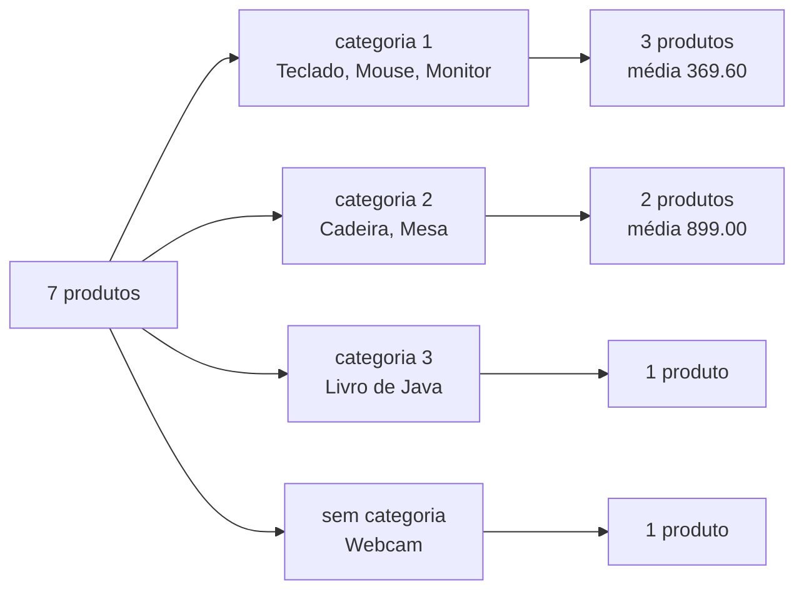
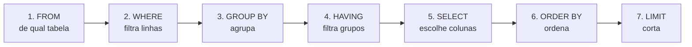

# 5.6 · SQL: consultando dados com `SELECT`

> **Em uma frase:** o `SELECT` busca dados: você diz **quais colunas** quer (`SELECT`), **de onde** (`FROM`), **quais linhas** (`WHERE`), **em que ordem** (`ORDER BY`) e, se quiser resumir, **como agrupar e calcular** (`GROUP BY`, `COUNT`, `SUM`, `AVG`...).

> [!NOTE]
> Todos os resultados desta aula usam o banco da loja das aulas [5.4](./04-sql-criando-tabelas.md) e [5.5](./05-sql-inserindo-e-alterando.md). Se você alterou os dados, rode o [`loja.sql`](./sql/loja.sql) para voltar ao estado original.

## 🔍 O básico: colunas e tabela

```sql
SELECT nome, preco FROM produtos;     -- só as colunas que interessam
SELECT * FROM produtos;               -- todas as colunas
```

| nome | preco |
| --- | --- |
| Teclado | 149.90 |
| Mouse | 59.90 |
| Monitor | 899.00 |
| Cadeira gamer | 1299.00 |
| Mesa | 499.00 |
| Livro de Java | 89.90 |
| Webcam | 199.90 |

> [!TIP]
> O `SELECT *` é ótimo para explorar, mas em código de verdade **liste as colunas**: a consulta fica mais clara, mais rápida e não quebra quando a tabela ganhar colunas novas.

### Apelidos e colunas calculadas

```sql
SELECT nome AS produto, preco, preco * 0.9 AS preco_com_desconto
FROM produtos;
```

| produto | preco | preco_com_desconto |
| --- | --- | --- |
| Teclado | 149.90 | 134.910 |
| Mouse | 59.90 | 53.910 |
| ... | ... | ... |

O `AS` dá um nome (apelido) à coluna do resultado. A tabela original não muda: o cálculo existe só na resposta.

### Sem repetições: `DISTINCT`

```sql
SELECT DISTINCT cidade FROM clientes ORDER BY cidade;
```

| cidade |
| --- |
| Recife |
| Rio de Janeiro |
| São Paulo |
| NULL |

Rio de Janeiro aparece uma vez, mesmo tendo dois clientes.

## 🎯 Filtrando linhas: `WHERE`

```sql
SELECT nome, preco FROM produtos WHERE preco > 200;
```

| nome | preco |
| --- | --- |
| Monitor | 899.00 |
| Cadeira gamer | 1299.00 |
| Mesa | 499.00 |

| Operador | Significa | Exemplo |
| --- | --- | --- |
| `=` `<>` (ou `!=`) | Igual / diferente | `status <> 'CANCELADO'` |
| `>` `>=` `<` `<=` | Comparações | `estoque >= 10` |
| `AND` `OR` `NOT` | E / ou / não | `preco < 500 AND estoque > 0` |
| `BETWEEN a AND b` | Entre dois valores (inclusive) | `preco BETWEEN 100 AND 900` |
| `IN (...)` | Está na lista | `cidade IN ('Recife', 'São Paulo')` |
| `LIKE` | Combina com um padrão de texto | `nome LIKE 'C%'` |
| `IS NULL` / `IS NOT NULL` | Está / não está vazio | `cidade IS NULL` |

```sql
SELECT nome, preco, estoque FROM produtos WHERE preco < 500 AND estoque > 0;
```

| nome | preco | estoque |
| --- | --- | --- |
| Teclado | 149.90 | 30 |
| Mouse | 59.90 | 50 |
| Mesa | 499.00 | 8 |
| Livro de Java | 89.90 | 20 |

(A Webcam ficou de fora porque está com estoque 0.)

### `LIKE`: buscando por pedaços de texto

| Padrão | Significa | Encontra |
| --- | --- | --- |
| `'C%'` | Começa com "C" | Carla Dias |
| `'%Lima'` | Termina com "Lima" | Ana Lima |
| `'%ar%'` | Contém "ar" | Carla Dias |
| `'_na%'` | Qualquer 1 caractere, depois "na" | Ana Lima |

`%` = qualquer quantidade de caracteres; `_` = exatamente um caractere. O `LIKE` diferencia maiúsculas de minúsculas; no PostgreSQL, o `ILIKE` ignora essa diferença: `WHERE nome ILIKE '%java%'` encontra "Livro de Java".

### A armadilha do `NULL`

`NULL` significa "**sem valor**" ou "desconhecido". Ele não é zero nem texto vazio, e **não pode ser comparado com `=`**:

```sql
SELECT nome FROM clientes WHERE cidade = NULL;    -- ❌ nenhuma linha (sempre!)
SELECT nome FROM clientes WHERE cidade IS NULL;   -- ✅ Elisa Moura
```

> [!WARNING]
> Qualquer comparação com `NULL` usando `=`, `<>`, `>`... dá "desconhecido", e a linha não entra no resultado. Use sempre `IS NULL` e `IS NOT NULL`.

## ↕️ Ordenando e limitando: `ORDER BY` e `LIMIT`

```sql
SELECT nome, preco FROM produtos ORDER BY preco DESC;          -- do mais caro ao mais barato
SELECT nome, cidade FROM clientes ORDER BY cidade, nome;       -- por cidade; empate → por nome
```

`ASC` (crescente) é o padrão; `DESC` é decrescente.

> [!IMPORTANT]
> Sem `ORDER BY`, o banco **não garante ordem nenhuma**: as linhas podem vir numa ordem diferente amanhã. Se a ordem importa, peça.

```sql
SELECT nome, preco FROM produtos ORDER BY preco DESC LIMIT 3;            -- os 3 mais caros
SELECT nome, preco FROM produtos ORDER BY preco DESC LIMIT 3 OFFSET 3;   -- os 3 seguintes
```

| nome | preco |
| --- | --- |
| Webcam | 199.90 |
| Teclado | 149.90 |
| Livro de Java | 89.90 |

`LIMIT` + `OFFSET` é a base da **paginação** ("página 2, com 3 itens por página"), que você verá no Spring Data.

> [!NOTE]
> No SQL Server, o equivalente é `SELECT TOP 3 ...` ou `OFFSET 3 ROWS FETCH NEXT 3 ROWS ONLY`. No MySQL, `LIMIT` funciona igual ao PostgreSQL.

## 🧮 Funções úteis

```sql
SELECT UPPER(nome) AS nome, LENGTH(nome) AS letras, EXTRACT(YEAR FROM nascimento) AS ano
FROM clientes;
```

| nome | letras | ano |
| --- | --- | --- |
| ANA LIMA | 8 | 1994 |
| BRUNO REIS | 10 | 1988 |
| CARLA DIAS | 10 | 2001 |
| DIEGO ALVES | 11 | NULL |
| ELISA MOURA | 11 | 1999 |

| Função | Faz |
| --- | --- |
| `UPPER(t)` / `LOWER(t)` | Maiúsculas / minúsculas |
| `LENGTH(t)` | Quantidade de caracteres |
| `CONCAT(a, b)` ou <code>a &#124;&#124; b</code> | Junta textos |
| `ROUND(n, 2)` | Arredonda para 2 casas |
| `COALESCE(valor, padrao)` | Troca `NULL` por um padrão: `COALESCE(cidade, 'não informada')` |
| `CURRENT_DATE` / `NOW()` | Data / data e hora atuais |
| `EXTRACT(YEAR FROM data)` | Pega uma parte da data |

### `CASE`: o "if" do SQL

```sql
SELECT nome, preco,
       CASE
           WHEN preco >= 500 THEN 'caro'
           WHEN preco >= 100 THEN 'médio'
           ELSE 'barato'
       END AS faixa
FROM produtos;
```

| nome | preco | faixa |
| --- | --- | --- |
| Teclado | 149.90 | médio |
| Mouse | 59.90 | barato |
| Monitor | 899.00 | caro |
| ... | ... | ... |

## 📊 Resumindo dados: funções de agregação

As funções de agregação transformam **várias linhas em um único valor**:

```sql
SELECT COUNT(*)               AS total,
       COUNT(cidade)          AS com_cidade,
       COUNT(DISTINCT cidade) AS cidades
FROM clientes;
```

| total | com_cidade | cidades |
| --- | --- | --- |
| 5 | 4 | 3 |

`COUNT(*)` conta linhas; `COUNT(coluna)` conta só os valores **não nulos** (a Elisa não tem cidade); `COUNT(DISTINCT coluna)` conta valores diferentes.

```sql
SELECT SUM(estoque) AS unidades, ROUND(AVG(preco), 2) AS preco_medio,
       MIN(preco) AS mais_barato, MAX(preco) AS mais_caro
FROM produtos;
```

| unidades | preco_medio | mais_barato | mais_caro |
| --- | --- | --- | --- |
| 123 | 456.66 | 59.90 | 1299.00 |

## 🗃️ Agrupando: `GROUP BY`

E se quisermos a quantidade de produtos **por categoria**? O `GROUP BY` separa as linhas em grupos e calcula a agregação **para cada grupo**:

```sql
SELECT categoria_id, COUNT(*) AS produtos, ROUND(AVG(preco), 2) AS preco_medio
FROM produtos
GROUP BY categoria_id
ORDER BY categoria_id;
```

| categoria_id | produtos | preco_medio |
| --- | --- | --- |
| 1 | 3 | 369.60 |
| 2 | 2 | 899.00 |
| 3 | 1 | 89.90 |
| NULL | 1 | 199.90 |



> [!WARNING]
> Com `GROUP BY`, cada coluna do `SELECT` precisa estar no `GROUP BY` **ou** dentro de uma função de agregação. `SELECT nome, COUNT(*) FROM produtos;` dá o erro *column "produtos.nome" must appear in the GROUP BY clause or be used in an aggregate function*: o banco não sabe qual dos 7 nomes mostrar ao lado do total.

O total de cada pedido, somando quantidade × preço dos itens:

```sql
SELECT pedido_id, SUM(quantidade * preco_unitario) AS total
FROM itens_pedido
GROUP BY pedido_id
ORDER BY total DESC;
```

| pedido_id | total |
| --- | --- |
| 3 | 1358.90 |
| 2 | 899.00 |
| 5 | 499.00 |
| 1 | 269.70 |
| 6 | 239.80 |
| 4 | 179.80 |

### Filtrando grupos: `HAVING`

O `WHERE` filtra **linhas** antes de agrupar; o `HAVING` filtra **grupos** depois:

```sql
-- Clientes com 2 ou mais pedidos não cancelados
SELECT cliente_id, COUNT(*) AS pedidos
FROM pedidos
WHERE status <> 'CANCELADO'        -- 1. descarta as linhas canceladas
GROUP BY cliente_id                -- 2. agrupa por cliente
HAVING COUNT(*) >= 2;              -- 3. mantém só os grupos com 2 ou mais
```

| cliente_id | pedidos |
| --- | --- |
| 1 | 2 |
| 2 | 2 |

## 🧭 A ordem em que o banco executa

Você **escreve** na ordem `SELECT → FROM → WHERE → GROUP BY → HAVING → ORDER BY → LIMIT`, mas o banco **executa** assim:



Isso explica dois comportamentos que confundem iniciantes: o `WHERE` **não pode** usar funções de agregação (os grupos ainda nem existem) e, em muitos bancos, **não enxerga** os apelidos criados no `SELECT` (que roda depois). Já o `ORDER BY` pode usar os apelidos.

## 📌 Resumindo

- `SELECT colunas FROM tabela` busca dados; `AS` dá apelidos; `DISTINCT` tira repetições.
- `WHERE` filtra com `=`, `<>`, `>`, `AND`, `OR`, `BETWEEN`, `IN`, `LIKE` e `IS NULL` (nunca `= NULL`).
- `ORDER BY` ordena (sem ele, a ordem não é garantida); `LIMIT`/`OFFSET` paginam.
- `COUNT`, `SUM`, `AVG`, `MIN`, `MAX` resumem; `GROUP BY` resume por grupo; `HAVING` filtra grupos.
- Ordem de execução: FROM → WHERE → GROUP BY → HAVING → SELECT → ORDER BY → LIMIT.

## 🏋️ Mão na massa

**1.** Liste nome e estoque dos produtos com estoque entre 1 e 10, do menor para o maior estoque.

<details>
<summary>Ver resposta</summary>

```sql
SELECT nome, estoque FROM produtos
WHERE estoque BETWEEN 1 AND 10
ORDER BY estoque;
```

| nome | estoque |
| --- | --- |
| Cadeira gamer | 5 |
| Mesa | 8 |
| Monitor | 10 |

</details>

**2.** Quantos clientes há em cada cidade? Mostre "não informada" para quem não tem cidade.

<details>
<summary>Ver resposta</summary>

```sql
SELECT COALESCE(cidade, 'não informada') AS cidade, COUNT(*) AS clientes
FROM clientes
GROUP BY cidade
ORDER BY clientes DESC, cidade;
```

| cidade | clientes |
| --- | --- |
| Rio de Janeiro | 2 |
| Recife | 1 |
| São Paulo | 1 |
| não informada | 1 |

</details>

**3.** Qual o valor total vendido em cada pedido com total acima de R$ 400?

<details>
<summary>Ver resposta</summary>

```sql
SELECT pedido_id, SUM(quantidade * preco_unitario) AS total
FROM itens_pedido
GROUP BY pedido_id
HAVING SUM(quantidade * preco_unitario) > 400
ORDER BY total DESC;
```

| pedido_id | total |
| --- | --- |
| 3 | 1358.90 |
| 2 | 899.00 |
| 5 | 499.00 |

O filtro é sobre o **resultado da soma**, por isso vai no `HAVING`, e não no `WHERE`.

</details>

**4.** Por que `SELECT * FROM clientes WHERE nascimento > '2000-01-01' OR nascimento IS NULL;` devolve Carla e Diego?

<details>
<summary>Ver resposta</summary>

A Carla nasceu em 2001 (satisfaz a primeira condição). O Diego não tem data (`NULL`): a comparação `>` com `NULL` dá "desconhecido", mas o `OR nascimento IS NULL` o inclui explicitamente.

</details>

---

<div align="center">

[⬅️ 5.5 SQL](./05-sql-inserindo-e-alterando.md) &nbsp;|&nbsp; [🏠 Índice](../../README.md) &nbsp;|&nbsp; [5.7 SQL ➡️](./07-sql-joins-e-subconsultas.md)

</div>
