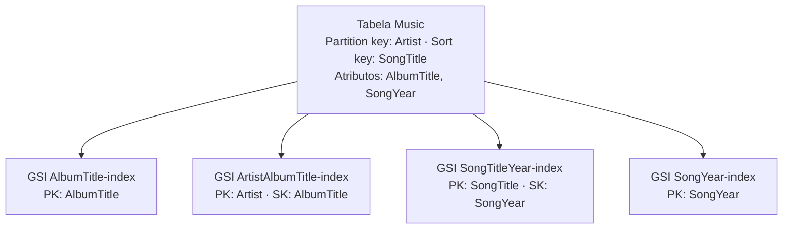

# 5.8 · Prática: DynamoDB pela AWS CLI

> **Em uma frase:** neste desafio criamos uma tabela de músicas no DynamoDB usando a linha de comando da AWS, inserimos itens, criamos índices secundários globais e fizemos consultas por eles.

📂 Meu projeto, com os arquivos JSON e todos os comandos: [`projetos/05-desafio-dynamodb`](../../projetos/05-desafio-dynamodb/) · Repositório original: [cassianobrexbit/dio-live-dynamodb](https://github.com/cassianobrexbit/dio-live-dynamodb)

## 🎯 Objetivos

1. Criar uma tabela no DynamoDB pela AWS CLI.
2. Inserir dados (um item e vários de uma vez).
3. Criar índices secundários globais (GSI).
4. Consultar pela chave primária e pelos índices.

## 🗺️ Modelo da tabela `Music`



## 🛠️ Preparação

1. Crie uma conta na AWS e um usuário no **IAM** com permissão para o DynamoDB (não use o usuário *root*).
2. Instale a [AWS CLI](https://docs.aws.amazon.com/pt_br/cli/latest/userguide/getting-started-install.html) e configure com `aws configure` (chave de acesso, chave secreta e região).

> [!TIP]
> Para treinar sem conta na AWS, suba o **DynamoDB Local** (`docker run -p 8000:8000 amazon/dynamodb-local`) e acrescente `--endpoint-url http://localhost:8000` a todos os comandos abaixo.

> [!CAUTION]
> Nunca coloque suas chaves de acesso da AWS no código nem no GitHub. Robôs varrem repositórios públicos atrás delas em minutos.

## 📋 Comandos

### Criar a tabela

```bash
aws dynamodb create-table \
    --table-name Music \
    --attribute-definitions \
        AttributeName=Artist,AttributeType=S \
        AttributeName=SongTitle,AttributeType=S \
    --key-schema \
        AttributeName=Artist,KeyType=HASH \
        AttributeName=SongTitle,KeyType=RANGE \
    --provisioned-throughput ReadCapacityUnits=10,WriteCapacityUnits=5
```

`HASH` = partition key; `RANGE` = sort key; `S` = String.

### Inserir itens

```bash
# Um item (o JSON fica no arquivo itemmusic.json)
aws dynamodb put-item --table-name Music --item file://itemmusic.json

# Vários itens de uma vez (até 25 por chamada)
aws dynamodb batch-write-item --request-items file://batchmusic.json
```

Exemplo do formato de um item (cada valor diz o seu tipo):

```json
{
  "Artist":     { "S": "Iron Maiden" },
  "SongTitle":  { "S": "Wasting Love" },
  "AlbumTitle": { "S": "Fear of the Dark" },
  "SongYear":   { "S": "1992" }
}
```

### Criar índices secundários globais

```bash
aws dynamodb update-table \
    --table-name Music \
    --attribute-definitions AttributeName=AlbumTitle,AttributeType=S \
    --global-secondary-index-updates \
        "[{\"Create\":{\"IndexName\":\"AlbumTitle-index\",\"KeySchema\":[{\"AttributeName\":\"AlbumTitle\",\"KeyType\":\"HASH\"}],\"ProvisionedThroughput\":{\"ReadCapacityUnits\":10,\"WriteCapacityUnits\":5},\"Projection\":{\"ProjectionType\":\"ALL\"}}}]"
```

Os outros índices (`ArtistAlbumTitle-index`, `SongTitleYear-index` e `SongYear-index`, este último criado por mim) seguem o mesmo formato e estão no README do projeto.

> [!NOTE]
> O DynamoDB só permite criar **um GSI por vez**: espere o status do índice ficar `ACTIVE` (confira com `aws dynamodb describe-table --table-name Music`) antes de criar o próximo.

### Consultar

```bash
# Pela partition key
aws dynamodb query --table-name Music \
    --key-condition-expression "Artist = :artist" \
    --expression-attribute-values '{":artist":{"S":"Silverchair"}}'

# Por um índice secundário
aws dynamodb query --table-name Music --index-name AlbumTitle-index \
    --key-condition-expression "AlbumTitle = :nome" \
    --expression-attribute-values '{":nome":{"S":"Fear of the Dark"}}'

# Por um índice com partition + sort key
aws dynamodb query --table-name Music --index-name SongTitleYear-index \
    --key-condition-expression "SongTitle = :musica AND SongYear = :ano" \
    --expression-attribute-values '{":musica":{"S":"Wasting Love"},":ano":{"S":"1992"}}'
```

> [!TIP]
> No PowerShell do Windows, as aspas simples em volta do JSON podem não funcionar como no Bash. Use o Git Bash, o WSL, ou coloque o JSON em um arquivo e passe com `file://arquivo.json`.

## 🧹 Ao terminar

```bash
aws dynamodb delete-table --table-name Music
```

Apagar a tabela evita cobranças inesperadas.

## 📌 Resumindo

- `create-table` com `HASH` (partition) e `RANGE` (sort).
- `put-item` e `batch-write-item` para inserir; os valores levam o tipo (`{"S": ...}`).
- `update-table` cria GSIs, um de cada vez.
- `query` sempre informa a partition key (da tabela ou do índice).

## 🏋️ Mão na massa

**1.** Escreva a consulta que lista todas as músicas lançadas em 1995 usando o `SongYear-index`.

<details>
<summary>Ver resposta</summary>

```bash
aws dynamodb query --table-name Music --index-name SongYear-index \
    --key-condition-expression "SongYear = :ano" \
    --expression-attribute-values '{":ano":{"S":"1995"}}'
```

</details>

**2.** Por que não dá para fazer `query` só pelo `AlbumTitle` sem criar um índice?

<details>
<summary>Ver resposta</summary>

Porque o `query` precisa da **partition key**, e na tabela ela é o `Artist`. Para buscar por `AlbumTitle`, é preciso um GSI que tenha esse atributo como partition key (ou usar um `scan`, que lê a tabela inteira e é caro).

</details>

**3.** Qual a diferença entre `query` e `scan`?

<details>
<summary>Ver resposta</summary>

O `query` vai direto à partição da chave informada e lê só os itens dela. O `scan` lê **todos** os itens da tabela e filtra depois, sendo bem mais lento e caro em tabelas grandes.

</details>

---

<div align="center">

[⬅️ 5.7 Amazon DynamoDB](./07-dynamodb.md) &nbsp;|&nbsp; [🏠 Índice](../../README.md) &nbsp;|&nbsp; [6.1 Como funciona o protocolo HTTP ➡️](../06-spring/01-http.md)

</div>
