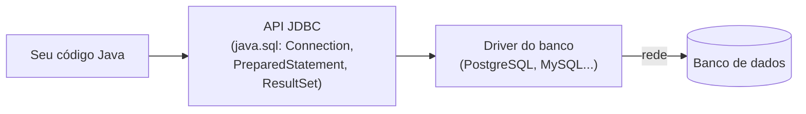

# 5.9 · Java + banco de dados: JDBC

> **Em uma frase:** o **JDBC** (*Java Database Connectivity*) é a API padrão do Java para conversar com bancos relacionais: você abre uma **conexão**, envia SQL com um **`PreparedStatement`** e lê as linhas devolvidas num **`ResultSet`**; é o que o JPA e o Spring Data fazem por baixo dos panos.

## 🔌 Como o Java fala com o banco



- A **API JDBC** (pacote `java.sql`) vem com o JDK e é igual para qualquer banco.
- O **driver** é uma biblioteca de cada fabricante que traduz as chamadas JDBC para o "idioma" daquele banco. Para trocar de PostgreSQL para MySQL, você troca o driver e a URL; o código quase não muda.

> [!TIP]
> Analogia: o JDBC é a **tomada padrão** da parede; o driver é o **adaptador** de cada aparelho.

## 📦 Preparando o projeto

Num projeto Maven (aula [4.15](../04-poo/15-maven.md)), adicione o driver do PostgreSQL:

```xml
<dependency>
    <groupId>org.postgresql</groupId>
    <artifactId>postgresql</artifactId>
    <version>42.7.7</version>
</dependency>
```

E tenha o banco da loja rodando (aulas [5.1](./01-o-que-e-banco-de-dados.md) e [5.5](./05-sql-inserindo-e-alterando.md)).

## 🚪 Abrindo uma conexão

```java
import java.sql.Connection;
import java.sql.DriverManager;
import java.sql.SQLException;

public class Conexao {

    private static final String URL = "jdbc:postgresql://localhost:5432/loja";
    private static final String USUARIO = "postgres";
    private static final String SENHA = System.getenv().getOrDefault("DB_SENHA", "senha");

    public static Connection abrir() throws SQLException {
        return DriverManager.getConnection(URL, USUARIO, SENHA);
    }
}
```

A **URL de conexão** diz tudo o que o driver precisa: `jdbc:postgresql://` (qual banco), `localhost:5432` (onde) e `/loja` (qual banco de dados).

> [!CAUTION]
> Não deixe senhas reais escritas no código: elas vão parar no GitHub. Leia de **variáveis de ambiente** (como acima) ou de arquivos de configuração fora do repositório.

## 🔍 Consultando: `PreparedStatement` e `ResultSet`

```java
import java.math.BigDecimal;
import java.sql.*;
import java.util.ArrayList;
import java.util.List;

record Produto(int id, String nome, BigDecimal preco, int estoque) { }

public class ProdutoDao {

    public List<Produto> buscarMaisCarosQue(BigDecimal valor) throws SQLException {
        String sql = "SELECT id, nome, preco, estoque FROM produtos WHERE preco > ? ORDER BY preco";

        try (Connection conexao = Conexao.abrir();
             PreparedStatement comando = conexao.prepareStatement(sql)) {

            comando.setBigDecimal(1, valor);              // preenche o 1º "?"

            try (ResultSet linhas = comando.executeQuery()) {
                List<Produto> produtos = new ArrayList<>();
                while (linhas.next()) {                   // avança para a próxima linha
                    produtos.add(new Produto(
                            linhas.getInt("id"),
                            linhas.getString("nome"),
                            linhas.getBigDecimal("preco"),
                            linhas.getInt("estoque")));
                }
                return produtos;
            }
        }
    }
}
```

Passo a passo:

1. **Abre** a conexão e **prepara** o comando SQL. O `?` é um **parâmetro**: um "buraco" a ser preenchido.
2. `setBigDecimal(1, valor)` preenche o primeiro `?` (a contagem começa em **1**, não em 0).
3. `executeQuery()` executa um `SELECT` e devolve um `ResultSet`, que funciona como um **cursor**: começa **antes** da primeira linha, e cada `next()` avança uma linha (devolvendo `false` quando acabam).
4. `getInt("id")`, `getString("nome")`... leem as colunas da linha atual.
5. O **try-with-resources** (aula [4.14](../04-poo/14-excecoes.md)) fecha `ResultSet`, `PreparedStatement` e `Connection` automaticamente, mesmo se der erro.

```java
new ProdutoDao().buscarMaisCarosQue(new BigDecimal("400")).forEach(System.out::println);
```

```text
Produto[id=5, nome=Mesa, preco=499.00, estoque=8]
Produto[id=3, nome=Monitor, preco=899.00, estoque=10]
Produto[id=4, nome=Cadeira gamer, preco=1299.00, estoque=5]
```

| Tipo SQL | Método do `ResultSet` | Tipo Java |
| --- | --- | --- |
| `INTEGER` | `getInt` | `int` |
| `BIGINT` | `getLong` | `long` |
| `DECIMAL` | `getBigDecimal` | `BigDecimal` |
| `VARCHAR` / `TEXT` | `getString` | `String` |
| `BOOLEAN` | `getBoolean` | `boolean` |
| `DATE` | `getObject("col", LocalDate.class)` | `LocalDate` |
| `TIMESTAMP` | `getObject("col", LocalDateTime.class)` | `LocalDateTime` |

> [!WARNING]
> `getInt` devolve **0** quando a coluna é `NULL` (um `int` não pode ser nulo). Se precisar distinguir, use `getObject("col", Integer.class)`, que devolve `null`.

## ✏️ Inserindo, alterando e apagando

Para `INSERT`, `UPDATE` e `DELETE`, use `executeUpdate()`, que devolve **quantas linhas** foram afetadas:

```java
public int inserir(String nome, BigDecimal preco, int estoque) throws SQLException {
    String sql = "INSERT INTO produtos (nome, preco, estoque) VALUES (?, ?, ?)";

    try (Connection conexao = Conexao.abrir();
         PreparedStatement comando = conexao.prepareStatement(sql, Statement.RETURN_GENERATED_KEYS)) {

        comando.setString(1, nome);
        comando.setBigDecimal(2, preco);
        comando.setInt(3, estoque);
        comando.executeUpdate();

        try (ResultSet chaves = comando.getGeneratedKeys()) {   // o id gerado pelo banco
            chaves.next();
            return chaves.getInt(1);
        }
    }
}

public boolean reajustar(int id, BigDecimal novoPreco) throws SQLException {
    String sql = "UPDATE produtos SET preco = ? WHERE id = ?";
    try (Connection conexao = Conexao.abrir();
         PreparedStatement comando = conexao.prepareStatement(sql)) {
        comando.setBigDecimal(1, novoPreco);
        comando.setInt(2, id);
        return comando.executeUpdate() == 1;      // true se achou e alterou o produto
    }
}
```

## 💉 SQL injection: o erro de segurança mais famoso

Parece mais simples montar o SQL **concatenando** textos. Não faça isso:

```java
// ❌ NUNCA: o texto digitado pelo usuário vira parte do comando SQL
String sql = "SELECT * FROM clientes WHERE email = '" + emailDigitado + "'";
```

Se alguém digitar `' OR '1'='1` no campo de e-mail, o SQL vira:

```sql
SELECT * FROM clientes WHERE email = '' OR '1'='1'
```

A condição `'1'='1'` é sempre verdadeira, e a consulta devolve **todos** os clientes. Com outras entradas, dá para apagar tabelas ou ler senhas. Isso se chama **SQL injection** e está, há décadas, entre as falhas de segurança mais exploradas da web.

```java
// ✅ SEMPRE: o valor vai como parâmetro, nunca como parte do SQL
PreparedStatement comando = conexao.prepareStatement("SELECT * FROM clientes WHERE email = ?");
comando.setString(1, emailDigitado);
```

Com o `PreparedStatement`, o banco recebe o SQL e os valores **separados**: `' OR '1'='1` é tratado como um e-mail (estranho), e não como código. De quebra, o banco pode reaproveitar o plano de execução, deixando a consulta mais rápida.

## 🔁 Transações no JDBC

Por padrão, cada comando é confirmado na hora (*autocommit*). Para o "tudo ou nada" da aula [5.8](./08-transacoes-indices-e-views.md):

```java
try (Connection conexao = Conexao.abrir()) {
    conexao.setAutoCommit(false);                 // equivale ao BEGIN
    try (PreparedStatement baixa = conexao.prepareStatement(
                 "UPDATE produtos SET estoque = estoque - ? WHERE id = ?");
         PreparedStatement item = conexao.prepareStatement(
                 "INSERT INTO itens_pedido (pedido_id, produto_id, quantidade, preco_unitario) VALUES (?, ?, ?, ?)")) {

        baixa.setInt(1, 2);                       // 2 unidades
        baixa.setInt(2, 2);                       // do Mouse (produto 2)
        baixa.executeUpdate();

        item.setInt(1, 6);                        // no pedido 6
        item.setInt(2, 2);                        // o Mouse
        item.setInt(3, 2);                        // 2 unidades
        item.setBigDecimal(4, new BigDecimal("59.90"));
        item.executeUpdate();

        conexao.commit();                         // deu tudo certo: confirma
    } catch (SQLException e) {
        conexao.rollback();                       // algo falhou: desfaz tudo
        throw e;
    }
}
```

## 🌱 E o JPA? Por que aprender JDBC?

Escrever JDBC à mão é **verboso**: abrir conexão, preencher `?`, percorrer o `ResultSet` e montar objetos, para cada consulta. Por isso, no dia a dia, usamos camadas por cima dele:

| Ferramenta | O que faz por você | Aula |
| --- | --- | --- |
| **Pool de conexões** (HikariCP) | Reaproveita conexões abertas em vez de abrir uma nova a cada consulta | Vem no Spring Boot |
| **`JdbcClient`** / `JdbcTemplate` (Spring) | Tira a parte repetitiva, mas você ainda escreve o SQL | Documentação do Spring |
| **JPA / Hibernate** | Gera o SQL a partir das suas classes (`@Entity`) | [6.13](../06-spring/13-projeto-spring-boot.md) |
| **Spring Data JPA** | Gera até os métodos de consulta (`findByNome`) | [6.25](../06-spring/25-spring-data-jpa.md) |

Mesmo assim, **todas** essas ferramentas usam JDBC por baixo. Entender conexão, `PreparedStatement`, transação e SQL injection ajuda a ler os erros e a configurar essas ferramentas corretamente.

## 📌 Resumindo

- JDBC = API padrão (`java.sql`) + driver do banco + URL `jdbc:postgresql://host:porta/banco`.
- `Connection` → `PreparedStatement` (com `?`) → `executeQuery()` (`ResultSet`) ou `executeUpdate()` (linhas afetadas).
- Sempre feche os recursos com try-with-resources.
- **Nunca** concatene valores no SQL: use parâmetros `?` para evitar SQL injection.
- `setAutoCommit(false)`, `commit()` e `rollback()` controlam transações.
- JPA e Spring Data são camadas sobre o JDBC.

## 🏋️ Mão na massa

**1.** Escreva um método que devolva os nomes dos clientes de uma cidade informada.

<details>
<summary>Ver resposta</summary>

```java
public List<String> clientesDaCidade(String cidade) throws SQLException {
    String sql = "SELECT nome FROM clientes WHERE cidade = ? ORDER BY nome";
    try (Connection conexao = Conexao.abrir();
         PreparedStatement comando = conexao.prepareStatement(sql)) {
        comando.setString(1, cidade);
        try (ResultSet linhas = comando.executeQuery()) {
            List<String> nomes = new ArrayList<>();
            while (linhas.next()) {
                nomes.add(linhas.getString("nome"));
            }
            return nomes;
        }
    }
}
```

Com `"Rio de Janeiro"`, devolve `[Ana Lima, Carla Dias]`.

</details>

**2.** O que há de errado neste código, e o que um usuário mal-intencionado poderia fazer com ele?

```java
String sql = "DELETE FROM pedidos WHERE id = " + idDigitado;
conexao.createStatement().executeUpdate(sql);
```

<details>
<summary>Ver resposta</summary>

Ele concatena a entrada do usuário no SQL: é **SQL injection**. Digitando `0 OR 1=1`, o comando vira `DELETE FROM pedidos WHERE id = 0 OR 1=1` e apaga **todos** os pedidos. Correção: `prepareStatement("DELETE FROM pedidos WHERE id = ?")` com `setInt(1, id)`, convertendo e validando o id antes.

</details>

**3.** Por que o método `reajustar` devolve `executeUpdate() == 1`?

<details>
<summary>Ver resposta</summary>

O `executeUpdate()` devolve quantas linhas foram alteradas. Se o id não existir, ele devolve 0 (e nada acontece, sem erro). Comparar com 1 permite avisar quem chamou que o produto não foi encontrado.

</details>

---

<div align="center">

[⬅️ 5.8 Transações, índices, views e permissões](./08-transacoes-indices-e-views.md) &nbsp;|&nbsp; [🏠 Índice](../../README.md) &nbsp;|&nbsp; [5.10 NoSQL ➡️](./10-nosql.md)

</div>
