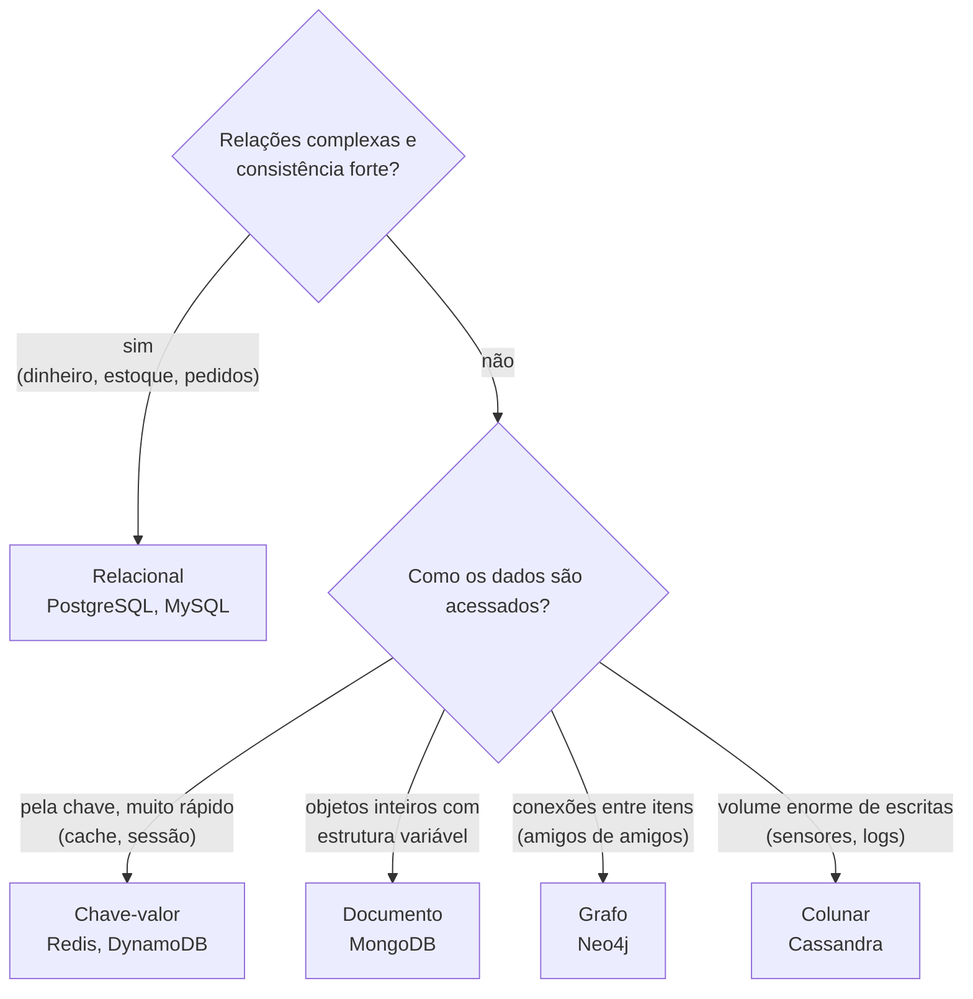

# 5.10 · NoSQL: o que é e quando usar

> **Em uma frase:** bancos **NoSQL** (*Not Only SQL*) guardam dados em formatos diferentes de tabelas (documentos, chave-valor, colunas, grafos), com esquema flexível e foco em **escalar horizontalmente**.

## 🤔 Se o relacional funciona tão bem, por que outro tipo?

Nas aulas anteriores, a loja virou cinco tabelas bem normalizadas. Isso é ótimo para **consistência**, mas tem custos:

- Para mostrar a página de **um** pedido, juntamos quatro tabelas com `JOIN`.
- Toda linha precisa seguir a estrutura da tabela. Se cada categoria de produto tiver atributos diferentes (um livro tem autor e páginas; um monitor tem polegadas e resolução), a modelagem fica complicada.
- Um único servidor tem limite. Quando o sistema tem **milhões** de acessos por segundo, espalhar os dados por vários servidores com `JOIN`s e transações entre eles é difícil.

Os bancos NoSQL fazem outra troca: abrem mão de parte dessas garantias (ou de `JOIN`s) em troca de **flexibilidade** e **escala**. O "Not Only" do nome é importante: eles **complementam** o SQL, não o substituem.

> [!TIP]
> Analogia: o banco relacional é um **arquivo de fichas** padronizadas, todas com os mesmos campos e com referências cruzadas entre gavetas. Um banco de documentos é uma **pasta por cliente**, com tudo o que importa sobre ele lá dentro, cada pasta podendo ter papéis diferentes.

## 📖 Como surgiram

No início dos anos 2000, empresas como Google e Amazon passaram a lidar com volumes de dados e acessos que os bancos relacionais tradicionais tinham dificuldade de atender em um só servidor. Surgiram soluções próprias e distribuídas:

- **2006:** o Google publica o artigo do **Bigtable**.
- **2007:** a Amazon publica o artigo do **Dynamo** (escrito por Werner Vogels, CTO da empresa, e colegas).
- **2008:** o Facebook cria o **Cassandra**, inspirado nos dois.
- **2009:** é lançado o **MongoDB**, e o termo "NoSQL" se populariza.

## 🗂️ Os quatro tipos principais

| Tipo | Como guarda | Exemplos | Bom para |
| --- | --- | --- | --- |
| **Documento** | Documentos parecidos com JSON | MongoDB, Couchbase, Firestore | Catálogos, perfis, conteúdo |
| **Chave-valor** | Um valor por chave, como um `Map` gigante | Redis, DynamoDB | Cache, sessões, carrinhos |
| **Colunar** (*wide-column*) | Linhas com colunas flexíveis, agrupadas em famílias | Cassandra, HBase | Muita escrita, séries temporais, IoT |
| **Grafo** | Nós e relacionamentos | Neo4j | Redes sociais, recomendações, detecção de fraude |

## ⚖️ SQL × NoSQL

| | Relacional (SQL) | NoSQL |
| --- | --- | --- |
| Estrutura | Tabelas com linhas e colunas | Documentos, chave-valor, colunas ou grafos |
| Esquema | Rígido, definido antes | Flexível; pode variar entre registros |
| Consultas | SQL, com `JOIN`s poderosos | API ou linguagem própria; *joins* limitados |
| Escalabilidade típica | **Vertical** (servidor maior) | **Horizontal** (mais servidores) |
| Transações | ACID completas | Variam; muitos priorizam disponibilidade |
| Melhor para | Dados estruturados, relações complexas, consistência forte | Grandes volumes, esquema variável, alta escala |

> [!NOTE]
> Essa divisão é uma tendência, não uma regra: bancos relacionais modernos também escalam horizontalmente (com réplicas e particionamento) e suportam JSON; vários NoSQL (como MongoDB e DynamoDB) já oferecem transações ACID.

> [!TIP]
> Não existe "o melhor banco". Muitos sistemas usam os dois: **PostgreSQL** para pedidos e pagamentos (consistência), **Redis** para cache e **MongoDB** ou **Elasticsearch** para catálogo e busca. Isso se chama **persistência poliglota**.

### Como escolher

> [!IMPORTANT]
> Na dúvida, **comece com um banco relacional**. Ele atende muito bem à grande maioria dos sistemas, e o PostgreSQL ainda guarda JSON (`JSONB`) quando você precisa de um pouco de flexibilidade. Adote um NoSQL quando houver um motivo concreto.

### O teorema CAP

Quando os dados ficam espalhados por vários servidores, a rede entre eles pode falhar. Durante essa falha (*Partition*, partição), o sistema precisa escolher:

- **Consistência** (*Consistency*): recusar responder até ter certeza de que o dado está atualizado; ou
- **Disponibilidade** (*Availability*): responder sempre, mesmo que com um dado possivelmente desatualizado.

As iniciais formam o nome **CAP**. Exemplo: no saldo bancário, é melhor dar erro do que mostrar um valor errado (consistência); no número de curtidas de um post, mostrar 1.203 em vez de 1.205 por alguns segundos não faz mal (disponibilidade). Cada banco NoSQL faz escolhas diferentes nesse equilíbrio, e vários deixam você configurar.

## 🔗 Para conhecer

- [Neo4j Sandbox](https://sandbox.neo4j.com/) (grafos)
- [Apache Cassandra](https://cassandra.apache.org/) (colunar)
- [Redis](https://redis.io/) (chave-valor em memória)
- [MongoDB](https://www.mongodb.com/) (documentos, próximas aulas)

## 📌 Resumindo

- NoSQL = modelos além das tabelas: documento, chave-valor, colunar e grafo.
- Esquema flexível e foco em escala horizontal.
- SQL e NoSQL se complementam; escolha pelo problema.

## 🏋️ Mão na massa

**1.** Que tipo de banco NoSQL você usaria para: (a) cache de sessões de usuário; (b) "amigos de amigos" numa rede social; (c) catálogo de produtos com atributos diferentes por categoria?

Ver resposta

(a) **Chave-valor** (Redis); (b) **Grafo** (Neo4j); (c) **Documento** (MongoDB).

**2.** Um sistema bancário de transferências deve usar um banco que priorize o quê?

Ver resposta

**Consistência** e transações **ACID**: o saldo não pode ficar errado. Por isso o núcleo de sistemas bancários costuma usar bancos relacionais.

**3.** O que significa escalar horizontalmente?

Ver resposta

Aumentar a capacidade **adicionando mais servidores** e distribuindo os dados entre eles, em vez de trocar por um servidor mais potente (escala vertical).

---

[⬅️ 5.9 Java + banco de dados](./09-jdbc.md) &nbsp;|&nbsp; [🏠 Índice](../../README.md) &nbsp;|&nbsp; [5.11 Conceitos e instalação ➡️](./11-mongodb.md)

