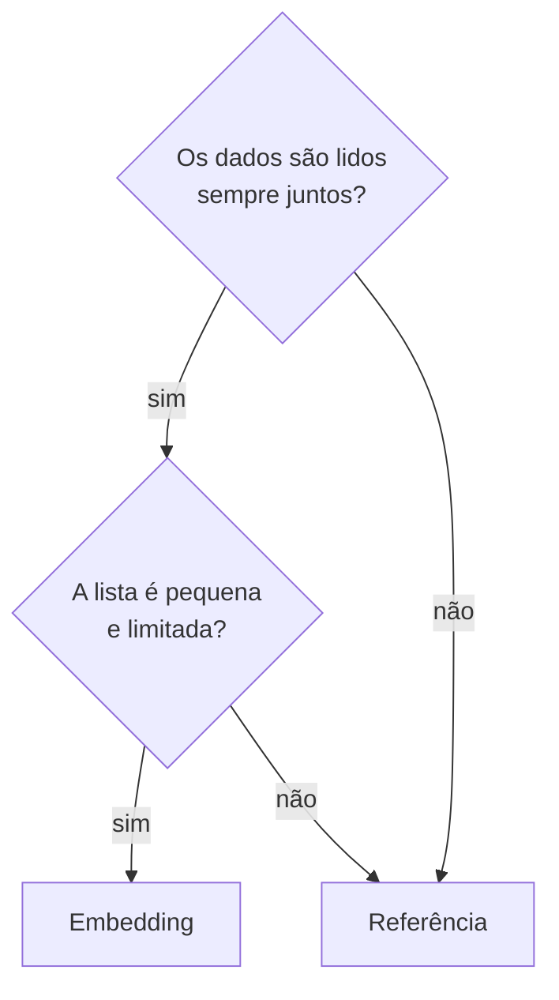

# 5.13 · MongoDB: modelagem (*embedding* × referência) e boas práticas

> **Em uma frase:** no MongoDB você escolhe entre **embutir** dados relacionados dentro do mesmo documento (*embedding*) ou guardar só uma **referência** ao documento de outra coleção; a regra de ouro é modelar pensando em **como os dados serão lidos**.

## 🎭 "Schemaless"?

Dizem que o MongoDB é *schemaless* (sem esquema), mas é mais preciso dizer **esquema flexível**: o banco não obriga, mas sua aplicação sempre espera uma estrutura. Você pode até impor regras com **validação de esquema** (`$jsonSchema`) na criação da coleção.

## 📦 Embedding (documentos embutidos)

Os dados relacionados ficam **dentro** do documento pai:

```json
{
  "_id": ObjectId("609aeec3aa1a68ca982b47d7"),
  "titulo": "Aprendendo MongoDB",
  "comentarios": [
    { "autor": "Ana", "texto": "Ótimo post!" },
    { "autor": "Bia", "texto": "Muito útil." }
  ]
}
```

| ✅ Prós | ❌ Contras |
| --- | --- |
| Uma única consulta traz tudo | Documento tem limite de **16 MB** |
| Atualização atômica em um só documento | Dados podem ficar duplicados |
| Ótimo desempenho de leitura | Arrays que crescem sem limite viram problema |

## 🔗 Referência

Guarda-se só o `_id` do outro documento, numa coleção separada:

```json
// coleção "pessoas"
{ "_id": ObjectId("609a..."), "nome": "Patrick", "enderecos": [ObjectId("123"), ObjectId("1234")] }

// coleção "enderecos"
{ "_id": ObjectId("123"),  "rua": "Av. das Conchas", "numero": 102 }
{ "_id": ObjectId("1234"), "rua": "Rua das Pérolas", "numero": 100 }
```

| ✅ Prós | ❌ Contras |
| --- | --- |
| Documentos menores | Precisa de duas consultas ou de `$lookup` |
| Sem duplicação de dados | Leitura mais lenta |
| Bom quando os dados nem sempre são lidos juntos | |

## 🧭 Recomendações por tipo de relacionamento

| Relacionamento | Recomendação | Exemplo |
| --- | --- | --- |
| **Um para um** | Campos no próprio documento (ou um subdocumento) | Pessoa → CPF |
| **Um para poucos** | **Embedding** | Pessoa → 2 ou 3 endereços |
| **Um para muitos** / **muitos para muitos** | **Referência** | Produto → milhares de avaliações; alunos ↔ cursos |



## ✅ Boas práticas

- **Modele pelas consultas**: pense primeiro em como a aplicação vai ler os dados.
- Evite documentos muito grandes e arrays que crescem sem limite.
- Use nomes de campos curtos e claros (eles são repetidos em cada documento).
- Crie **índices** nos campos usados em filtros e nas referências (aula [5.14](./14-mongodb-indices-e-agregacoes.md)).
- Analise as consultas com `.explain()`.
- Atualize só os campos alterados (`$set`), em vez de substituir o documento inteiro.
- Evite filtros com negação (`$ne`, `$nin`), que costumam não aproveitar índices.

## 🔣 JSON × BSON

| | JSON | BSON |
| --- | --- | --- |
| Formato | Texto, legível por humanos | Binário |
| Uso típico | Trocar dados entre sistemas (APIs) | Armazenamento interno do MongoDB |
| Tipos | string, número, booleano, null, array, objeto | Todos os do JSON + `Date`, `ObjectId`, `Decimal128`, `Int32`/`Int64`, binários... |
| Vantagem | Simples e universal | Mais rápido de percorrer e com tipos ricos |

Você escreve e lê os documentos como JSON; o driver e o banco convertem para BSON automaticamente.

## 📌 Resumindo

- Esquema flexível não significa ausência de modelagem.
- **Embedding** para dados lidos juntos e listas pequenas; **referência** para relações grandes ou N:N.
- Limite de 16 MB por documento; índices nos campos consultados.
- BSON é o JSON binário com tipos extras.

## 🏋️ Mão na massa

**1.** Um blog tem posts e comentários; um post famoso pode ter 50 mil comentários. Embedding ou referência?

<details>
<summary>Ver resposta</summary>

**Referência** (uma coleção `comentarios` com o `postId`). Com 50 mil comentários embutidos, o documento do post cresceria sem limite e poderia passar dos 16 MB.

</details>

**2.** Modele um pedido de e-commerce com seus itens (normalmente poucos) e o cliente (que também faz outros pedidos).

<details>
<summary>Ver resposta</summary>

```json
{
  "_id": ObjectId("..."),
  "clienteId": ObjectId("..."),
  "data": ISODate("2026-10-18T10:00:00Z"),
  "itens": [
    { "produto": "Teclado", "quantidade": 1, "preco": NumberDecimal("149.90") },
    { "produto": "Mouse", "quantidade": 2, "preco": NumberDecimal("59.90") }
  ]
}
```

Os **itens** são embutidos (fazem parte do pedido e são lidos juntos). O **cliente** é uma referência, porque existe por conta própria e tem vários pedidos.

</details>

**3.** Por que o BSON tem um tipo `Decimal128` se o JSON já tem números?

<details>
<summary>Ver resposta</summary>

Porque os números do JSON costumam ser tratados como ponto flutuante (impreciso). O `Decimal128` guarda decimais **exatos**, essencial para valores monetários.

</details>

---

<div align="center">

[⬅️ 5.12 Comandos essenciais (CRUD)](./12-mongodb-comandos.md) &nbsp;|&nbsp; [🏠 Índice](../../README.md) &nbsp;|&nbsp; [5.14 Índices, desempenho e agregações ➡️](./14-mongodb-indices-e-agregacoes.md)

</div>
