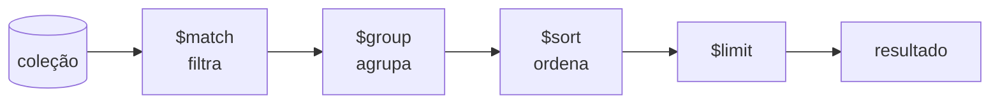

# 5.14 · MongoDB: índices, desempenho e agregações

> **Em uma frase:** **índices** fazem as consultas encontrarem documentos sem ler a coleção inteira, e o **pipeline de agregação** processa documentos em etapas (filtrar, agrupar, calcular) para gerar relatórios.

## ⚡ Índices

Sem índice, o MongoDB faz um **COLLSCAN**: lê **todos** os documentos para achar os que batem com o filtro. Com índice, ele vai direto aos documentos certos (**IXSCAN**), como o índice remissivo de um livro. É a mesma ideia do `Seq Scan` × `Index Scan` dos bancos relacionais (aula [5.8](./08-transacoes-indices-e-views.md)).

```javascript
db.clientes.createIndex({ email: 1 }, { unique: true })   // simples (e único)
db.pedidos.createIndex({ clienteId: 1, data: -1 })        // composto
db.lojas.createIndex({ localizacao: "2dsphere" })         // geoespacial
db.artigos.createIndex({ conteudo: "text" })              // busca textual

db.clientes.getIndexes()                                   // lista os índices
db.clientes.find({ email: "ana@email.com" }).explain("executionStats")   // IXSCAN ou COLLSCAN?
```

| Tipo | Uso |
| --- | --- |
| Simples | Filtros em um campo |
| Composto | Filtros/ordenação em vários campos (a ordem dos campos importa) |
| Único | Impede valores repetidos |
| Geoespacial (`2dsphere`) | Consultas por proximidade ("lojas perto de mim") |
| Texto | Busca por palavras |
| TTL | Apaga documentos automaticamente depois de um tempo (sessões, logs) |

> [!WARNING]
> Índices aceleram a **leitura**, mas deixam a **escrita** um pouco mais lenta e ocupam memória. Crie índices para as consultas que realmente existem.

### Medindo o desempenho

Acompanhe **latência** (tempo de cada operação), **vazão** (*throughput*, operações por segundo) e o uso de **CPU, memória e disco**. Ferramentas: `explain()`, o *profiler* do banco, `mongostat`/`mongotop` e os painéis do MongoDB Atlas.

## 🧮 Pipeline de agregação

Os documentos passam por uma sequência de **estágios**, como numa linha de montagem. Cada estágio recebe o resultado do anterior:



| Estágio | Equivalente SQL | O que faz |
| --- | --- | --- |
| `$match` | `WHERE` | Filtra documentos |
| `$group` | `GROUP BY` | Agrupa e calcula (`$sum`, `$avg`, `$min`, `$max`, `$addToSet`...) |
| `$project` | colunas do `SELECT` | Escolhe/renomeia/calcula campos |
| `$sort` | `ORDER BY` | Ordena |
| `$limit` / `$skip` | `LIMIT` / `OFFSET` | Paginação |
| `$lookup` | `JOIN` | Junta com outra coleção |
| `$unwind` | — | "Desmonta" um array em vários documentos |
| `$count` | `COUNT(*)` | Conta os documentos |

### Contando

```javascript
db.clientes.aggregate([
  { $match: { status: "ativo" } },
  { $count: "total_ativos" }
])
// { total_ativos: 42 }
```

### Valores distintos

```javascript
// Cidades distintas dos clientes ativos
db.clientes.aggregate([
  { $match: { status: "ativo" } },
  { $group: { _id: "$cidade" } },
  { $sort: { _id: 1 } }
])

// Atalho para o mesmo resultado:
db.clientes.distinct("cidade", { status: "ativo" })
```

### Relatório: total vendido por cliente

```javascript
db.pedidos.aggregate([
  { $match: { status: "pago" } },
  { $group: { _id: "$clienteId", total: { $sum: "$valor" }, pedidos: { $sum: 1 } } },
  { $sort: { total: -1 } },
  { $limit: 5 },
  { $lookup: { from: "clientes", localField: "_id", foreignField: "_id", as: "cliente" } }
])
```

> [!TIP]
> Coloque o `$match` o mais **cedo** possível no pipeline: menos documentos chegam às etapas seguintes, e o `$match` inicial ainda pode usar índices.

📚 Para ir além: [Agregações (documentação)](https://www.mongodb.com/docs/manual/aggregation/) · [Padrões de modelagem (*Building with Patterns*)](https://www.mongodb.com/blog/post/building-with-patterns-a-summary)

## 📌 Resumindo

- Índices evitam o COLLSCAN; confira com `explain()`.
- Há índices simples, compostos, únicos, geoespaciais, de texto e TTL.
- Agregação = pipeline de estágios: `$match`, `$group`, `$project`, `$sort`, `$lookup`...
- Filtre cedo com `$match`.

## 🏋️ Mão na massa

**1.** Crie um índice que impeça dois clientes com o mesmo CPF.

<details>
<summary>Ver resposta</summary>

```javascript
db.clientes.createIndex({ cpf: 1 }, { unique: true })
```

Inserir outro documento com um CPF já existente gera o erro `E11000 duplicate key`.

</details>

**2.** Calcule a média de idade dos clientes por cidade, da maior média para a menor.

<details>
<summary>Ver resposta</summary>

```javascript
db.clientes.aggregate([
  { $group: { _id: "$cidade", mediaIdade: { $avg: "$idade" } } },
  { $sort: { mediaIdade: -1 } }
])
```

</details>

**3.** Como saber se a consulta `db.pedidos.find({ clienteId: X })` está usando um índice?

<details>
<summary>Ver resposta</summary>

Rode `db.pedidos.find({ clienteId: X }).explain("executionStats")` e procure o estágio vencedor: **IXSCAN** indica uso de índice; **COLLSCAN** indica leitura da coleção inteira. Compare também `totalDocsExamined` com `nReturned`.

</details>

---

<div align="center">

[⬅️ 5.13 Modelagem (embedding × referência) e boas práticas](./13-mongodb-modelagem.md) &nbsp;|&nbsp; [🏠 Índice](../../README.md) &nbsp;|&nbsp; [5.15 Amazon DynamoDB ➡️](./15-dynamodb.md)

</div>
