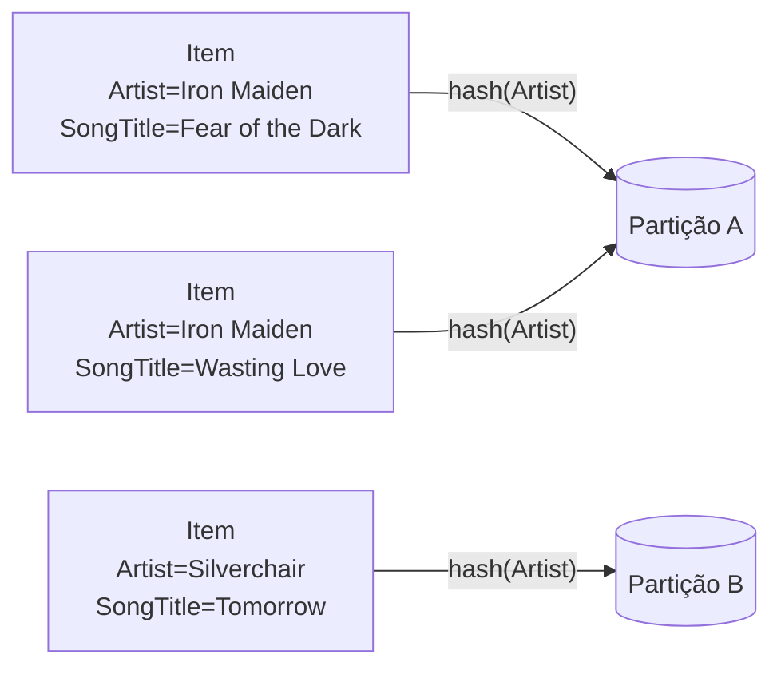

# 5.15 · Amazon DynamoDB

> **Em uma frase:** o DynamoDB é o banco NoSQL **chave-valor e de documentos** da AWS, totalmente gerenciado e *serverless*: você não cuida de servidores, só cria tabelas e paga pelo uso.

## 📖 Origem

Em 2007, engenheiros da Amazon publicaram o artigo **Dynamo**, sobre o banco distribuído interno que mantinha o carrinho de compras sempre disponível. Essas ideias inspiraram outros bancos (como o Cassandra) e, em **2012**, deram origem ao **Amazon DynamoDB**, oferecido como serviço gerenciado.

## 🧠 Uma forma diferente de pensar

No banco relacional, você modela os dados primeiro (normalização) e depois escreve qualquer consulta com `JOIN`s. No DynamoDB é o **contrário**: não existe `JOIN` e as buscas eficientes precisam informar a chave. Por isso você começa listando as **perguntas** que a aplicação vai fazer (os **padrões de acesso**) e desenha as chaves para respondê-las.

| Relacional | DynamoDB |
| --- | --- |
| Modela os dados, depois as consultas | Lista as consultas, depois modela as chaves |
| Qualquer `WHERE` funciona (com ou sem índice) | Consulta eficiente só pela chave (ou por um índice secundário) |
| `JOIN` junta tabelas | Sem `JOIN`: dados lidos juntos ficam juntos |
| Escala principalmente num servidor maior | Escala sozinho, distribuindo por partições |

> [!TIP]
> Analogia: o DynamoDB é como um **guarda-volumes** gigante. Com o número do armário (a chave), você pega suas coisas em segundos, não importa se há mil ou um bilhão de armários. Mas se pedir "todos os armários com um guarda-chuva azul", o funcionário terá de abrir um por um (um `scan`).

## ✅ Vantagens

| Vantagem | Na prática |
| --- | --- |
| **Serverless e gerenciado** | Sem instalar, atualizar ou fazer backup de servidores. |
| **Escala automática** | Aguenta de poucas a milhões de requisições por segundo. |
| **Baixa latência** | Respostas na casa de milissegundos, em qualquer escala. |
| **Alta disponibilidade** | Dados replicados automaticamente em várias zonas de disponibilidade da região. |
| **Transações ACID** | Operações atômicas envolvendo vários itens (`TransactWriteItems`). |
| **Integração com a AWS** | Lambda, Kinesis, S3, IAM, CloudWatch... |

## 🧱 Componentes

| Componente | O que é |
| --- | --- |
| **Tabela** | Coleção de itens (não tem esquema fixo além da chave). |
| **Item** | Um registro (como uma linha); até 400 KB. |
| **Atributo** | Um dado do item (nome + valor). |
| **Chave primária** | Identifica cada item; é a única parte obrigatória do "esquema". |
| **Partições** | O DynamoDB divide os dados automaticamente entre partições, usando a chave de partição. |
| **Índices secundários** | Permitem consultar por outros atributos (GSI e LSI). |
| **Streams** | Capturam cada alteração na tabela, para reagir em tempo real (ex.: disparar uma Lambda). |

### Tipos de chave primária

| Tipo | Composição | Exemplo |
| --- | --- | --- |
| **Simples** | Só a **partition key** (chave de partição, ou *hash key*) | `ProductID` |
| **Composta** | **Partition key** + **sort key** (chave de ordenação, ou *range key*) | `Artist` + `SongTitle` |

A **partition key** decide em qual partição o item fica; dentro da partição, os itens são ordenados pela **sort key**. Por isso as consultas eficientes no DynamoDB sempre informam a partition key.

### Exemplo de tabela

| ProductID *(partition)* | Type *(sort)* | Atributos (cada item pode ter os seus) |
| --- | --- | --- |
| 1 | Book ID | Title: Odyssey · Author: Homer · Year: 1871 |
| 2 | Album ID | Title: 6 Partitas · Artist: Bach |
| 2 | Album ID: Track ID | Title: Partita No. 1 |
| 3 | Movie ID | Title: The Kid · Genre: Drama, Comedy · Director: Chaplin |

### Índices secundários

- **GSI** (*Global Secondary Index*): outra partition key (e sort key opcional). Pode ser criado a qualquer momento.
- **LSI** (*Local Secondary Index*): mesma partition key, outra sort key. Só pode ser criado junto com a tabela.

## 🔢 Tipos de dados

| Categoria | Tipos |
| --- | --- |
| **Escalares** | `S` (String), `N` (Number), `B` (Binary), `BOOL` (Boolean), `NULL` |
| **Documentos** | `M` (Map: chave → valor, aninhável), `L` (List: lista ordenada de qualquer tipo) |
| **Conjuntos** | `SS` (String Set), `NS` (Number Set), `BS` (Binary Set) |

> [!NOTE]
> O tipo `N` guarda números com até 38 dígitos de precisão, de forma **exata** (não é ponto flutuante binário).

## 💰 Modos de capacidade

| | Sob demanda (*on-demand*) | Provisionado (*provisioned*) |
| --- | --- | --- |
| Como funciona | Paga por requisição; escala sozinho | Você define RCUs (leitura) e WCUs (escrita) por segundo |
| Bom para | Tráfego imprevisível, projetos novos | Tráfego previsível, otimização de custo |
| Escala | Automática e instantânea | Manual ou com *auto scaling* |

> [!TIP]
> O DynamoDB tem um **nível gratuito** permanente na AWS (25 GB de armazenamento e capacidade provisionada limitada). Para estudar sem custo e sem conta, use o **DynamoDB Local** em Docker: `docker run -p 8000:8000 amazon/dynamodb-local`.

## 📌 Resumindo

- DynamoDB = NoSQL chave-valor/documentos da AWS, gerenciado e serverless.
- Chave primária simples (partition) ou composta (partition + sort).
- GSIs e LSIs permitem consultar por outros atributos.
- Capacidade sob demanda ou provisionada.

## 🏋️ Mão na massa

**1.** Numa tabela de pedidos, qual seria uma boa chave composta para listar os pedidos de um cliente por data?

Ver resposta

Partition key = `ClienteId` e sort key = `DataPedido`. Assim, uma consulta pelo cliente devolve os pedidos dele já ordenados por data.

**2.** Qual a diferença entre GSI e LSI?

Ver resposta

O **GSI** usa uma partition key diferente da tabela e pode ser criado a qualquer momento. O **LSI** mantém a mesma partition key, muda só a sort key e precisa ser criado junto com a tabela.

**3.** Um app novo tem tráfego imprevisível. Qual modo de capacidade escolher?

Ver resposta

**Sob demanda**: você paga pelo que usar e não precisa prever a capacidade. Quando o tráfego ficar estável, pode valer a pena migrar para o provisionado.

---

[⬅️ 5.14 Índices, desempenho e agregações](./14-mongodb-indices-e-agregacoes.md) &nbsp;|&nbsp; [🏠 Índice](../../README.md) &nbsp;|&nbsp; [5.16 DynamoDB pela AWS CLI ➡️](./16-dynamodb-pratica.md)

