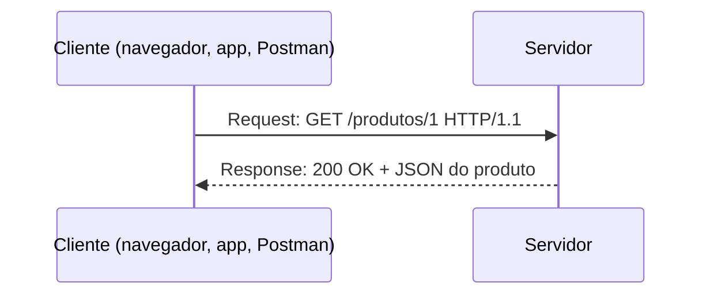
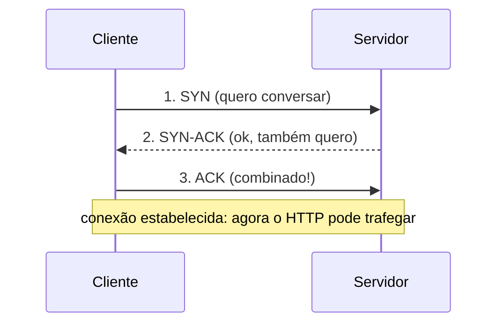

# 6.1 · Como funciona o protocolo HTTP

> **Em uma frase:** o HTTP é o "idioma" que navegadores, apps e APIs usam para conversar com servidores: o **cliente** faz uma **requisição** (*request*) e o **servidor** devolve uma **resposta** (*response*).

📄 Slides do curso: [Conhecendo os principais protocolos de comunicação da internet](./slides/protocolos-de-comunicacao.pdf)

## 💬 Cliente e servidor



- O **cliente** pede algo: uma página, uma imagem, os dados de um produto.
- O **servidor** processa e responde com um **código de status** (200, 404, 500...), **cabeçalhos** e, opcionalmente, um **corpo** (HTML, JSON, imagem...).
- O HTTP é **sem estado** (*stateless*): cada requisição é independente, e o servidor não "lembra" das anteriores por padrão (para isso existem cookies e tokens).

## 📜 Versões e especificações (RFCs)

| Versão | Ano | Especificação | Destaques |
| --- | --- | --- | --- |
| HTTP/0.9 | 1991 | — | Só `GET` e HTML |
| HTTP/1.0 | 1996 | RFC 1945 | Cabeçalhos, códigos de status, `POST` |
| HTTP/1.1 | 1997 | RFC 2068 → RFC 2616 (1999) → hoje **RFC 9110/9112** | Conexões persistentes, `Host` obrigatório, `PUT`, `DELETE`, `OPTIONS` |
| HTTP/2 | 2015 | RFC 7540 → RFC 9113 | Binário, multiplexação, compressão de cabeçalhos |
| HTTP/3 | 2022 | RFC 9114 | Roda sobre **QUIC** (UDP) |

> [!NOTE]
> Uma **RFC** (*Request for Comments*) é o documento oficial que define um padrão da internet. Muitos materiais citam a RFC 2616 para o HTTP/1.1; hoje ela foi substituída pelas RFCs 9110 (semântica) e 9112 (formato da mensagem).

## 🚚 Protocolos de transporte: TCP e UDP

O HTTP precisa de um protocolo de **transporte** por baixo para levar os dados:

| | TCP | UDP |
| --- | --- | --- |
| Conexão | Estabelece uma conexão antes (handshake) | Sem conexão |
| Confiabilidade | Garante entrega, ordem e retransmite pacotes perdidos | Não garante nada |
| Controle de fluxo e congestionamento | Sim | Não |
| Velocidade | Mais "pesado" | Mais leve e rápido |
| Usos | HTTP/1.1 e HTTP/2, e-mail, transferência de arquivos | Vídeo e voz em tempo real, jogos, DNS, HTTP/3 (via QUIC) |

### O *three-way handshake* do TCP



Os três passos sincronizam os dois lados antes de qualquer dado ser enviado, garantindo uma conexão confiável.

## 🧰 Métodos (verbos) HTTP

| Método | Uso | Exemplo |
| --- | --- | --- |
| `GET` | **Ler** um recurso | `GET /clientes/1` |
| `POST` | **Criar** um recurso / enviar dados | `POST /clientes` |
| `PUT` | **Substituir** um recurso inteiro | `PUT /clientes/1` |
| `PATCH` | **Alterar parte** de um recurso | `PATCH /clientes/1` |
| `DELETE` | **Apagar** um recurso | `DELETE /clientes/1` |
| `HEAD` | Igual ao GET, mas só os cabeçalhos | Conferir se um arquivo mudou |
| `OPTIONS` | Quais métodos o servidor aceita (usado no CORS) | — |

## 📦 Corpo da mensagem (*body*)

É a parte da mensagem que carrega os **dados**: no request, por exemplo, o JSON de um formulário enviado com `POST`; no response, o HTML de uma página ou o JSON de uma API. O cabeçalho `Content-Type` diz o formato (`application/json`, `text/html`, `image/png`...).

## 🚧 *Head-of-line blocking* (HOL)

No **HTTP/1.1**, as respostas de uma mesma conexão precisam chegar **na ordem**: se a primeira demora, as outras ficam esperando na fila, como um carro quebrado no início de uma faixa. Os navegadores contornavam isso abrindo várias conexões em paralelo (normalmente até 6 por domínio).

O **HTTP/2** resolveu o problema na camada do HTTP com a **multiplexação**, mas, como ainda usa TCP, uma perda de pacote ainda trava a conexão inteira. O **HTTP/3**, sobre QUIC, resolve também essa parte (aula [6.4](./04-http2-e-http3.md)).

## 📌 Resumindo

- HTTP = requisição do cliente + resposta do servidor, sem estado.
- Versões: 1.0 → 1.1 (conexões persistentes) → 2 (multiplexação) → 3 (QUIC).
- TCP é confiável (handshake de 3 vias); UDP é rápido, sem garantias.
- Verbos: GET, POST, PUT, PATCH, DELETE (+ HEAD e OPTIONS).

## 🏋️ Mão na massa

**1.** Abra as **ferramentas do desenvolvedor** do navegador (`F12` → aba **Rede/Network**) e acesse um site. Escolha uma requisição e identifique o método, o status e o `Content-Type`.

<details>
<summary>Ver resposta</summary>

Clicando numa requisição, a aba **Headers** mostra a *Request URL*, o *Request Method* (geralmente `GET`), o *Status Code* (ex.: `200`) e, nos *Response Headers*, o `content-type` (ex.: `text/html; charset=utf-8`). A coluna **Protocol** mostra se foi `http/1.1`, `h2` ou `h3`.

</details>

**2.** Faça uma requisição pelo terminal com o `curl` e veja os cabeçalhos da resposta.

<details>
<summary>Ver resposta</summary>

```bash
curl -i https://viacep.com.br/ws/01001000/json/
```

O `-i` mostra a linha de status e os cabeçalhos antes do corpo (um JSON com o endereço do CEP).

</details>

**3.** Por que um jogo online de tiro costuma usar UDP em vez de TCP?

<details>
<summary>Ver resposta</summary>

Porque a velocidade importa mais que a garantia de entrega: se a posição de um jogador se perde, a próxima atualização (milissegundos depois) já corrige. Esperar a retransmissão do TCP causaria atraso (*lag*).

</details>

---

<div align="center">

[⬅️ 5.8 DynamoDB pela AWS CLI](../05-banco-de-dados/08-dynamodb-pratica.md) &nbsp;|&nbsp; [🏠 Índice](../../README.md) &nbsp;|&nbsp; [6.2 Mensagens HTTP ➡️](./02-mensagens-http.md)

</div>
